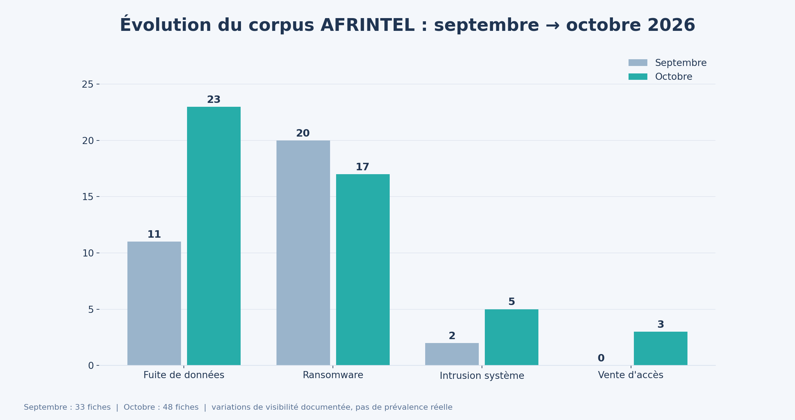
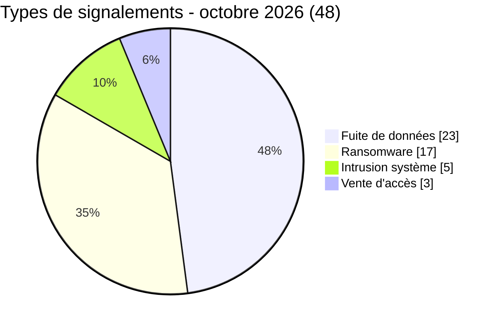
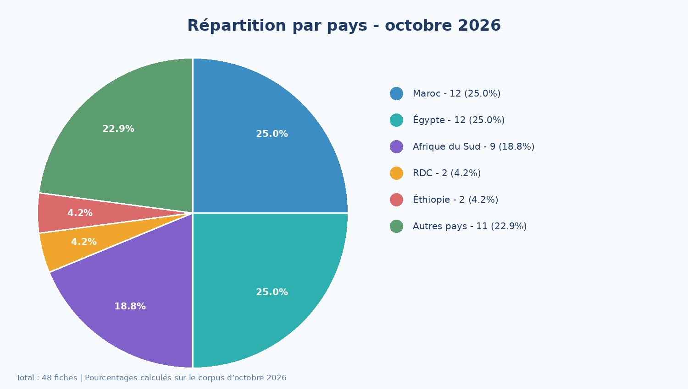

# AFRINTEL - Rapport CTI | Cyberincidents en Afrique - Octobre 2026

   

**Période étudiée :** 1er–31 octobre 2026 · **Revue éditoriale :** 5 novembre 2026  
**Périmètre :** 54 pays africains suivis ; 15 pays représentés dans le corpus du mois  
**Sources :** sites de divulgation ransomware, forums underground et places de marché clandestines (dark web/deep web), communications officielles, presse spécialisée et échantillons disponibles  
**Consulter les données :** [fiches victimes FR](./victims_FR.md) · [Victim records EN](./victims.md) · [English report](./README.md)

> **Sources et démarche d'analyse -** Ce rapport s'appuie sur la veille menée par AFRINTEL sur les sites de divulgation de groupes ransomware, les forums underground et les places de marché clandestines du dark web et du deep web. Chaque dossier est documenté à partir des publications observées, des éléments visuels disponibles et, lorsque cela est possible, de l'examen en lecture seule d'échantillons de données. Les informations sont rapprochées des sources publiques et des communications officielles lorsqu'elles existent. Les fiches précisent les éléments examinés, le niveau de confiance et les points qui restent à établir.

## 1. Synthèse exécutive

**Octobre laisse un constat clair : les données professionnelles et personnelles sont au centre des publications suivies par AFRINTEL.** Sur **48 dossiers documentés dans 15 pays**, les fuites de données représentent **23 cas (47,9 %)**, devant **17 publications liées au ransomware (35,4 %)**, **5 intrusions système signalées (10,4 %)** et **3 offres de vente d'accès (6,3 %)**. Les chiffres regroupent des faits de nature et de solidité différentes : ils ne correspondent pas à 48 compromissions techniquement confirmées.

Le **Maroc et l'Égypte totalisent chacun 12 dossiers**. L'**Afrique du Sud en compte 9**. Ces trois pays concentrent **33 des 48 observations (68,8 %)**. Cette concentration reflète aussi les sources accessibles, les capacités de collecte et la visibilité des victimes ; elle ne mesure pas le niveau de risque national à elle seule.

Trois enseignements ressortent. D'abord, les exports d'outils de gestion - ERP, e-commerce, recrutement, paie - peuvent exposer simultanément clients, salariés, partenaires et transactions. Ensuite, plusieurs dossiers concernent des informations particulièrement sensibles : santé, identité, dossiers administratifs ou judiciaires. Enfin, les plateformes gérées par des tiers, les environnements d'identité et les chaînes de diffusion numérique élargissent le périmètre de risque au-delà d'un seul organisme.

**Qualification des éléments recueillis :** AFRINTEL distingue **21 dossiers avec échantillon publié ou visible** (dont le niveau d'examen varie), **2 lots publiés et analysés**, **4 incidents reconnus publiquement par l'organisation concernée**, **1 dossier en investigation** et **20 revendications non vérifiées**. Cette classification rend la lecture du corpus plus précise : elle indique ce qui est documenté dans chaque cas, sans confondre une annonce criminelle avec une confirmation technique.

### 1.1 Comparaison avec septembre 2026

> Comparaison des **corpus AFRINTEL**, et non du nombre réel de cyberattaques. La hausse peut aussi découler d'une meilleure collecte, de nouveaux canaux ou de rattrapages documentaires.

| Indicateur | Septembre | Octobre | Évolution observée |
|---|---:|---:|---:|
| **Total des dossiers** | **33** | **48** | **+15 (+45,5 %)** |
| Ransomware | 20 | 17 | −3 (−15,0 %) |
| Data Leak | 11 | 23 | +12 (+109,1 %) |
| Access Sale | 0 | 3 | +3 (nouveau) |
| DDoS | 0 | 0 | 0 (stable) |
| Defacement | 0 | 0 | 0 (stable) |
| Account Takeover | 0 | 0 | 0 (stable) |
| System Intrusion | 2 | 5 | +3 (+150,0 %) |
| Malware | 0 | 0 | 0 (stable) |
| Operational Fraud | 0 | 0 | 0 (stable) |

Le changement le plus visible n'est pas une hausse des publications ransomware : leur nombre baisse de 20 à 17. C'est surtout **la place prise par les fuites de données dans le corpus** qui distingue octobre. Cette évolution doit néanmoins être interprétée avec prudence tant que les méthodes de collecte, la couverture des sources et les dossiers rétrospectifs ne sont pas comparés à périmètre constant.

## 2. Périmètre, méthode et limites

AFRINTEL suit les revendications et incidents concernant des organisations ou des données associées à l'Afrique. La collecte s'appuie notamment sur les publications directement observées sur les sites de groupes ransomware, les forums underground et les espaces de vente clandestins. Les captures, avis officiels et échantillons accessibles sont rapprochés pour documenter chaque dossier. Le classement d'octobre retient la **date de publication observée** ou la **première observation documentée par AFRINTEL**, lorsque la date technique de l'incident n'est pas établie. Une date de publication ne doit pas être confondue avec la date d'accès initial.

Les **48 fiches FR et les 48 fiches EN** ont été rapprochées pour les types, les statuts et l'ordre des dossiers. Pour les statistiques, les types composites sont ramenés à une seule catégorie principale : le cas **Decathlon Maroc** est compté en `Data Leak`, la présomption d'exposition restant décrite dans la fiche. Un événement est compté une seule fois dans le total mensuel ; les effets secondaires ne créent pas de seconde attaque.

La ventilation sectorielle est recalculée depuis les secteurs des fiches et le **[référentiel sectoriel AFRINTEL 2026](../../../normalization/sector_mapping_2026.csv)**. Elle diffère de l'ancienne illustration sectorielle : les graphiques corrigés figurent dans ce rapport. Ce regroupement est une convention de comparaison, pas une classification réglementaire des infrastructures critiques.

**Point chronologique à suivre :** la publication relative à **e-Solde (République du Congo)** datée d'octobre est liée à une annonce antérieure du **28 juin 2026**. Le dossier reste rattaché au suivi d'octobre, car il s'agit de la première observation AFRINTEL retenue dans le corpus publié. La date de juin est désormais explicitée ; **ce dossier ne doit pas être traité comme une nouvelle compromission d'octobre**. Une revue des séries historiques peut conduire à une réattribution temporelle documentée, sans double comptage.

**Règle de preuve :** un fichier examiné ne valide ni l'ensemble des volumes annoncés ni l'origine technique des données. Un nombre de lignes, de fichiers, de commandes ou de comptes ne représente pas nécessairement autant de personnes. Les données personnelles, secrets, clés et liens vers les espaces criminels ne sont pas diffusés dans le dépôt.

## 3. Panorama du mois

### 3.1 Types de signalements

| Type d'incident | Dossiers | Part du corpus |
|---|---:|---:|
| **Data Leak - Fuite de données** | **23** | **47,9 %** |
| Ransomware | 17 | 35,4 % |
| System Intrusion - Intrusion système | 5 | 10,4 % |
| Access Sale - Vente d'accès | 3 | 6,3 % |
| **Total** | **48** | **100,0 %** |

### 3.2 Pays et régions

| Pays | Dossiers | Pays | Dossiers |
|---|---:|---|---:|
| Égypte | 12 | République du Congo | 1 |
| Maroc | 12 | Rwanda | 1 |
| Afrique du Sud | 9 | Mozambique | 1 |
| RDC | 2 | Gabon | 1 |
| Éthiopie | 2 | Tunisie | 1 |
| Madagascar | 2 | Bénin | 1 |
| Nigeria | 1 | Sierra Leone | 1 |
| Côte d'Ivoire | 1 | **Total (15 pays)** | **48** |

| Région AFRINTEL | Dossiers | Part |
|---|---:|---:|
| Afrique du Nord | 25 | 52,1 % |
| Afrique australe | 10 | 20,8 % |
| Afrique de l'Est | 5 | 10,4 % |
| Afrique centrale | 4 | 8,3 % |
| Afrique de l'Ouest | 4 | 8,3 % |
| **Total** | **48** | **100,0 %** |

La géographie souligne un autre enjeu : **39 des 54 pays suivis ne figurent pas dans ce corpus**, mais cela ne signifie ni absence d'incident ni absence de menace. Les priorités de collecte doivent également tenir compte des zones moins documentées, notamment hors des grands marchés médiatiques et technologiques.

### 3.3 Qualité des éléments accessibles

| État documentaire AFRINTEL | Dossiers | Part |
|---|---:|---:|
| Claim - Unverified | 20 | 41,7 % |
| Claim - Data Sample Published | 21 | 43,8 % |
| Data Fully Published | 2 | 4,2 % |
| Incident Confirmed by Victim | 4 | 8,3 % |
| Under Investigation | 1 | 2,1 % |
| **Total** | **48** | **100,0 %** |

**À ne pas confondre :** `Claim - Data Sample Published` indique qu'un échantillon a été annoncé, visible ou examiné selon la fiche ; ce statut ne certifie pas une compromission de l'infrastructure de la victime. Dans le cas du **CNESTEN**, l'artefact analysé est un **inventaire de répertoire**, pas le contenu des dizaines de milliers de fichiers annoncés. Les communications de victimes confirment également des périmètres variables : une alerte ou un accès non autorisé reconnu ne confirme pas nécessairement tous les volumes circulant sur les forums.

### 3.4 Acteurs, groupes et comptes de publication

| Identifiant observé | Dossiers associés |
|---|---:|
| Nameless511 | 9 |
| UmBra | 4 |
| N0n | 4 |
| The Gentlemen | 3 |
| SensitiveDarkForum | 2 |
| Krybit | 2 |
| Qilin | 2 |
| Lenken | 2 |
| Kazu | 2 |
| List1 | 2 |

Ces **dix libellés couvrent 32 dossiers** ; les autres publications concernent des noms moins fréquents ou des dossiers sans auteur identifié. Il s'agit **d'identifiants de sources et d'attributions déclarées**, pas d'une validation de l'identité des cybercriminels. Certains noms renvoient à des groupes ransomware ; d'autres sont seulement des comptes ou vendeurs observés sur des plateformes.

### 3.5 Secteurs normalisés - répartition corrigée

| Secteur normalisé | Dossiers | Part |
|---|---:|---:|
| Gouvernement / Administration publique | 12 | 25,0 % |
| Autres secteurs | 7 | 14,6 % |
| Technologie / Services numériques | 6 | 12,5 % |
| Commerce / Distribution | 5 | 10,4 % |
| Santé | 5 | 10,4 % |
| Éducation | 5 | 10,4 % |
| Industrie / Ingénierie | 3 | 6,3 % |
| Finance / Assurance | 3 | 6,3 % |
| Transport | 2 | 4,2 % |
| **Total** | **48** | **100,0 %** |

L'**administration publique (12 dossiers)** reste le premier ensemble. La rubrique **« Autres secteurs » (7)** comprend des activités hétérogènes - recherche nucléaire, eau, médias audiovisuels, ONG ou environnement, entre autres. Elle gagnera à être affinée dans le référentiel futur, sans casser la comparaison avec les mois antérieurs. Dans la nomenclature utilisée ici, certains distributeurs informatiques sont classés en « Technologie / Services numériques » : le chiffre du commerce ne représente donc pas l'ensemble du commerce électronique au sens économique.

## 4. Les dossiers qui marquent octobre

### 4.1 Maroc : l'ERP et les données commerciales au premier plan

**Tera.ma** est l'un des dossiers les plus documentés : AFRINTEL a inventorié **8 140 fichiers**, soit **2 389 358 436 octets**, dont **282 CSV et 3 693 PDF**. Les contrôles structurels retrouvent **19 595 entrées partenaires**, **69 197 commandes** et **124 088 écritures comptables**. La cohérence de ces éléments renforce le lien avec un environnement commercial de type Odoo. **Elle ne prouve pas la date d'extraction, le vecteur d'accès ou une confirmation officielle de Tera.ma.**

Chez **NextLevel PC**, les **huit CSV** fournis permettent de vérifier les décomptes annoncés : **52 545 comptes clients**, **60 262 adresses de livraison**, **47 653 commandes**, **11 comptes internes** et **14 160 règles commerciales**. La publication de ces structures pose un risque concret de fraude liée à la livraison, de faux remboursements et de ciblage de comptes. Un compte, une adresse et une commande ne sont pas trois personnes distinctes.

Les dossiers **Midipcom**, **Karamtech** et **Decathlon Maroc** élargissent la même problématique : les fonctions de vente, facturation et logistique concentrent des données réutilisables pour l'usurpation et la fraude. Pour Midipcom et Karamtech, les échantillons disponibles ne permettent pas de valider les volumes globaux revendiqués ; pour Decathlon, l'origine exacte du jeu de données (enseigne, prestataire ou export historique) n'est pas établie.

### 4.2 Administrations : des données difficiles à remplacer

Au **ministère marocain des Habous et des Affaires islamiques**, les **33 fichiers XLSX et un CSV** disponibles représentent environ **109 640 lignes de données** après retrait présumé des en-têtes. La structure évoque des candidatures à un concours, avec identité, formation et références administratives. La provenance technique depuis l'infrastructure ministérielle n'est pas démontrée.

Au **Rwanda**, un corpus associé au **ministère de la Santé** contient **375 CSV**, soit **6 050 914 271 octets** et **42 509 228 lignes physiques**. Ces lignes agrègent différents types d'enregistrements, dont des informations de comptes, des journaux et des données liées à la santé. **Ce nombre ne peut pas être présenté comme 42,5 millions de patients ou de citoyens touchés.** La question de la provenance technique et du périmètre réel reste ouverte.

En **RDC**, la publication concernant la plateforme d'enregistrement des enseignants **MINESURSI** revendique **136 Go et 125 823 fichiers**. Le lot examiné est plus limité : **1 531 fichiers**, dont **581 PDF et 950 images**. En **République du Congo**, le cas **e-Solde** expose dans l'échantillon des catégories liées aux comptes et à la paie de personnels publics ; l'existence d'un accès administrateur fonctionnel proposé à la vente reste à établir.

### 4.3 Santé et données sensibles : l'impact potentiel dépasse la taille des fichiers

Pour **Ampath Laboratories** en Afrique du Sud, AFRINTEL a examiné des fichiers structurés associés à des employés, patients, admissions, assurances et paiements. Ils confirment la présence de catégories de données sensibles dans l'échantillon fourni. En revanche, les **80 millions d'enregistrements revendiqués** et les centaines de bases annoncées ne sont pas vérifiés par ces seuls fichiers.

Les annonces visant des organismes de santé ou des établissements de formation en **Égypte**, ainsi que la publication liée au **ministère éthiopien de la Santé**, montrent combien les références d'identité, les informations médicales et les données de professionnels peuvent accroître l'exposition des personnes. Pour les dossiers reposant surtout sur une publication ou une capture, l'origine des systèmes reste inconnue.

### 4.4 Ransomware : une publication n'est pas une preuve de chiffrement

**Eurogate Tanger** dispose d'un premier lot publié : une archive de **355 fichiers**, totalisant **373 065 003 octets non compressés**, comprenant notamment documents bureautiques, correspondances et fichiers techniques liés à l'environnement portuaire. Le contenu ne permet **pas** de conclure à un arrêt du terminal, à un chiffrement ou à une exfiltration exhaustive.

Pour le **CNESTEN**, la publication associée à **Qilin** a été rapprochée d'un **inventaire de 110 803 fichiers** annonçant **205 805 114 681 octets**. Ce sont les valeurs d'un arbre documentaire ; les fichiers eux-mêmes n'ont pas été analysés. Aucune conséquence sur la sûreté nucléaire ou la continuité d'installation n'est établie. Le cas **YOD Ingénierie** est rattaché **uniquement au Bénin**, conformément à sa fiche.

Les publications associées à **Gabon Meca (HYFLOCK)**, à la **Société Ivoirienne de Télédiffusion (Qilin)** et à d'autres victimes démontrent une visibilité sur les sites de groupes ou les dispositifs de suivi. Elles ne suffisent pas à déterminer l'état réel des négociations, l'accès initial ou une publication future. Un compte à rebours est un signal à surveiller, pas une preuve de résultat.

### 4.5 Des incidents reconnus publiquement : le risque ne se limite pas aux fuites

En **Afrique du Sud**, **Lawyers for Human Rights** a annoncé qu'une base de données hébergée chez un prestataire avait été consultée et téléchargée sans autorisation. Le **GCIS** a communiqué sur la compromission de son portail de recrutement, sans établir pour autant l'étendue finale des informations consultées.

Au **Nigeria**, **InvestNaija / Chapel Hill Denham** a signalé une activité inhabituelle pouvant concerner une part limitée des informations clients. En **Égypte**, **Al Arabia United** a reconnu la diffusion de contenu non autorisé sur un écran publicitaire ; l'incident renvoie à une chaîne de distribution de contenus, **sans preuve d'une fuite de données**. Ces cas rappellent qu'une compromission peut toucher la confidentialité, l'intégrité ou la disponibilité de manière différente.

## 5. Lecture stratégique : ce qui change pour les organisations africaines

**Première tendance : les exports de gestion sont une cible rentable pour la fraude.** Une base d'ERP ou de commandes n'est pas seulement un fichier de clients : elle peut relier personnes, transactions, fournisseurs, adresses et documents. Les dossiers Tera.ma et NextLevel PC donnent une idée de cette profondeur ; d'autres publications du mois décrivent des ensembles similaires avec moins de preuve disponible.

**Deuxième tendance : les données d'identité circulent entre plusieurs métiers.** Concours publics, universités, santé, paie ou recrutement peuvent contenir des pièces difficiles à renouveler. La priorité n'est donc pas seulement de fermer une exposition : il faut aussi limiter les réutilisations frauduleuses après publication.

**Troisième tendance : la dépendance aux tiers mérite une surveillance dédiée.** L'incident annoncé par Lawyers for Human Rights concerne un prestataire. Les propositions d'accès à Madagascar visent deux plateformes d'identité distinctes, tandis que l'incident d'Al Arabia United touche une chaîne d'affichage. On ne peut pas déduire un même vecteur d'attaque de ces cas, mais ils justifient de mieux contrôler les délégations d'administration et les accès entre systèmes.

Enfin, **la hausse du volume observé ne signifie pas que les attaques se sont accélérées au même rythme**. Octobre présente davantage de dossiers de fuite dans AFRINTEL ; la collecte, les republications et les sources disponibles restent des facteurs déterminants.

## 6. Risques prioritaires par environnement

| Environnement | Exposition documentée dans le corpus | Risque à anticiper | Priorité défensive |
|---|---|---|---|
| Administrations et recrutement | Dossiers de candidature, paie, comptes et pièces justificatives | Usurpation, fraude administrative, ciblage des agents | Contrôler exports, IAM et prestataires |
| Commerce, ERP et logistique | Clients, commandes, factures, adresses, historique financier | Fausse facture, modification de RIB, fraude livraison | Journaliser exports et changements critiques |
| Santé | Données de patients, personnel, assurances ou référentiels | Atteinte à la vie privée, phishing ciblé, extorsion | Segmenter et limiter les consultations massives |
| Services numériques et identité | Sauvegardes applicatives, comptes, offres d'accès | Réutilisation de jetons, abus de privilèges | MFA, rotation contrôlée, revue des accès |
| Transport et infrastructures de service | Documents opérationnels, systèmes de diffusion | Usage abusif des documents et détournement d'affichage | Journaliser actions sensibles et vérifier les tiers |

**Précision :** ce tableau hiérarchise les risques pour les organisations appartenant à ces catégories ; il n'attribue pas à chaque victime l'intégralité des conséquences possibles.

## 7. Priorités de veille et lacunes à résoudre

| Dossier ou sujet | Ce que l'on sait | Ce qu'il faut encore établir |
|---|---|---|
| e-Solde (Congo) | Deux publications concordantes en juin et octobre, un dossier suivi | Chronologie canonique et traitement des reprises dans les séries historiques |
| PGR Mozambique / Rand Mutual Assurance | Deux fiches décrivent un échantillon de **262 fichiers et 75 941 802 octets**, avec la même composition | Empreintes des archives, provenance des lots et éventuelle erreur d'association ; **ne pas traiter ces corpus comme deux preuves indépendantes avant contrôle** |
| Rand Mutual Assurance | Alerte et enquête publiquement reconnues ; échantillon attribué contextuellement | Accès non autorisé, origine du lot, portée réelle de la revendication et résultat de l'enquête |
| CNESTEN | Inventaire de répertoire examiné, pas les documents cités | Réalité, exhaustivité et sensibilité des fichiers annoncés ; éventuel impact opérationnel |
| Revendications ransomware sans échantillon disponible | Présence de publications et parfois d'une échéance | Dernière vérification, état de divulgation, confirmation victime, éventuelles preuves techniques |
| Pays peu représentés | Aucun dossier ou peu de dossiers dans les sources d'octobre utilisées | Couverture des langues et sources locales, communiqués CERT/CSIRT, recoupement régional |

**Méthode de suivi :** donner la priorité aux avis institutionnels, aux preuves d'exposition vérifiables sans diffuser de données personnelles, aux contrôles de provenance et aux changements de statut des publications. Une absence de communiqué dans les sources consultées n'est ni une preuve de silence volontaire ni une preuve d'absence d'incident.

## 8. MITRE ATT&CK : hypothèses de détection, pas attribution de techniques

Aucun élément du seul classement mensuel ne suffit à identifier une chaîne d'attaque complète. Les techniques ci-dessous sont **des pistes défensives** : elles doivent être confirmées, ou écartées, par les journaux et enquêtes des organisations concernées.

| Technique ATT&CK | Hypothèse à tester | Données à corréler |
|---|---|---|
| [T1078 - Valid Accounts](https://attack.mitre.org/techniques/T1078/) | Usage d'un compte légitime compromis pour accéder à un outil métier | IAM, SSO, VPN, historique des sessions, contexte du terminal |
| [T1190 - Exploit Public-Facing Application](https://attack.mitre.org/techniques/T1190/) | Exploitation d'une application Internet exposée | WAF, reverse proxy, HTTP, erreurs applicatives, EDR serveur |
| [T1213 - Data from Information Repositories](https://attack.mitre.org/techniques/T1213/) | Consultation ou extraction abusive depuis un espace documentaire | Audit SharePoint/stockage documentaire, logs de fichiers, droits d'accès |
| [T1530 - Data from Cloud Storage](https://attack.mitre.org/techniques/T1530/) | Lecture ou téléchargement de données depuis un stockage cloud | Audit bucket/objet, API cloud, logs de téléchargement |
| [T1567 - Exfiltration Over Web Service](https://attack.mitre.org/techniques/T1567/) | Sortie de données vers un service web à vérifier uniquement si la télémétrie le suggère | Proxy, DNS, flux sortants, DLP/CASB, trafic applicatif |
| [T1486 - Data Encrypted for Impact](https://attack.mitre.org/techniques/T1486/) | Chiffrement massif en cas de ransomware avéré | EDR, modifications de fichiers, événements de sauvegarde |

**Important :** la présence de données sur un forum ne prouve **ni T1567 ni aucune méthode d'exfiltration précise**. Une publication attribuée à un groupe ransomware ne démontre pas automatiquement T1486.

## 9. Recommandations SOC : quoi surveiller concrètement ?

| Scénario défensif | Sources à collecter | Corrélation / alerte à envisager |
|---|---|---|
| Export ERP ou e-commerce inhabituel | Odoo/ERP, DB audit, IAM, proxy, DLP | Export massif hors habitudes + privilèges élevés + transfert sortant anormal |
| Réutilisation d'un compte privilégié | SSO/Keycloak, VPN, EDR, bastion | Connexion depuis nouveau pays/ASN ou terminal + action sensible + horaire atypique |
| Téléchargement massif de dossiers | Applications de recrutement, santé, stockage, journaux d'accès | Volume de consultations/téléchargements anormal pour l'utilisateur et son rôle |
| Compromission d'un prestataire | IdP, comptes tiers, API, audit des accès | Nouveau contexte de connexion du tiers + accès à plusieurs environnements |
| Détournement de contenu affiché | CMS, API de publication, SSO, historique de déploiement | Modification non approuvée + publication sur plusieurs écrans + écart avec le planning |
| Préparation d'impact ransomware | EDR, fichiers, sauvegardes, identité | Modifications massives de fichiers + anomalie de comptes + activité de sauvegarde inhabituelle |

**Observé dans le corpus :** publications de données, inventaires et échantillons, offres d'accès, avis d'organisations sur des événements de sécurité et diffusion non autorisée de contenu dans le cas Al Arabia United.

**Hypothèses à tester dans les environnements :** extraction automatisée, détournement de compte, accès via un prestataire, transfert sortant ou tentative de chiffrement. Aucune de ces techniques n'est présumée observée chez toutes les victimes.

**Mesures préventives :** appliquer une MFA résistante au phishing sur les comptes privilégiés, réduire les permissions permanentes, revoir la journalisation des exports, sécuriser les sauvegardes et prévoir des procédures de révocation rapide des sessions et secrets. Les journaux doivent être conservés selon les obligations applicables et les besoins d'investigation.

## 10. Plan d'action priorisé

### Immédiatement - 0 à 7 jours

1. **Qualifier les données exposées** : localiser les applications et prestataires susceptibles de détenir les mêmes catégories de données que celles signalées ; préserver les preuves et limiter les consultations non nécessaires.
2. **Réduire les possibilités de réutilisation** : révoquer les sessions et renouveler de façon contrôlée les secrets réellement concernés, sans tester ceux publiés par des acteurs.
3. **Bloquer les fraudes secondaires** : imposer une validation hors bande pour tout changement de coordonnées bancaires, remboursement inhabituel ou demande de transfert sensible.

### À court terme - 8 à 30 jours

1. Tester les alertes SIEM sur exports volumineux, opérations privilégiées, accès tiers et téléchargements répétés.
2. Revoir les droits des prestataires, comptes de service et environnements de préproduction ; supprimer les accès qui ne sont plus nécessaires.
3. Préparer une procédure de notification et de protection des personnes concernées, adaptée au niveau de preuve et aux règles locales.

### À consolider - 30 à 90 jours

1. Exercices de crise : fuite ERP, exposition de données de recrutement, compromission d'un prestataire et détournement d'affichage numérique.
2. Mesurer la couverture de journalisation, la durée de conservation utile, les délais de révocation et la fréquence des tests de restauration.
3. Mettre à jour les référentiels de secteurs, la déduplication et le suivi du cycle ransomware afin de fiabiliser les séries mensuelles.

## 11. Perspectives de veille - novembre 2026

L'effort doit porter sur le suivi des **nouveaux lots de données**, la vérification des **avis officiels**, la comparaison des **échantillons attribués à plusieurs victimes**, les éventuels **changements d'état des publications ransomware** et les signaux de fraude utilisant des références commerciales authentiques. Les observations futures devront être datées et séparées des hypothèses.

## Conclusion

**Le signal principal d'octobre n'est pas simplement le nombre de victimes citées : c'est la profondeur de certaines données rendues visibles.** Une base de commandes, un dossier de candidature, un inventaire de répertoire ou un export de paie peuvent servir à cibler une organisation longtemps après la première publication. Pour les équipes de sécurité, la réponse ne se limite plus à rechercher une intrusion : il faut aussi protéger les comptes, vérifier les accès des tiers, repérer les extractions anormales et anticiper les fraudes qui suivent l'exposition.

La lecture d'AFRINTEL reste volontairement prudente : **on distingue ce qui est publié, ce qui est observé dans les fichiers et ce qui reste inconnu**. C'est cette séparation qui rend la veille exploitable pour les décideurs, les CERT/CSIRT et les SOC.

---

*AFRINTEL - Cyber Threat Intelligence for Africa*  
*Sources et fiches détaillées : [GitHub AFRINTEL](https://github.com/Hatchepsoute/AFRINTEL) · [Fiches victimes, octobre 2026](./victims_FR.md)*
