# AFRINTEL - Rapport CTI | Cyberincidents en Afrique - Octobre 2026

   

**Période étudiée :** 1er-31 octobre 2026 · **Revue éditoriale et vérification OSINT :** 17 novembre 2026 
**Périmètre :** 54 pays africains suivis ; 15 pays représentés dans le corpus du mois 
**Destinataires :** RSSI, DSI, SOC, CERT/CSIRT et équipes IT 
**Sources :** veille AFRINTEL des sites de divulgation ransomware, forums underground, dark web/deep web et marketplaces clandestines ; analyses locales d'échantillons ; recoupements avec les communications officielles et la presse spécialisée 
**Consulter les données :** [fiches victimes FR](./victims_FR.md) · [Victim records EN](./victims.md) · [English report](./README.md)

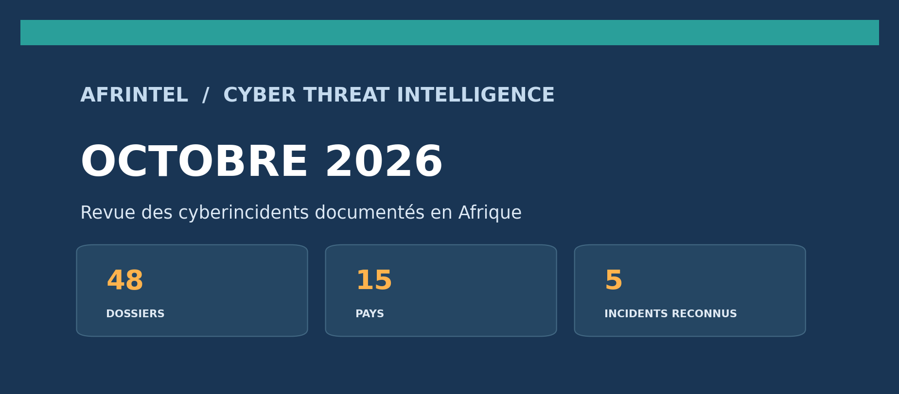

> **Origine du renseignement.** Le cœur de cette veille provient de publications identifiées sur des **sites de fuite ransomware**, des **forums cybercriminels**, des **marketplaces clandestines** et d'autres espaces accessibles du **dark web/deep web**. AFRINTEL documente les messages, captures, métadonnées et échantillons mis à disposition ; lorsque des fichiers ont été fournis, leur structure a été examinée en lecture seule. Les communiqués de victimes, les autorités et la presse spécialisée servent au recoupement. Une référence à une source criminelle certifie l'**observation de sa publication**, pas à elle seule l'intégralité de l'attaque revendiquée.

## 1. Synthèse exécutive

**Octobre confirme la valeur que les cybercriminels accordent aux données professionnelles, administratives et personnelles.** AFRINTEL a documenté **48 signalements dans 15 pays africains**, principalement à partir de publications sur des espaces cybercriminels et de preuves accessibles. Les **fuites de données dominent avec 23 dossiers (47,9 %)**, suivies de **17 signalements ransomware (35,4 %)**, **5 intrusions système (10,4 %)** et **3 offres de vente d'accès (6,3 %)**. Chaque dossier est une observation CTI canonique, non une affirmation de compromission techniquement démontrée.

Le **Maroc et l'Égypte totalisent chacun 12 dossiers**. L'**Afrique du Sud en compte 9**. Ces trois pays concentrent **33 des 48 observations (68,8 %)**. Cette concentration reflète aussi les sources accessibles, les capacités de collecte et la visibilité des victimes ; elle ne mesure pas le niveau de risque national à elle seule.

Trois enseignements ressortent. D'abord, les exports d'outils de gestion - ERP, e-commerce, recrutement, paie - peuvent exposer simultanément clients, salariés, partenaires et transactions. Ensuite, plusieurs dossiers concernent des informations particulièrement sensibles : santé, identité, dossiers administratifs ou judiciaires. Enfin, les plateformes gérées par des tiers, les environnements d'identité et les chaînes de diffusion numérique élargissent le périmètre de risque au-delà d'un seul organisme.

**La vérification croisée améliore la solidité du corpus :** **5 événements reconnus par les organisations concernées**, **2 publications intégrales examinées**, **19 dossiers avec échantillon annoncé, visible ou examiné**, **1 enquête publiquement déclarée** et **21 autres publications documentées**. Cette répartition qualifie les éléments accessibles sans gommer leur origine underground. **Ampath Laboratories** rejoint les cas reconnus grâce à sa communication du 14 octobre ; la revendication visant la **PGR Mozambique** reste comptée, mais son lot documentaire a été retiré des preuves attribuables à cette victime en raison d'un problème de provenance.

### 1.1 Comparaison avec septembre 2026

> Comparaison des **corpus AFRINTEL**, et non du nombre réel de cyberattaques. La hausse peut aussi découler d'une meilleure collecte, de nouveaux canaux ou de rattrapages documentaires.

| Indicateur | Septembre | Octobre | Évolution observée |
|---|---:|---:|---:|
| **Total des dossiers** | **33** | **48** | **+15 (+45,5 %)** |
| Ransomware | 20 | 17 | −3 (−15,0 %) |
| Data Leak | 11 | 23 | +12 (+109,1 %) |
| Access Sale | 0 | 3 | +3 (nouveau) |
| DDoS | 0 | 0 | 0 (stable) |
| Defacement | 0 | 0 | 0 (stable) |
| Account Takeover | 0 | 0 | 0 (stable) |
| System Intrusion | 2 | 5 | +3 (+150,0 %) |
| Malware | 0 | 0 | 0 (stable) |
| Operational Fraud | 0 | 0 | 0 (stable) |

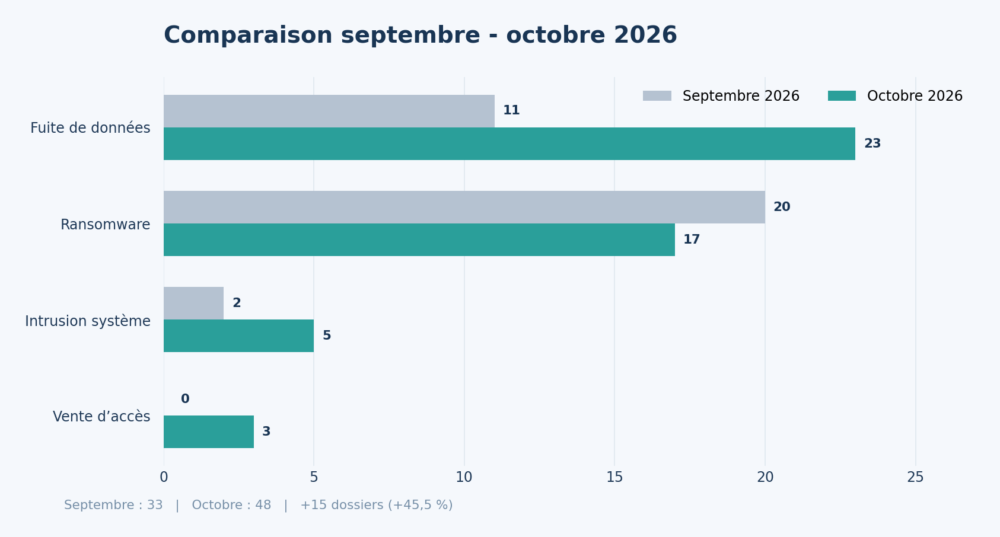

Les fuites de données expliquent l'essentiel de l'évolution du corpus (**11 à 23 dossiers**). À l'inverse, les publications ransomware passent de **20 à 17**. Cette comparaison mesure le **rythme de documentation AFRINTEL** : couverture des sources, reposts et enquêtes rétrospectives peuvent influer sur les résultats.

### 1.2 Ce que le lecteur doit retenir

- **Données et fraude :** commandes, comptes clients, paie, recrutement et dossiers de santé fournissent aux fraudeurs un contexte exploitable longtemps après la publication initiale.
- **Écosystèmes tiers :** applications de gestion, prestataires, plateformes publicitaires et systèmes externalisés élargissent le périmètre à défendre.
- **Confirmation publique :** Ampath, Lawyers for Human Rights, GCIS, InvestNaija et Al Arabia United ont fait l'objet de reconnaissances ou notifications publiques concernant un événement de sécurité, avec des périmètres différents.
- **Priorité opérationnelle :** protéger les identités et les exports, vérifier les accès des fournisseurs et mettre sous surveillance les scénarios de fraude secondaire.

## 2. Périmètre, méthode et limites

AFRINTEL suit les revendications et incidents concernant des organisations ou des données associées à l'Afrique. La collecte s'appuie notamment sur les publications directement observées sur les sites de groupes ransomware, les forums underground et les espaces de vente clandestins. Les captures, avis officiels et échantillons accessibles sont rapprochés pour documenter chaque dossier. Le classement d'octobre retient les **publications et signalements intégrés pour la première fois dans le suivi mensuel AFRINTEL**. La date réelle de l'incident, la première publication de l'acteur, la communication publique de la victime et la date de collecte sont des dimensions différentes, consignées dans les fiches. Cette méthode documente la **visibilité CTI du mois**, et non exclusivement des attaques survenues en octobre.

Les **48 fiches FR et les 48 fiches EN** ont été rapprochées pour les types, les statuts et l'ordre des dossiers. Pour les statistiques, les types composites sont ramenés à une seule catégorie principale : le cas **Decathlon Maroc** est compté en `Data Leak`, la présomption d'exposition restant décrite dans la fiche. Un événement est compté une seule fois dans le total mensuel ; les effets secondaires ne créent pas de seconde attaque.

La ventilation sectorielle est recalculée depuis les secteurs des fiches et le **[référentiel sectoriel AFRINTEL 2026](../../../normalization/sector_mapping_2026.csv)**. Elle diffère de l'ancienne illustration sectorielle : les graphiques corrigés figurent dans ce rapport. Ce regroupement est une convention de comparaison, pas une classification réglementaire des infrastructures critiques.

**Cas rétrospectif : e-Solde (République du Congo).** La première publication connue est datée du **28 juin 2026** ; le **2 octobre** correspond à une republication intégrée au suivi AFRINTEL. La fiche conserve ces deux dates. Le dossier est maintenu dans les **48 observations d'octobre**, sans être présenté comme une attaque nouvelle de ce mois ; son transfert éventuel vers une série historique événementielle exige de recalculer simultanément les deux mois, sans doublon.

**Règle de preuve :** un fichier examiné ne valide ni l'ensemble des volumes annoncés ni l'origine technique des données. Un nombre de lignes, de fichiers, de commandes ou de comptes ne représente pas nécessairement autant de personnes. Les données personnelles, secrets, clés et liens vers les espaces criminels ne sont pas diffusés dans le dépôt.

## 3. Panorama du mois

### 3.1 Types de signalements

| Type d'incident | Dossiers | Part du corpus |
|---|---:|---:|
| **Data Leak - Fuite de données** | **23** | **47,9 %** |
| Ransomware | 17 | 35,4 % |
| System Intrusion - Intrusion système | 5 | 10,4 % |
| Access Sale - Vente d'accès | 3 | 6,3 % |
| **Total** | **48** | **100,0 %** |

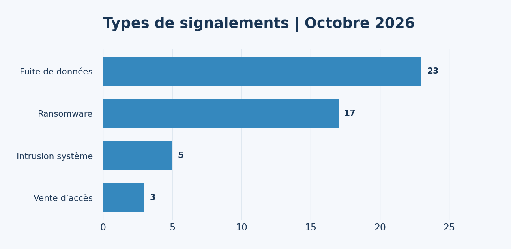
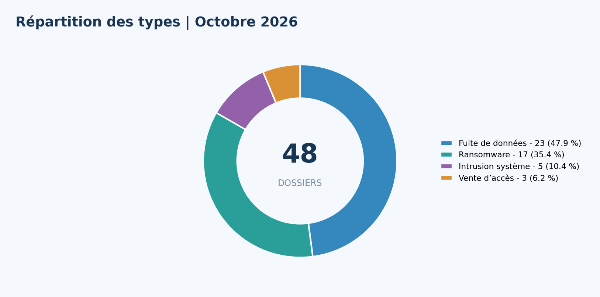

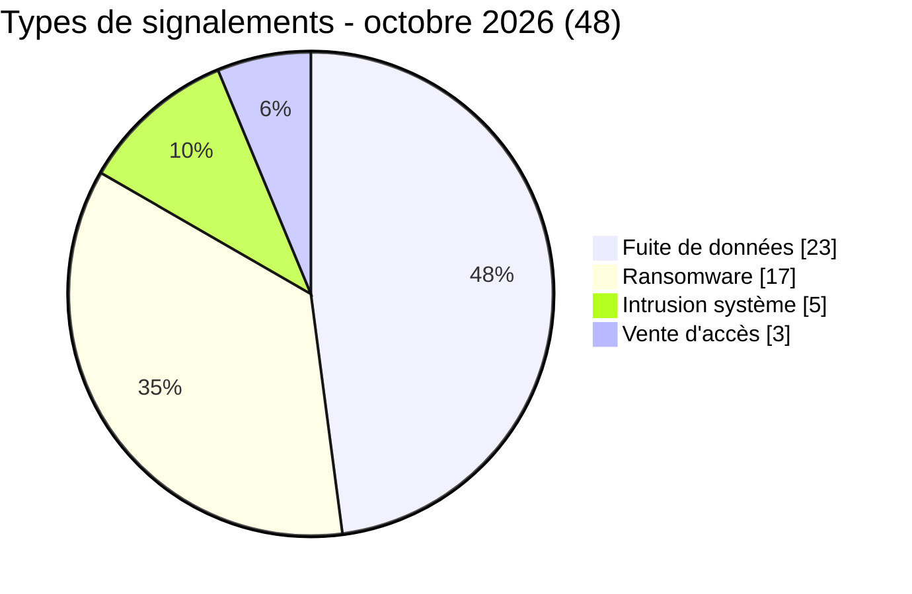

### 3.2 Pays et régions

| Pays | Dossiers | Pays | Dossiers |
|---|---:|---|---:|
| Égypte | 12 | République du Congo | 1 |
| Maroc | 12 | Rwanda | 1 |
| Afrique du Sud | 9 | Mozambique | 1 |
| RDC | 2 | Gabon | 1 |
| Éthiopie | 2 | Tunisie | 1 |
| Madagascar | 2 | Bénin | 1 |
| Nigeria | 1 | Sierra Leone | 1 |
| Côte d'Ivoire | 1 | **Total (15 pays)** | **48** |

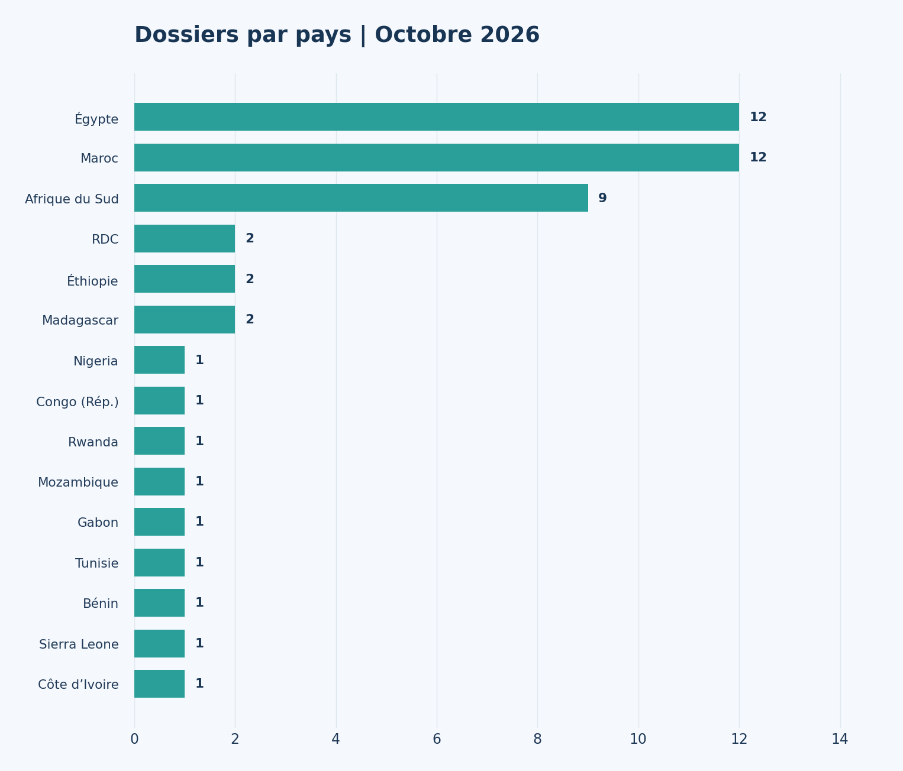
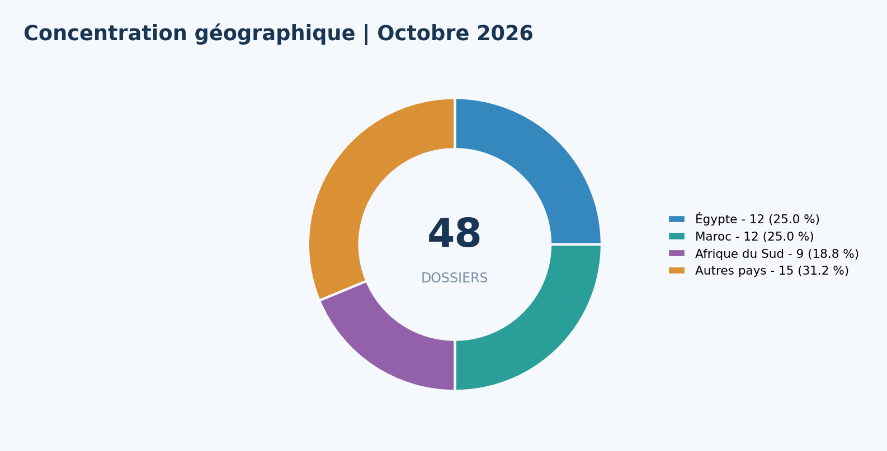

| Région AFRINTEL | Dossiers | Part |
|---|---:|---:|
| Afrique du Nord | 25 | 52,1 % |
| Afrique australe | 10 | 20,8 % |
| Afrique de l'Est | 5 | 10,4 % |
| Afrique centrale | 4 | 8,3 % |
| Afrique de l'Ouest | 4 | 8,3 % |
| **Total** | **48** | **100,0 %** |

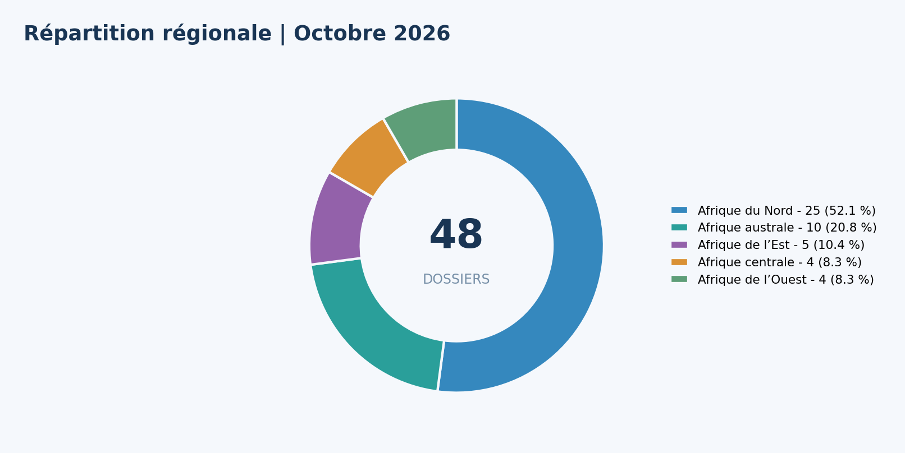

La géographie souligne un autre enjeu : **39 des 54 pays suivis ne figurent pas dans ce corpus**, mais cela ne signifie ni absence d'incident ni absence de menace. Les priorités de collecte doivent également tenir compte des zones moins documentées, notamment hors des grands marchés médiatiques et technologiques.

### 3.3 Qualification documentaire et confirmations publiques

| Statut AFRINTEL | Dossiers | Part |
|---|---:|---:|
| Claim - Unverified | 21 | 43,8 % |
| Claim - Data Sample Published | 19 | 39,6 % |
| Data Fully Published | 2 | 4,2 % |
| Incident Confirmed by Victim | 5 | 10,4 % |
| Under Investigation | 1 | 2,1 % |
| **Total** | **48** | **100,0 %** |

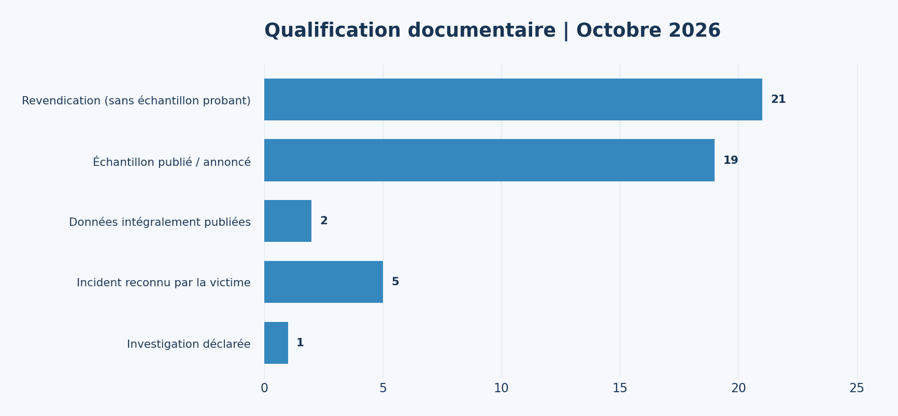

**Cinq événements disposent désormais d'une reconnaissance publique de la victime ou d'une autorité :**

| Organisation | Pays | Information publique établie | Source accessible |
|---|---|---|---|
| **Ampath Laboratories** | Afrique du Sud | Cyberincident détecté le 2 octobre, contenu et notifié au régulateur ; enquête sur les données administratives | [Déclaration de l'entreprise, 14 octobre](https://novuspressbulletin.co.za/blog/ampath-cautions-about-overstated-numbers-as-cybersecurity-incident-probe-continues) |
| **Lawyers for Human Rights** | Afrique du Sud | Accès et téléchargement non autorisés d'une base hébergée chez un prestataire, détectés le 5 octobre | [Avis officiel, 15 octobre](https://www.lhr.org.za/lhr-news/important-notice-regarding-a-security-incident/) |
| **GCIS** | Afrique du Sud | Portail de recrutement compromis, activité suspecte identifiée le 24 octobre ; notification aux candidats | [ITWeb, 30 octobre](https://www.itweb.co.za/article/gcis-warns-of-information-breach/wbrpO7g2ea3vDLZn) |
| **InvestNaija / Chapel Hill Denham** | Nigeria | Notification d'activité inhabituelle et d'une exposition potentielle limitée d'informations clients | [The Sun Nigeria, 30 octobre](https://thesun.ng/chapel-hill-denham-alerts-customers-to-potential-data-breach-says-investments-safe/) |
| **Al Arabia United** | Égypte | Diffusion non autorisée sur un panneau numérique ; compromission d'une plateforme de diffusion tierce confirmée par les autorités | [Ministère égyptien de l'Intérieur, 29 octobre](https://www.moi.gov.eg/news/GetDetails?newsId=bbfb00a8-b8e2-4c10-81bd-161ba437d035) |

La communication sur un incident **ne valide pas automatiquement chaque affirmation diffusée à son sujet**. Les autres dossiers conservent une valeur de renseignement lorsqu'ils comportent une publication retracée, des métadonnées, des captures ou des échantillons crédibles. Les limites sont consignées dans les fiches, sans être répétées au détriment de l'analyse.

### 3.4 Comptes de publication et groupes revendiquants

| Identifiant observé | Dossiers associés |
|---|---:|
| Nameless511 | 9 |
| UmBra | 4 |
| N0n | 4 |
| The Gentlemen | 3 |
| SensitiveDarkForum | 2 |
| Krybit | 2 |
| Qilin | 2 |
| Lenken | 2 |
| Kazu | 2 |
| List1 | 2 |

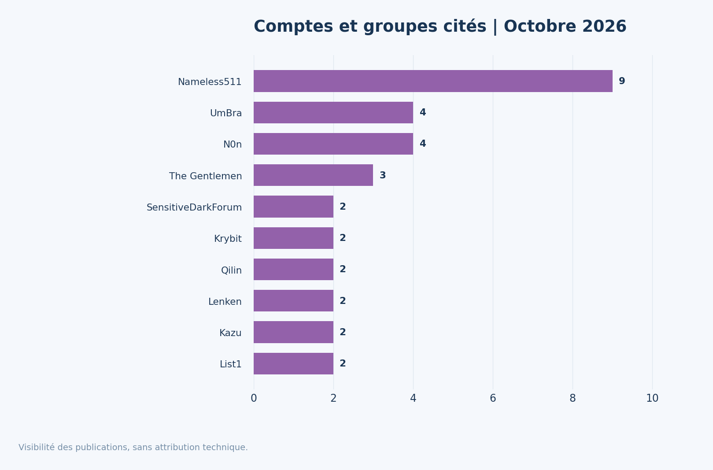

Ces **dix libellés couvrent 32 dossiers** ; les autres publications concernent des noms moins fréquents ou des dossiers sans auteur identifié. Il s'agit **d'identifiants de sources et d'attributions déclarées**, pas d'une validation de l'identité des cybercriminels. Certains noms renvoient à des groupes ransomware ; d'autres sont seulement des comptes ou vendeurs observés sur des plateformes.

### 3.5 Secteurs normalisés - répartition corrigée

| Secteur normalisé | Dossiers | Part |
|---|---:|---:|
| Gouvernement / Administration publique | 12 | 25,0 % |
| Autres secteurs | 7 | 14,6 % |
| Technologie / Services numériques | 6 | 12,5 % |
| Commerce / Distribution | 5 | 10,4 % |
| Santé | 5 | 10,4 % |
| Éducation | 5 | 10,4 % |
| Industrie / Ingénierie | 3 | 6,3 % |
| Finance / Assurance | 3 | 6,3 % |
| Transport | 2 | 4,2 % |
| **Total** | **48** | **100,0 %** |

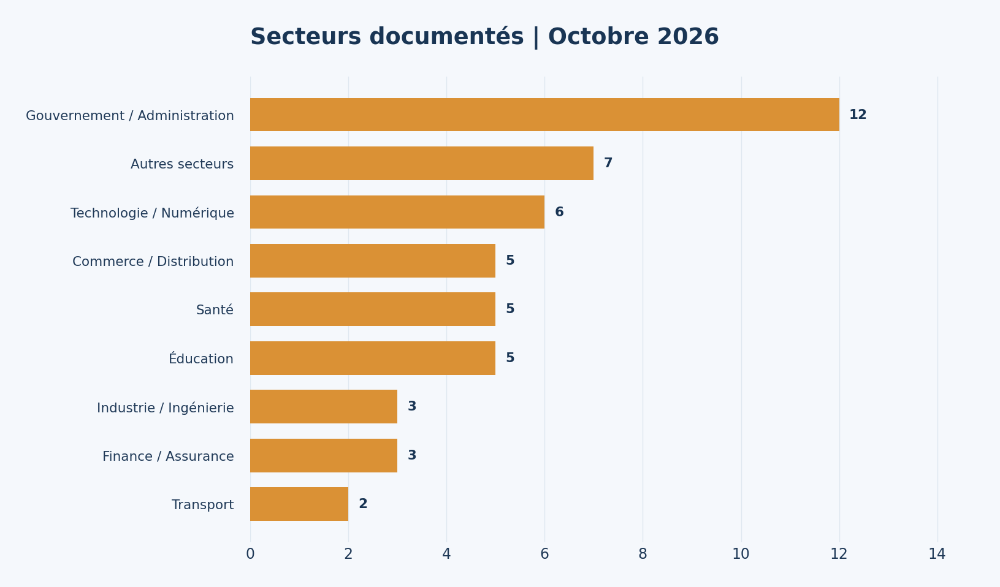
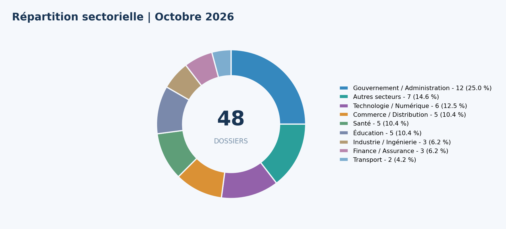

L'**administration publique (12 dossiers)** reste le premier ensemble. La rubrique **« Autres secteurs » (7)** comprend des activités hétérogènes - recherche nucléaire, eau, médias audiovisuels, ONG ou environnement, entre autres. Elle gagnera à être affinée dans le référentiel futur, sans casser la comparaison avec les mois antérieurs. Dans la nomenclature utilisée ici, certains distributeurs informatiques sont classés en « Technologie / Services numériques » : le chiffre du commerce ne représente donc pas l'ensemble du commerce électronique au sens économique.

## 4. Les dossiers qui marquent octobre

### 4.1 Maroc : l'ERP et les données commerciales au premier plan

**Tera.ma** est l'un des dossiers les plus documentés : AFRINTEL a inventorié **8 140 fichiers**, soit **2 389 358 436 octets**, dont **282 CSV et 3 693 PDF**. Les contrôles structurels retrouvent **19 595 entrées partenaires**, **69 197 commandes** et **124 088 écritures comptables**. La cohérence de ces éléments renforce le lien avec un environnement commercial de type Odoo. **Elle ne prouve pas la date d'extraction, le vecteur d'accès ou une confirmation officielle de Tera.ma.**

Chez **NextLevel PC**, les **huit CSV** fournis permettent de vérifier les décomptes annoncés : **52 545 comptes clients**, **60 262 adresses de livraison**, **47 653 commandes**, **11 comptes internes** et **14 160 règles commerciales**. La publication de ces structures pose un risque concret de fraude liée à la livraison, de faux remboursements et de ciblage de comptes. Un compte, une adresse et une commande ne sont pas trois personnes distinctes.

Les dossiers **Midipcom**, **Karamtech** et **Decathlon Maroc** élargissent la même problématique : les fonctions de vente, facturation et logistique concentrent des données réutilisables pour l'usurpation et la fraude. Pour Midipcom et Karamtech, les échantillons disponibles ne permettent pas de valider les volumes globaux revendiqués ; pour Decathlon, l'origine exacte du jeu de données (enseigne, prestataire ou export historique) n'est pas établie.

### 4.2 Administrations : des données difficiles à remplacer

Au **ministère marocain des Habous et des Affaires islamiques**, les **33 fichiers XLSX** contiennent **109 607 lignes de candidatures**, avant déduplication, auxquelles s'ajoute un CSV de **10 lignes distinctes**. La revue retrouve **78 467 valeurs de CIN distinctes au format attendu**, ce qui ne constitue pas un nombre confirmé de personnes uniques. La structure évoque des candidatures à un concours, avec identité, formation et références administratives. La provenance technique depuis l'infrastructure ministérielle n'est pas démontrée.

Au **Rwanda**, un corpus associé au **ministère de la Santé** contient **375 CSV**, soit **6 050 914 271 octets** et **42 509 228 lignes physiques**. Ces lignes agrègent différents types d'enregistrements, dont des informations de comptes, des journaux et des données liées à la santé. **Ce nombre ne peut pas être présenté comme 42,5 millions de patients ou de citoyens touchés.** La question de la provenance technique et du périmètre réel reste ouverte.

En **RDC**, la publication concernant la plateforme d'enregistrement des enseignants **MINESURSI** revendique **136 Go et 125 823 fichiers**. Le lot examiné est plus limité : **1 531 fichiers**, dont **581 PDF et 950 images**. En **République du Congo**, le cas **e-Solde** expose dans l'échantillon des catégories liées aux comptes et à la paie de personnels publics ; l'existence d'un accès administrateur fonctionnel proposé à la vente reste à établir.

### 4.3 Santé : un incident reconnu et des jeux de données sensibles

Le dossier **Ampath Laboratories (Afrique du Sud)** illustre l'intérêt du recoupement entre la veille underground et les déclarations publiques. La publication associée au compte ByteToBreach a été confrontée aux échantillons examinés par AFRINTEL. L'entreprise a pour sa part **reconnu un cyberincident détecté le 2 octobre** et communiqué le **14 octobre** sur son confinement et sa notification au régulateur.

Les fichiers examinés comportent des structures relatives aux **employés, patients, inscriptions, assurances et opérations de paiement**. Ampath indique toutefois que les informations potentiellement concernées paraissent surtout **démographiques ou administratives**, sans preuve identifiée, selon son communiqué, de compromission de **dossiers médicaux, diagnostics, résultats d'analyses ou coordonnées bancaires**. Les **80 millions d'enregistrements** annoncés sur le forum ne doivent pas être convertis en patients distincts.

Le corpus associé au **ministère rwandais de la Santé** (375 CSV, environ 6,05 Go, 42,5 millions de lignes physiques) et le dossier relatif au **ministère éthiopien de la Santé** montrent, à des degrés de documentation différents, l'attrait des référentiels de santé. **Une ligne de journal, un compte applicatif et un dossier patient ne représentent pas la même unité statistique.** Le risque défensif prioritaire demeure la combinaison de données d'identité, de contact et d'accès métier.

### 4.4 Ransomware : une publication n'est pas une preuve de chiffrement

**Eurogate Tanger** dispose d'un premier lot publié : une archive de **355 fichiers**, totalisant **373 065 003 octets non compressés**, comprenant notamment documents bureautiques, correspondances et fichiers techniques liés à l'environnement portuaire. Le contenu ne permet **pas** de conclure à un arrêt du terminal, à un chiffrement ou à une exfiltration exhaustive.

Pour le **CNESTEN**, la publication associée à **Qilin** a été rapprochée d'un **inventaire de 110 803 fichiers** annonçant **205 805 114 681 octets**. Ce sont les valeurs d'un arbre documentaire ; les fichiers eux-mêmes n'ont pas été analysés. Aucune conséquence sur la sûreté nucléaire ou la continuité d'installation n'est établie. Le cas **YOD Ingénierie** est rattaché **uniquement au Bénin**, conformément à sa fiche.

Les publications visant **Gabon Meca (HYFLOCK)** et la **Société Ivoirienne de Télédiffusion (Qilin)** sont également reprises par des [dispositifs de suivi ransomware](https://www.legal-isac.org/ransomware/). La trace OSINT recoupe ici la présence de la fiche sur des espaces adverses ; elle ne décrit ni une technique d'accès initial ni l'issue d'une négociation.

**Attention à la dépendance logicielle dans la chaîne maritime :** le groupe **N0n** a publié le 12 octobre une série de **38 organisations du transport et des ports**, dont Eurogate Tanger, selon [SOCRadar](https://socradar.io/blog/n0n-group-global-ports-shipping-leak/). Le regroupement des publications justifie une investigation sur les applications et prestataires partagés, **sans présumer 38 intrusions indépendantes ni une vulnérabilité commune démontrée**.

### 4.5 Des incidents reconnus publiquement : le risque ne se limite pas aux fuites

En **Afrique du Sud**, **Lawyers for Human Rights** a annoncé, le **15 octobre**, qu'une base de données hébergée chez un prestataire avait été consultée et téléchargée sans autorisation le **5 octobre**. Le **GCIS** a notifié les candidats de la compromission de son portail de recrutement, après détection d'une activité suspecte le **24 octobre**. Dans les deux cas, les mesures de protection des personnes doivent être proportionnées au périmètre établi.

Au **Nigeria**, **InvestNaija / Chapel Hill Denham** a signalé une activité inhabituelle pouvant concerner une part limitée des informations clients. En **Égypte**, **Al Arabia United** a reconnu la diffusion de contenu non autorisé sur un écran publicitaire ; l'incident renvoie à une chaîne de distribution de contenus, **sans preuve d'une fuite de données**. Ces cas rappellent qu'une compromission peut toucher la confidentialité, l'intégrité ou la disponibilité de manière différente.

## 5. Lecture stratégique : ce qui change pour les organisations africaines

**Première tendance : les exports de gestion sont une cible rentable pour la fraude.** Une base d'ERP ou de commandes n'est pas seulement un fichier de clients : elle peut relier personnes, transactions, fournisseurs, adresses et documents. Les dossiers Tera.ma et NextLevel PC donnent une idée de cette profondeur ; d'autres publications du mois décrivent des ensembles similaires avec moins de preuve disponible.

**Deuxième tendance : les données d'identité circulent entre plusieurs métiers.** Concours publics, universités, santé, paie ou recrutement peuvent contenir des pièces difficiles à renouveler. La priorité n'est donc pas seulement de fermer une exposition : il faut aussi limiter les réutilisations frauduleuses après publication.

**Troisième tendance : la dépendance aux tiers mérite une surveillance dédiée.** L'incident annoncé par Lawyers for Human Rights concerne un prestataire. Les propositions d'accès à Madagascar visent deux plateformes d'identité distinctes, tandis que l'incident d'Al Arabia United touche une chaîne d'affichage. On ne peut pas déduire un même vecteur d'attaque de ces cas, mais ils justifient de mieux contrôler les délégations d'administration et les accès entre systèmes.

Enfin, **la hausse du volume observé ne signifie pas que les attaques se sont accélérées au même rythme**. Octobre présente davantage de dossiers de fuite dans AFRINTEL ; la collecte, les republications et les sources disponibles restent des facteurs déterminants.

## 6. Risques prioritaires par environnement

| Environnement | Exposition documentée dans le corpus | Risque à anticiper | Priorité défensive |
|---|---|---|---|
| Administrations et recrutement | Dossiers de candidature, paie, comptes et pièces justificatives | Usurpation, fraude administrative, ciblage des agents | Contrôler exports, IAM et prestataires |
| Commerce, ERP et logistique | Clients, commandes, factures, adresses, historique financier | Fausse facture, modification de RIB, fraude livraison | Journaliser exports et changements critiques |
| Santé | Données de patients, personnel, assurances ou référentiels | Atteinte à la vie privée, phishing ciblé, extorsion | Segmenter et limiter les consultations massives |
| Services numériques et identité | Sauvegardes applicatives, comptes, offres d'accès | Réutilisation de jetons, abus de privilèges | MFA, rotation contrôlée, revue des accès |
| Transport et infrastructures de service | Documents opérationnels, systèmes de diffusion | Usage abusif des documents et détournement d'affichage | Journaliser actions sensibles et vérifier les tiers |

**Précision :** ce tableau hiérarchise les risques pour les organisations appartenant à ces catégories ; il n'attribue pas à chaque victime l'intégralité des conséquences possibles.

## 7. Priorités de veille et lacunes à résoudre

| Dossier ou sujet | Ce que l'on sait | Ce qu'il faut encore établir |
|---|---|---|
| e-Solde (République du Congo) | Première publication connue le **28 juin** ; republication suivie le **2 octobre** | Conserver les deux dates et éviter un doublon dans les séries événementielles ; correction historique coordonnée si nécessaire |
| **PGR Mozambique / Rand Mutual** | L'inventaire du lot de **262 fichiers / 75 941 802 octets** est identique, alors que les marqueurs documentaires détaillés pointent vers RMA | **Échantillon exclu de la démonstration PGR** ; obtenir les empreintes de fichiers et la chaîne de provenance avant toute réattribution |
| Rand Mutual Assurance | Alerte et enquête annoncées par l'entreprise le **23 octobre** ; lot de documents comportant des marqueurs RMA | Source exacte du lot, lien avec l'offre clandestine et conclusions de l'enquête |
| CNESTEN | Inventaire de répertoire examiné, pas les documents cités | Réalité, exhaustivité et sensibilité des fichiers annoncés ; éventuel impact opérationnel |
| Revendications ransomware sans échantillon disponible | Présence de publications et parfois d'une échéance | Dernière vérification, état de divulgation, confirmation victime, éventuelles preuves techniques |
| Pays peu représentés | Aucun dossier ou peu de dossiers dans les sources d'octobre utilisées | Couverture des langues et sources locales, communiqués CERT/CSIRT, recoupement régional |

**Méthode de suivi :** donner la priorité aux avis institutionnels, aux preuves d'exposition vérifiables sans diffuser de données personnelles, aux contrôles de provenance et aux changements de statut des publications. Une absence de communiqué dans les sources consultées n'est ni une preuve de silence volontaire ni une preuve d'absence d'incident.

## 8. MITRE ATT&CK : hypothèses de détection, pas attribution de techniques

Aucun élément du seul classement mensuel ne suffit à identifier une chaîne d'attaque complète. Les techniques ci-dessous sont **des pistes défensives** : elles doivent être confirmées, ou écartées, par les journaux et enquêtes des organisations concernées.

| Technique ATT&CK | Hypothèse à tester | Données à corréler |
|---|---|---|
| [T1078 - Valid Accounts](https://attack.mitre.org/techniques/T1078/) | Usage d'un compte légitime compromis pour accéder à un outil métier | IAM, SSO, VPN, historique des sessions, contexte du terminal |
| [T1190 - Exploit Public-Facing Application](https://attack.mitre.org/techniques/T1190/) | Exploitation d'une application Internet exposée | WAF, reverse proxy, HTTP, erreurs applicatives, EDR serveur |
| [T1213 - Data from Information Repositories](https://attack.mitre.org/techniques/T1213/) | Consultation ou extraction abusive depuis un espace documentaire | Audit SharePoint/stockage documentaire, logs de fichiers, droits d'accès |
| [T1530 - Data from Cloud Storage](https://attack.mitre.org/techniques/T1530/) | Lecture ou téléchargement de données depuis un stockage cloud | Audit bucket/objet, API cloud, logs de téléchargement |
| [T1567 - Exfiltration Over Web Service](https://attack.mitre.org/techniques/T1567/) | Sortie de données vers un service web à vérifier uniquement si la télémétrie le suggère | Proxy, DNS, flux sortants, DLP/CASB, trafic applicatif |
| [T1486 - Data Encrypted for Impact](https://attack.mitre.org/techniques/T1486/) | Chiffrement massif en cas de ransomware avéré | EDR, modifications de fichiers, événements de sauvegarde |

**Important :** la présence de données sur un forum ne prouve **ni T1567 ni aucune méthode d'exfiltration précise**. Une publication attribuée à un groupe ransomware ne démontre pas automatiquement T1486.

## 9. Recommandations SOC : détection et corrélation concrètes

| Scénario défensif | Sources à collecter | Corrélation / alerte à envisager |
|---|---|---|
| Export ERP ou e-commerce inhabituel | Odoo/ERP, DB audit, IAM, proxy, DLP | Export massif hors habitudes + privilèges élevés + transfert sortant anormal |
| Réutilisation d'un compte privilégié | SSO/Keycloak, VPN, EDR, bastion | Connexion depuis nouveau pays/ASN ou terminal + action sensible + horaire atypique |
| Téléchargement massif de dossiers | Applications de recrutement, santé, stockage, journaux d'accès | Volume de consultations/téléchargements anormal pour l'utilisateur et son rôle |
| Compromission d'un prestataire | IdP, comptes tiers, API, audit des accès | Nouveau contexte de connexion du tiers + accès à plusieurs environnements |
| Détournement de contenu affiché | CMS, API de publication, SSO, historique de déploiement | Modification non approuvée + publication sur plusieurs écrans + écart avec le planning |
| Préparation d'impact ransomware | EDR, fichiers, sauvegardes, identité | Modifications massives de fichiers + anomalie de comptes + activité de sauvegarde inhabituelle |

**Observé dans le corpus :** publications de données, inventaires et échantillons, offres d'accès, avis d'organisations sur des événements de sécurité et diffusion non autorisée de contenu dans le cas Al Arabia United.

**Hypothèses à tester dans les environnements :** extraction automatisée, détournement de compte, accès via un prestataire, transfert sortant ou tentative de chiffrement. Aucune de ces techniques n'est présumée observée chez toutes les victimes.

**Exemple de règle comportementale à adapter au SIEM :** sur un périmètre ERP ou recrutement, prioriser une alerte lorsque **(i)** un utilisateur exporte en une heure plus de cinq fois son volume habituel sur 30 jours, **(ii)** le même compte accède à un périmètre inhabituel ou gagne des privilèges, et **(iii)** un transfert sortant ou un volume de téléchargements anormal apparaît dans les journaux de proxy, DLP ou stockage. Les seuils servent à l'essai de détection, **pas à décrire des techniques observées chez les victimes**.

**Mesures préventives :** MFA résistante au phishing pour les comptes privilégiés, privilèges minimaux, revue des exports, journaux intègres, sauvegardes protégées et procédures de révocation rapides des sessions et des secrets. Les durées de conservation doivent répondre aux contraintes réglementaires et d'enquête.

## 10. Plan d'action priorisé

### Immédiatement - 0 à 7 jours

1. **Qualifier les données exposées** : localiser les applications et prestataires susceptibles de détenir les mêmes catégories de données que celles signalées ; préserver les preuves et limiter les consultations non nécessaires.
2. **Réduire les possibilités de réutilisation** : révoquer les sessions et renouveler de façon contrôlée les secrets réellement concernés, sans tester ceux publiés par des acteurs.
3. **Bloquer les fraudes secondaires** : imposer une validation hors bande pour tout changement de coordonnées bancaires, remboursement inhabituel ou demande de transfert sensible.

### À court terme - 8 à 30 jours

1. Tester les alertes SIEM sur exports volumineux, opérations privilégiées, accès tiers et téléchargements répétés.
2. Revoir les droits des prestataires, comptes de service et environnements de préproduction ; supprimer les accès qui ne sont plus nécessaires.
3. Préparer une procédure de notification et de protection des personnes concernées, adaptée au niveau de preuve et aux règles locales.

### À consolider - 30 à 90 jours

1. Exercices de crise : fuite ERP, exposition de données de recrutement, compromission d'un prestataire et détournement d'affichage numérique.
2. Mesurer la couverture de journalisation, la durée de conservation utile, les délais de révocation et la fréquence des tests de restauration.
3. Mettre à jour les référentiels de secteurs, la déduplication et le suivi du cycle ransomware afin de fiabiliser les séries mensuelles.

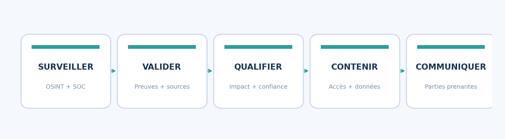

## 11. Perspectives de veille - novembre 2026

L'effort doit porter sur le suivi des **nouveaux lots de données**, la vérification des **avis officiels**, la comparaison des **échantillons attribués à plusieurs victimes**, les éventuels **changements d'état des publications ransomware** et les signaux de fraude utilisant des références commerciales authentiques. Les observations futures devront être datées et séparées des hypothèses.

## 12. Références et transparence de la collecte

**Sources primaires du projet :** captures et métadonnées des publications sur les sites de divulgation ransomware, forums underground, marchés clandestins du dark web/deep web, ainsi que les résultats d'examen local d'échantillons. Les liens actifs vers les services criminels et les données individuelles ne sont pas reproduits. Chaque fiche victime contient son acteur ou compte de publication, le type de source et les éléments examinés.

**Recoupements publics sélectionnés :** [Ampath, déclaration d'entreprise](https://novuspressbulletin.co.za/blog/ampath-cautions-about-overstated-numbers-as-cybersecurity-incident-probe-continues) ; [Lawyers for Human Rights, avis officiel](https://www.lhr.org.za/lhr-news/important-notice-regarding-a-security-incident/) ; [GCIS via ITWeb](https://www.itweb.co.za/article/gcis-warns-of-information-breach/wbrpO7g2ea3vDLZn) ; [InvestNaija via The Sun](https://thesun.ng/chapel-hill-denham-alerts-customers-to-potential-data-breach-says-investments-safe/) ; [ministère égyptien de l'Intérieur](https://www.moi.gov.eg/news/GetDetails?newsId=bbfb00a8-b8e2-4c10-81bd-161ba437d035) ; [Rand Mutual Assurance via ITWeb](https://www.itweb.co.za/article/rand-mutual-probes-alleged-breach-of-168m-claims/G98YdqLGAgXMX2PD) ; [N0n et la chaîne maritime, SOCRadar](https://socradar.io/blog/n0n-group-global-ports-shipping-leak/) ; [Qilin / SIDT via Legal-ISAC](https://www.legal-isac.org/ransomware/).

*Revue documentaire réalisée le 17 novembre 2026. Les sources publiques citées corroborent ce qu'elles déclarent explicitement ; elles ne remplacent pas une investigation forensique chez les organismes concernés.*

## Conclusion

**Le signal principal d’octobre est la profondeur des données commerciales, personnelles et administratives visibles sur les espaces de publication cybercriminels.** Une base de commandes, un dossier de candidature, un inventaire de répertoire ou un export de paie peuvent servir à cibler une organisation longtemps après la première publication. Pour les équipes de sécurité, la réponse ne se limite plus à rechercher une intrusion : il faut aussi protéger les comptes, vérifier les accès des tiers, repérer les extractions anormales et anticiper les fraudes qui suivent l'exposition.

La lecture d'AFRINTEL reste volontairement prudente : **on distingue ce qui est publié, ce qui est observé dans les fichiers et ce qui reste inconnu**. C'est cette séparation qui rend la veille exploitable pour les décideurs, les CERT/CSIRT et les SOC.

---

*AFRINTEL - Cyber Threat Intelligence for Africa* 
*Sources et fiches détaillées : [GitHub AFRINTEL](https://github.com/Hatchepsoute/AFRINTEL) · [Fiches victimes, octobre 2026](./victims_FR.md)*
