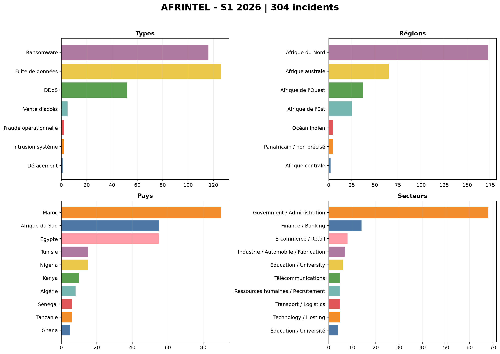
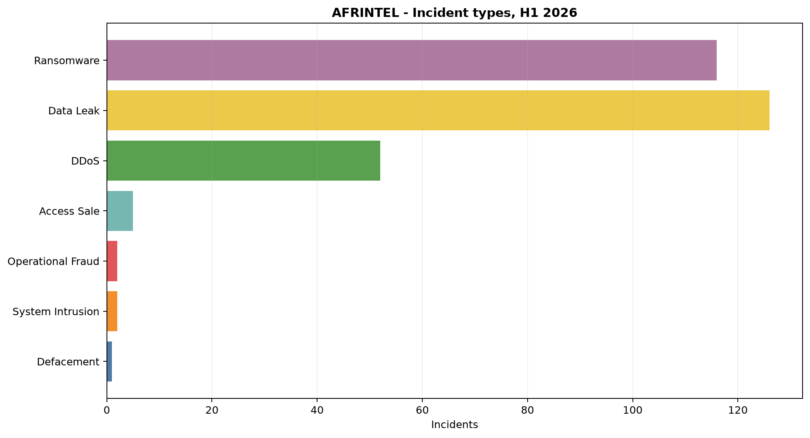
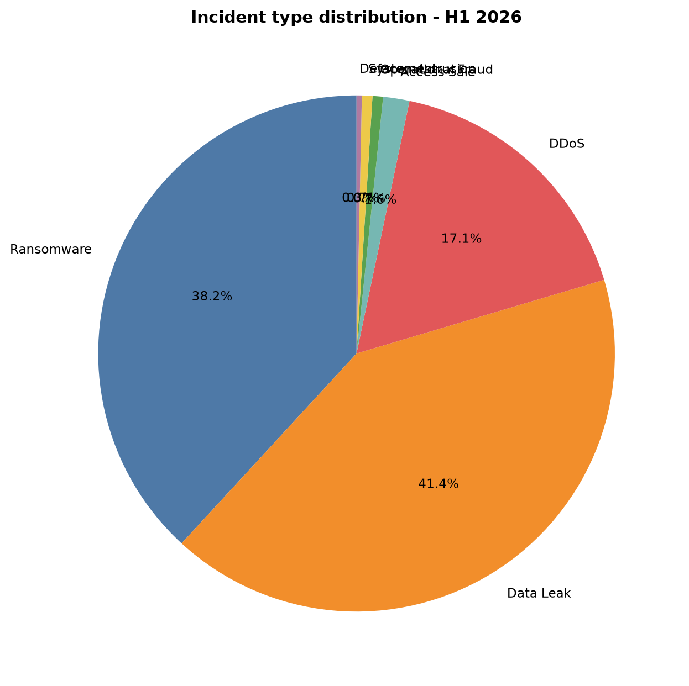
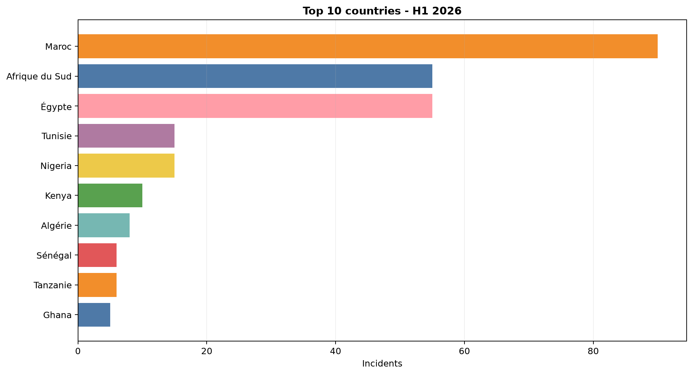
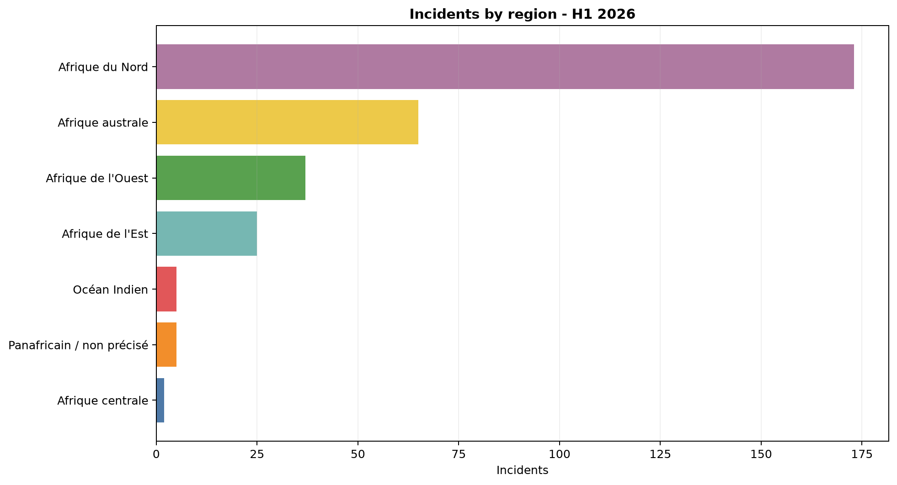
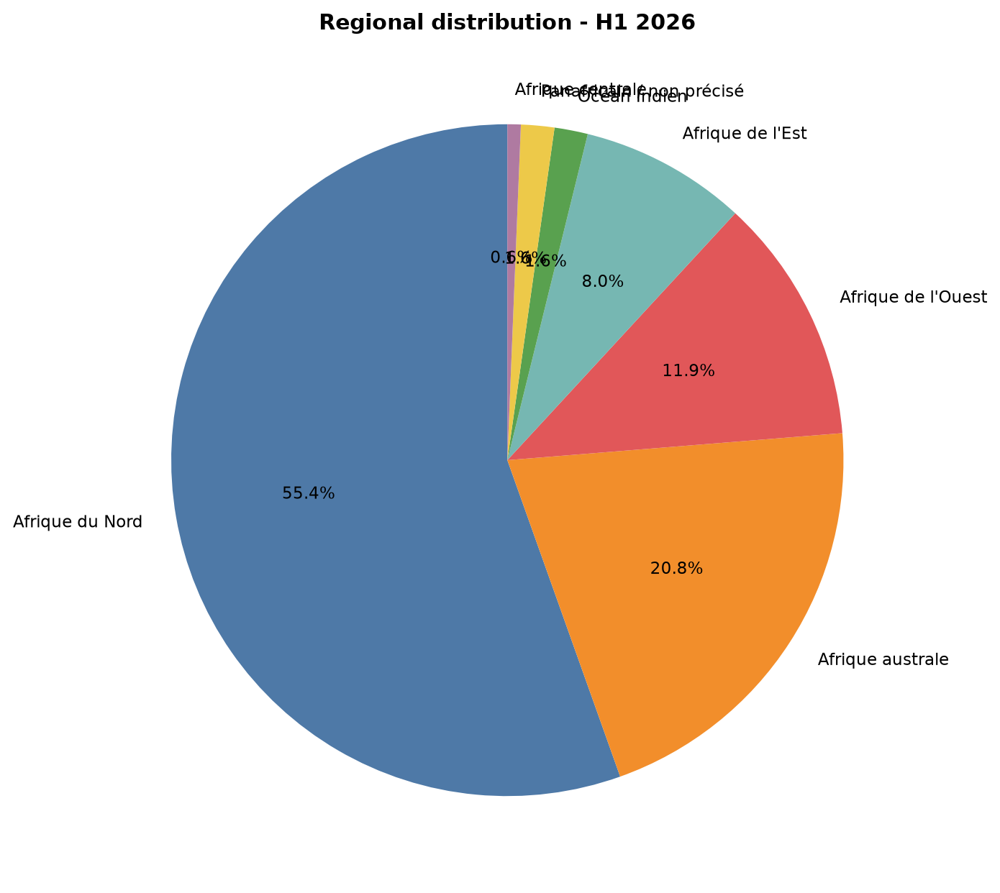
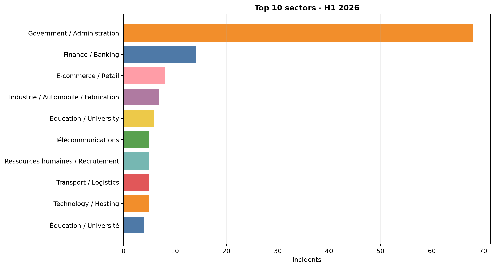
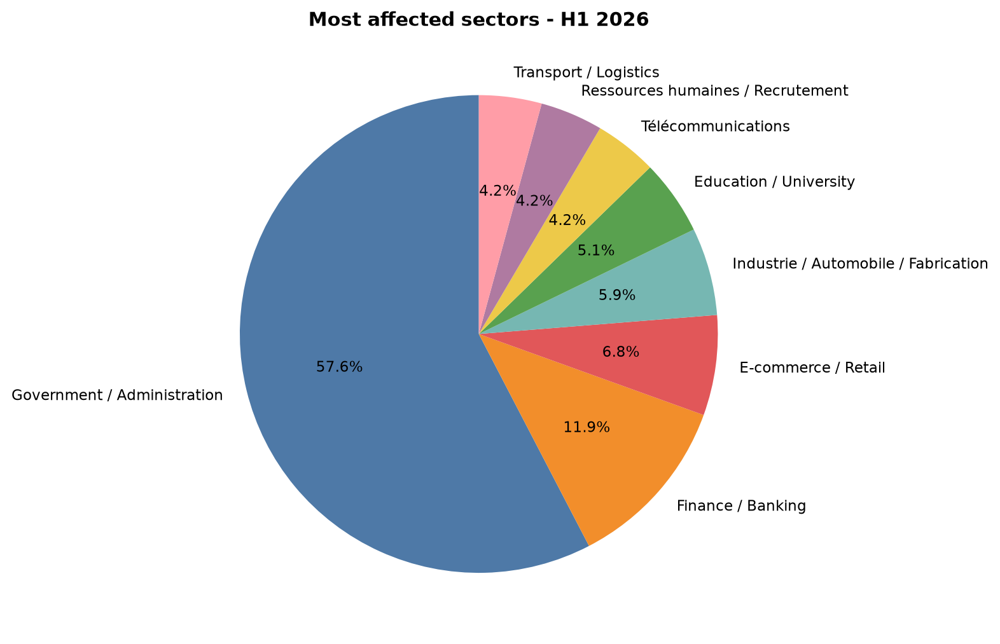
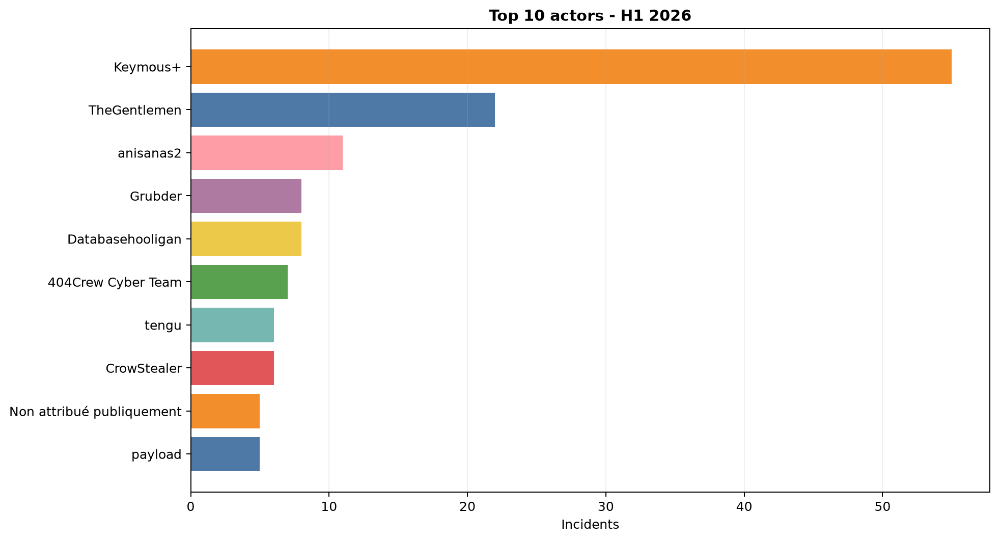

# AFRINTEL H1 2026 cyber threat report

From 1 January to 30 June 2026, AFRINTEL records **304 documented incidents or cases** in the validated monthly corpus.

## Semester breakdown

| Type | Count | Share |
|---|---:|---:|
| Data Leak | 126 | 41.4% |
| Ransomware | 116 | 38.2% |
| DDoS | 52 | 17.1% |
| Access Sale | 5 | 1.6% |
| Operational Fraud | 2 | 0.7% |
| System Intrusion | 2 | 0.7% |
| Defacement | 1 | 0.3% |
| **Total** | **304** | **100.0%** |

## Monthly totals

| Month | Records |
|---|---:|
| January | 23 |
| February | 21 |
| March | 41 |
| April | 72 |
| May | 106 |
| June | 41 |

## Methodology

The figures are derived from the French-first victim files, checked against the English files and reused in comparisons and STIX. Monthly assignment follows publication or first documented observation; no compromise date is inferred.

## Visualisations

[Complete H1 2026 visual intelligence set](../../visual-intelligence/H1-2026/README.md)

