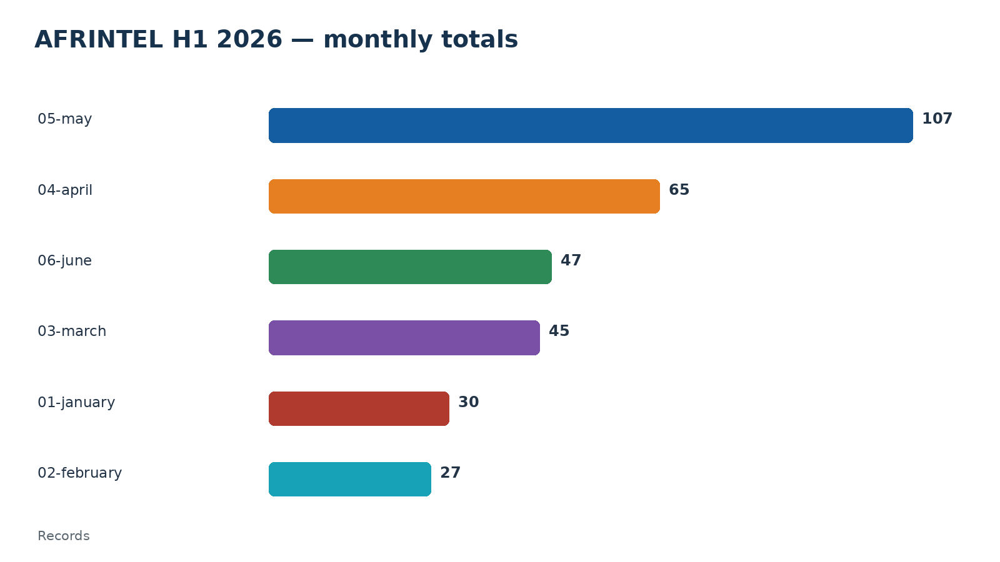
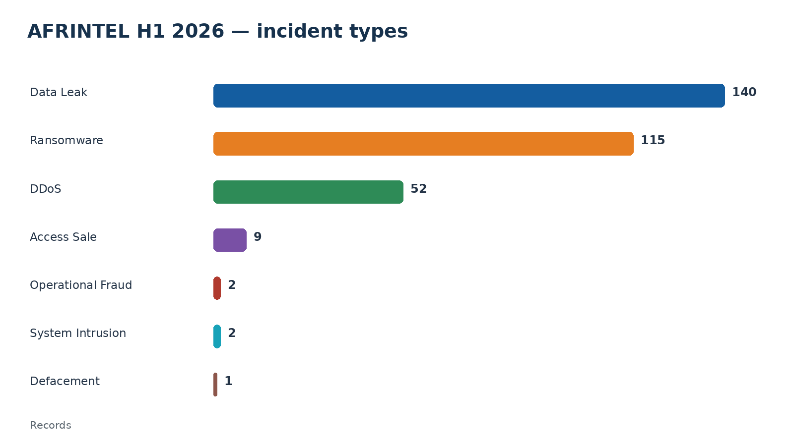
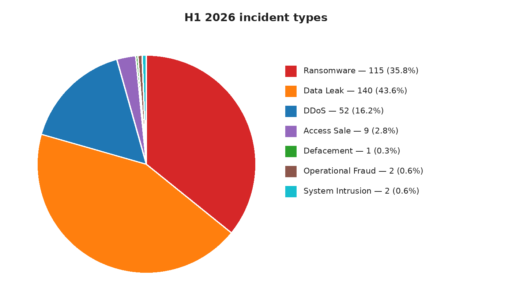
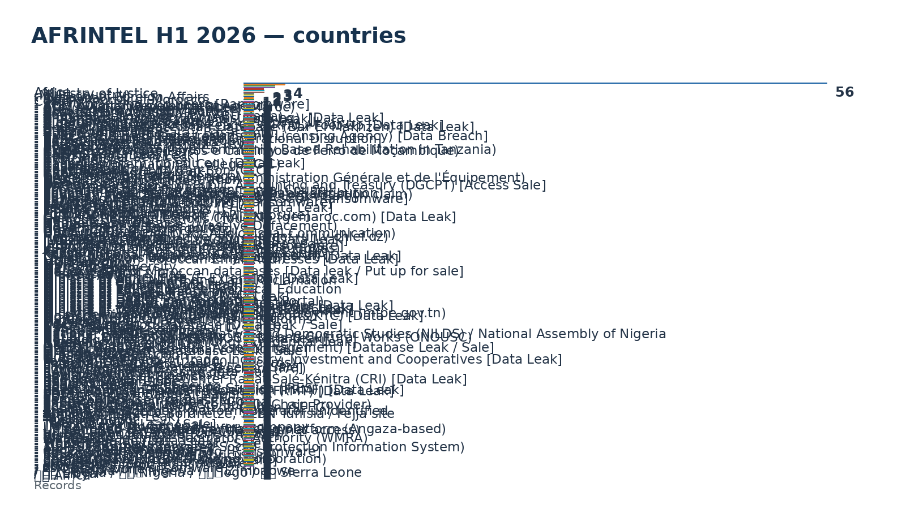
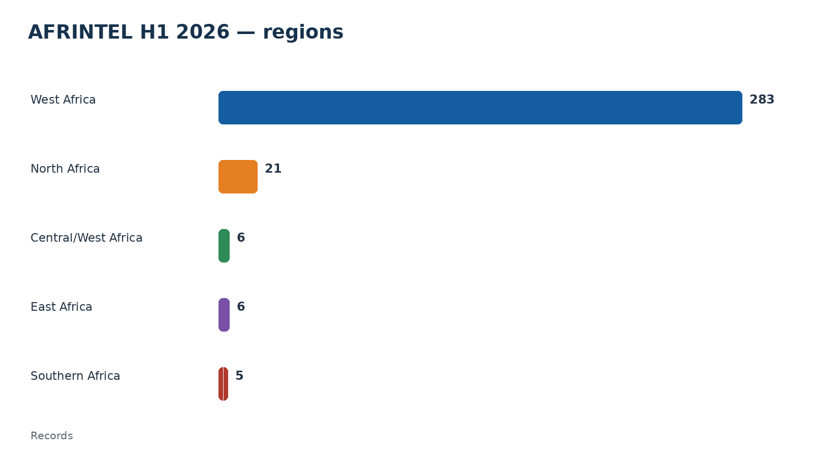
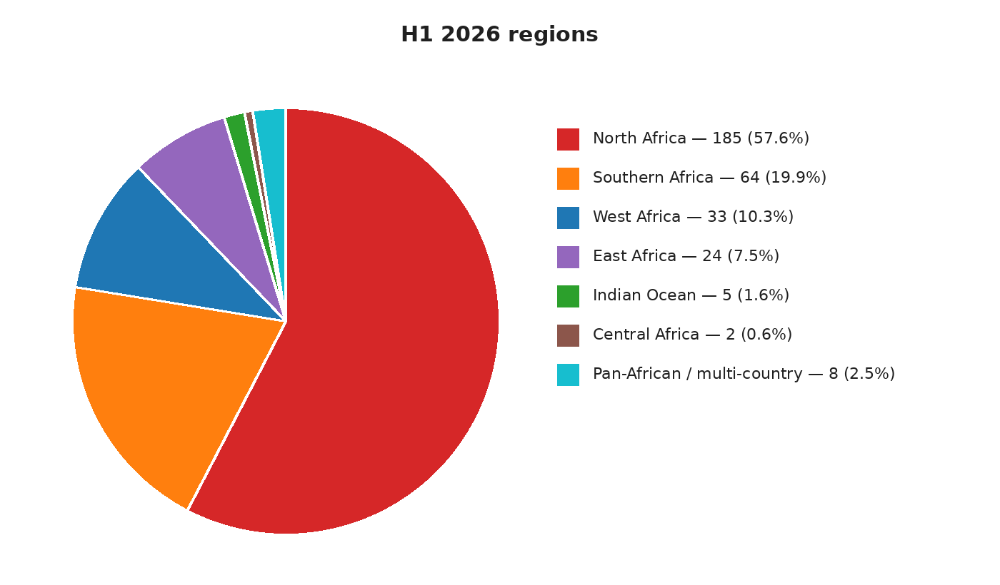
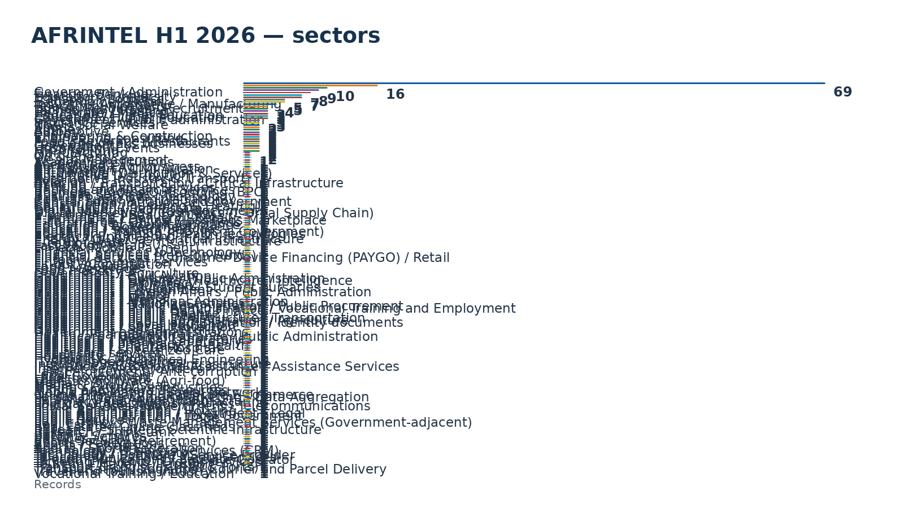
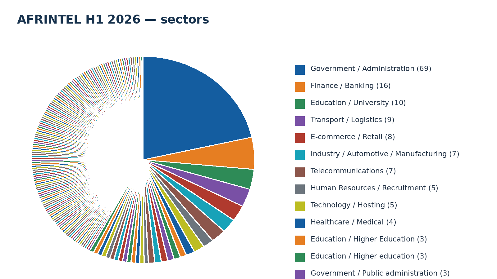
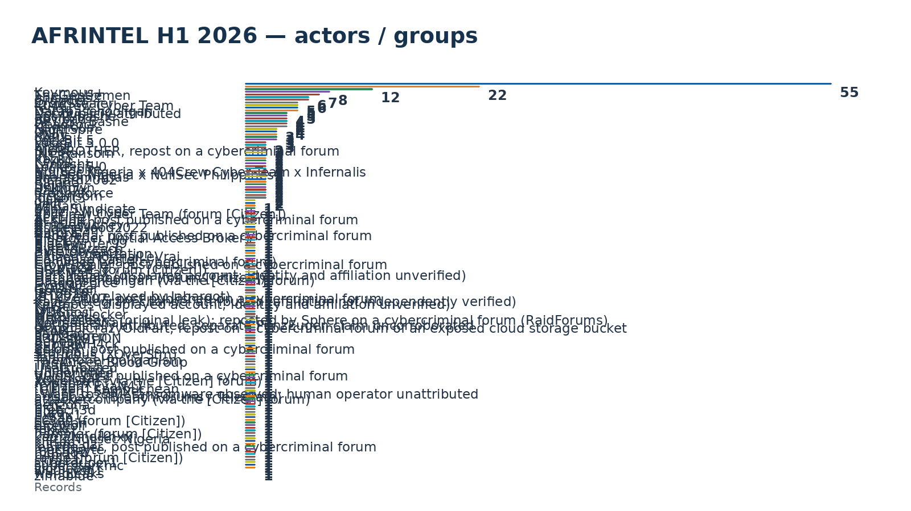

# AFRINTEL H1 2026 cyber threat report

From 1 January to 30 June 2026, AFRINTEL records **320 documented incidents or cases** in the validated monthly corpus.

## Semester breakdown

| Type | Count | Share |
|---|---:|---:|
| Data Leak | 140 | 43.8% |
| Ransomware | 115 | 35.9% |
| DDoS | 52 | 16.2% |
| Access Sale | 9 | 2.8% |
| Operational Fraud | 1 | 0.3% |
| System Intrusion | 2 | 0.6% |
| Defacement | 1 | 0.3% |
| **Total** | **320** | **100.0%** |

## Monthly totals

| Month | Records |
|---|---:|
| January | 30 |
| February | 27 |
| March | 45 |
| April | 65 |
| May | 107 |
| June | 47 |

## Methodology

The figures are derived from the French-first victim files, checked against the English files and reused in comparisons and STIX. Monthly assignment follows publication or first documented observation; no compromise date is inferred. April contains **65 canonical records** in the current synchronized monthly pair.

## Visualisations

[Complete H1 2026 visual intelligence set](../../visual-intelligence/H1-2026/README.md)

