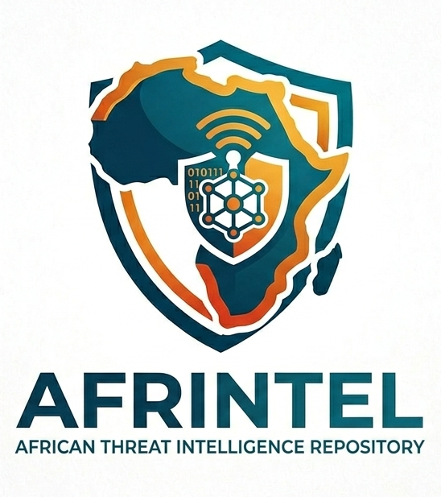

<p align="left">


# AFRINTEL - African Threat Intelligence
</p>

👉🏾 [Version française](README_FR.md)

AFRINTEL is an open-source CTI project tracking cyber incidents and threat activity affecting African organisations and ecosystems. It covers all 54 African countries and documents nine canonical incident types:

**Ransomware · Data Leak · Access Sale · DDoS · Defacement · Account Takeover · System Intrusion · Malware · Operational Fraud**

AFRINTEL separates incident type, evidence status, confidence, impact and chronology. A criminal claim is not silently treated as a confirmed compromise.

| Countries monitored | Period covered | Main formats |
| :---: | :---: | :--- |
| 54 | 2024–2026 | Markdown · STIX 2.1 · Visual CTI |

> The repository records what was observed in leak sites, underground forums, public statements and OSINT sources. Each victim record retains its evidence status at the latest review.

## Latest reports

### October 2026

The October corpus contains **48 records**: **23 Data Leak**, **17 Ransomware**, **5 System Intrusion** and **3 Access Sale** cases.

- [CTI report](CyberAttackAfrica/2026/10-october/README.md)
- [Victim records](CyberAttackAfrica/2026/10-october/victims.md)
- [Statistics](statistics/2026/10-october/README.md)
- [September–October comparison](comparison/2026/09-september-october/README.md)
- [STIX 2.1 / OpenCTI bundle](stix/2026/10-october/afrintel_october_2026_opencti.json)

### First half of 2026

The validated H1 corpus contains **320 observations**: **115 ransomware**, **140 data leaks**, **9 access-sale records**, **52 DDoS claims**, **2 system intrusions**, **1 defacement** and **1 operational-fraud record**.

- [H1 English report](CyberAttackAfrica/2026/README_H1.md)
- [Rapport S1 français](CyberAttackAfrica/2026/README_H1_FR.md)
- [H1 STIX bundle](stix/2026/afrintel_h1_2026_opencti.json)
- [H1 visual intelligence](visual-intelligence/H1-2026/README.md)

## Reports and datasets

| Resource | Access |
| :--- | :--- |
| Annual CTI reports | [2024](CyberAttackAfrica/2024/README.md) · [2025](CyberAttackAfrica/2025/README.md) |
| Monthly CTI reports | [2026 directory](CyberAttackAfrica/2026/) |
| Monthly statistics | [2026 directory](statistics/2026/) |
| Month-over-month comparisons | [2026 directory](comparison/2026/) |
| Visual intelligence | [Dashboards and charts](visual-intelligence/) |
| STIX / OpenCTI exports | [STIX directory](stix/) |
| STIX generation and validation | [Scripts guide](scripts/README.md) |

## Source-of-truth workflow

For each month, `victims_FR.md` is edited first and `victims.md` is synchronised afterward. The bilingual pair is validated before statistics, reports, visualisations or STIX bundles are generated.

The repository preserves:

- observed facts, assumptions and unknowns as separate analytical states;
- claim, sample-publication, full-publication and confirmation statuses;
- French/English parity for dates, victims, countries, actors, types and figures;
- deduplicated totals for multi-country incidents;
- aggregated public reporting without raw personal data, secrets or illicit access instructions.

## Project structure

```text
AFRINTEL/
├── CyberAttackAfrica/   # Monthly victim lists and CTI reports
├── statistics/          # Country, sector, actor and type statistics
├── comparison/          # Month-over-month comparisons
├── visual-intelligence/ # Maps, dashboards and charts
├── stix/                # STIX 2.1 / OpenCTI bundles
├── scripts/             # Generation and validation utilities
└── workflows/           # Automation workflows
```

## Author and licence

**Adama ASSIONGBON** — SOC & Cyber Threat Intelligence Consultant

[LinkedIn](https://www.linkedin.com/in/adama-assiongbon-9029893a/) · [MIT License](LICENSE)
