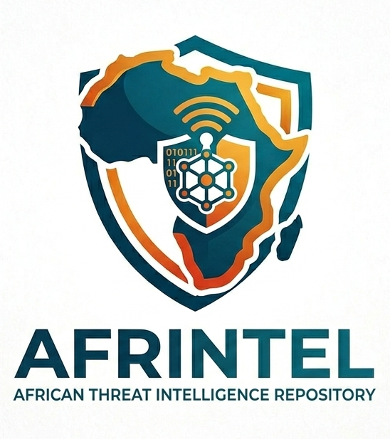

<p align="left">


# AFRINTEL - African Threat Intelligence
</p>

👉🏾 [English version](README.md)

AFRINTEL est un projet CTI open source consacré au suivi des incidents cyber et de l’activité des menaces visant les organisations et écosystèmes africains. Le projet couvre les 54 pays africains et documente neuf types d’incidents canoniques :

**Ransomware · Fuite de données · Vente d’accès · DDoS · Défiguration · Prise de contrôle de compte · Intrusion système · Malware · Fraude opérationnelle**

AFRINTEL sépare le type d’incident, le statut de preuve, la confiance, l’impact et la chronologie. Une revendication criminelle n’est pas automatiquement présentée comme une compromission confirmée.

| Pays surveillés | Période couverte | Formats principaux |
| :---: | :---: | :--- |
| 54 | 2024–2026 | Markdown · STIX 2.1 · CTI visuelle |

> Le dépôt recense les éléments observés sur les sites de fuite, forums clandestins, communications publiques et sources OSINT. Chaque fiche conserve son statut de preuve au moment de la dernière revue.

## Derniers rapports

### Octobre 2026

Le corpus d’octobre contient **48 dossiers** : **23 fuites de données**, **17 ransomware**, **5 intrusions système** et **3 ventes d’accès**.

- [Rapport CTI](CyberAttackAfrica/2026/10-october/README_FR.md)
- [Fiches victimes](CyberAttackAfrica/2026/10-october/victims_FR.md)
- [Statistiques](statistics/2026/10-october/README_FR.md)
- [Comparaison septembre–octobre](comparison/2026/09-september-october/README_FR.md)
- [Bundle STIX 2.1 / OpenCTI](stix/2026/10-october/afrintel_october_2026_opencti.json)

### Premier semestre 2026

Le corpus validé du S1 contient **320 observations** : **115 ransomware**, **140 fuites de données**, **9 ventes d’accès**, **52 revendications DDoS**, **2 intrusions système**, **1 défiguration** et **1 fraude opérationnelle**.

- [Rapport S1 français](CyberAttackAfrica/2026/README_H1_FR.md)
- [H1 English report](CyberAttackAfrica/2026/README_H1.md)
- [Bundle STIX du S1](stix/2026/afrintel_h1_2026_opencti.json)
- [Intelligence visuelle du S1](visual-intelligence/H1-2026/README.md)

## Rapports et jeux de données

| Ressource | Accès |
| :--- | :--- |
| Rapports CTI annuels | [2024](CyberAttackAfrica/2024/README_FR.md) · [2025](CyberAttackAfrica/2025/README_FR.md) |
| Rapports CTI mensuels | [Répertoire 2026](CyberAttackAfrica/2026/) |
| Statistiques mensuelles | [Répertoire 2026](statistics/2026/) |
| Comparaisons mensuelles | [Répertoire 2026](comparison/2026/) |
| Intelligence visuelle | [Tableaux de bord et graphiques](visual-intelligence/) |
| Exports STIX / OpenCTI | [Répertoire STIX](stix/) |
| Génération et validation STIX | [Guide des scripts](scripts/README.md) |

## Workflow et source de vérité

Pour chaque mois, `victims_FR.md` est d’abord édité, puis `victims.md` est synchronisé. Le couple bilingue est contrôlé avant la génération des statistiques, rapports, visualisations ou bundles STIX.

Le dépôt préserve :

- la séparation entre faits observés, hypothèses et inconnues ;
- les statuts de revendication, échantillon publié, divulgation complète et confirmation ;
- la parité FR/EN pour les dates, victimes, pays, acteurs, types et chiffres ;
- le comptage dédoublonné des incidents multi-pays ;
- une publication agrégée sans données personnelles brutes, secrets ni instructions d’accès illicite.

## Structure du projet

```text
AFRINTEL/
├── CyberAttackAfrica/   # Fiches victimes et rapports CTI mensuels
├── statistics/          # Statistiques pays, secteur, acteur et type
├── comparison/          # Comparaisons mensuelles
├── visual-intelligence/ # Cartes, tableaux de bord et graphiques
├── stix/                # Bundles STIX 2.1 / OpenCTI
├── scripts/             # Outils de génération et de validation
└── workflows/           # Workflows d’automatisation
```

## Auteur et licence

**Adama ASSIONGBON** — Consultant SOC & Cyber Threat Intelligence

[LinkedIn](https://www.linkedin.com/in/adama-assiongbon-9029893a/) · [Licence MIT](LICENSE)
