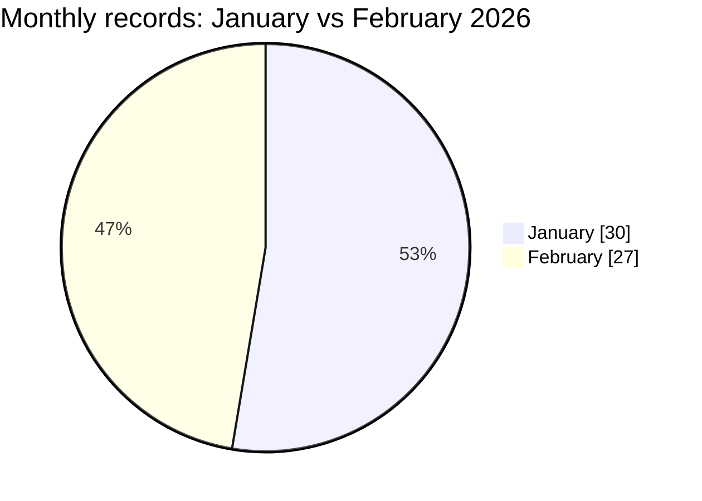

# AFRINTEL comparison: January and February 2026

## Comparable scope

This comparison uses the validated bilingual victim files: **30 records in January** and **27 records in February**. Each record is counted once in its publication or first documented observation month. January excludes the uncorroborated Kenyan “National Water Authority” claim; multi-country records are not duplicated.

| Indicator | January | February | Change |
|---|---:|---:|---:|
| Total incidents | **30** | **27** | **-3 (-10.0%)** |
| Ransomware | 18 | 20 | **+2 (+11.1%)** |
| Data Leak | 10 | 7 | **-3 (-30.0%)** |
| Access Sale | 1 | 0 | -1 |
| Defacement | 1 | 0 | -1 |
| Account Takeover | 0 | 0 | 0 |
| System Intrusion | 0 | 0 | 0 |
| Malware | 0 | 0 | 0 |
| Operational Fraud | 0 | 0 | 0 |

## Countries represented

| Country code | January | February |
|---|---:|---:|
| ZA | 6 | 3 |
| EG | 4 | 7 |
| KE | 4 | 1 |
| MA | 3 | 3 |
| GH | 1 | 2 |
| MU | 1 | 1 |
| NG | 0 | 2 |
| SN | 1 | 1 |
| TN | 2 | 1 |
| TZ | 1 | 1 |
| CI | 0 | 1 |
| DZ | 4 | 0 |
| MZ | 1 | 0 |
| NA | 0 | 1 |
| NE | 1 | 0 |
| SD | 0 | 1 |
| SO | 0 | 1 |
| TG | 1 | 0 |
| MULTI: NG/CI | 0 | 1 |

February includes one multi-country record counted once globally; it is shown separately rather than added to both country totals.

## CTI reading

The corpus falls from 30 to 27 records, while ransomware rises from 18 to 20 and data leaks fall from 10 to 7. This is a change in AFRINTEL documented visibility and composition; it is not, by itself, evidence of a change in the underlying number of compromises.
