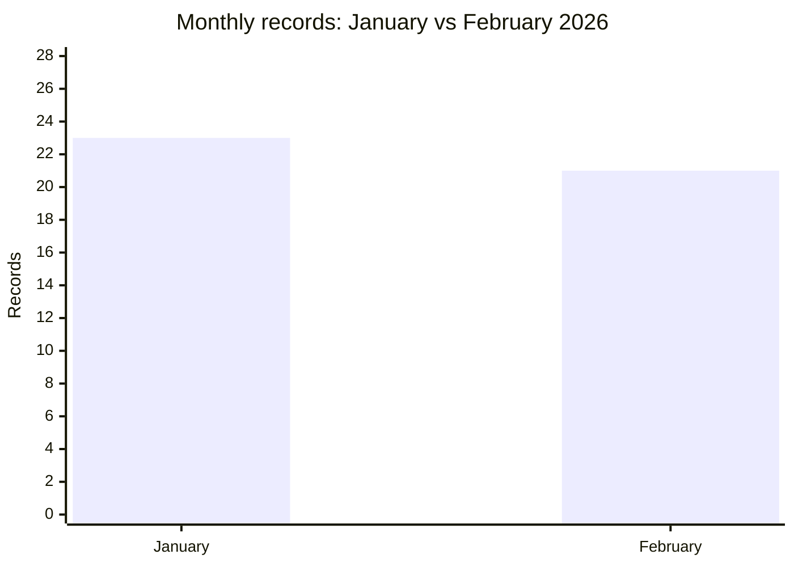

# AFRINTEL comparison: January and February 2026

## Comparable scope

This comparison uses the validated bilingual victim files: **23 records in January** and **21 records in February**. Each record is counted once in its publication or first documented observation month. Earlier or later discovery does not move a record between months.

| Indicator | January | February | Change |
|---|---:|---:|---:|
| Total incidents | **23** | **21** | **-2 (-8.7%)** |
| Ransomware | 19 | 20 | +1 |
| Data Leak | 2 | 1 | -1 |
| Access Sale | 1 | 0 | -1 |
| Defacement | 1 | 0 | -1 |

## Countries represented

| Country code | January | February |
|---|---:|---:|
| ZA | 6 | 3 |
| EG | 3 | 4 |
| KE | 4 | 1 |
| MA | 2 | 1 |
| GH | 0 | 2 |
| MU | 1 | 1 |
| NG | 0 | 2 |
| SN | 1 | 1 |
| TN | 1 | 1 |
| TZ | 1 | 1 |
| CI | 0 | 1 |
| DZ | 1 | 0 |
| MZ | 1 | 0 |
| NA | 0 | 1 |
| NE | 1 | 0 |
| SD | 0 | 1 |
| SO | 0 | 1 |
| TG | 1 | 0 |

## CTI reading

The corpus changes from 23 to 21 records. This is a change in AFRINTEL documented visibility and composition; it is not, by itself, evidence of a change in the underlying number of compromises.
