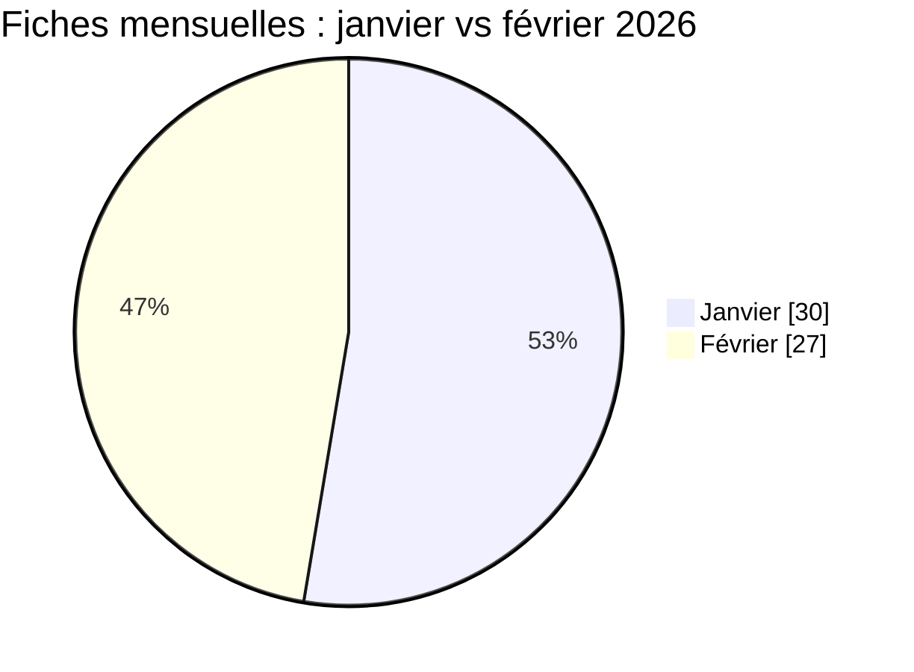

# Comparaison AFRINTEL : janvier et février 2026

## Périmètre comparable

Cette comparaison utilise les fichiers victimes bilingues validés : **30 fiches en janvier** et **27 fiches en février**. Chaque fiche est comptée une fois dans son mois de publication ou de première observation documentée. Le corpus de janvier exclut la revendication kényane non corroborée « National Water Authority » ; les fiches multi-pays ne sont pas dupliquées.

| Indicateur | Janvier | Février | Évolution |
|---|---:|---:|---:|
| Total incidents | **30** | **27** | **-3 (-10,0 %)** |
| Ransomware | 18 | 20 | **+2 (+11,1 %)** |
| Fuite de données | 10 | 7 | **-3 (-30,0 %)** |
| Vente d'accès | 1 | 0 | -1 |
| Défacement | 1 | 0 | -1 |
| DDoS | 0 | 0 | 0 |
| Prise de contrôle de compte | 0 | 0 | 0 |
| Intrusion système | 0 | 0 | 0 |
| Malware | 0 | 0 | 0 |
| Fraude opérationnelle | 0 | 0 | 0 |

## Countries represented

| Country code | January | February |
|---|---:|---:|
| ZA | 6 | 3 |
| EG | 4 | 7 |
| KE | 4 | 1 |
| MA | 3 | 3 |
| GH | 1 | 2 |
| MU | 1 | 1 |
| NG | 0 | 2 |
| SN | 1 | 1 |
| TN | 2 | 1 |
| TZ | 1 | 1 |
| CI | 0 | 1 |
| DZ | 4 | 0 |
| MZ | 1 | 0 |
| NA | 0 | 1 |
| NE | 1 | 0 |
| SD | 0 | 1 |
| SO | 0 | 1 |
| TG | 1 | 0 |
| MULTI : NG/CI | 0 | 1 |

> Février comprend une fiche multi-pays comptée une seule fois dans le total global ; elle est présentée séparément et n'est pas ajoutée aux deux pays.

## CTI reading

Le corpus passe de 30 à 27 fiches, tandis que les publications ransomware passent de 18 à 20 et les fuites de données de 10 à 7. Il s'agit d'une évolution de la visibilité et de la composition documentées par AFRINTEL ; elle ne constitue pas, à elle seule, une preuve d'une évolution du nombre réel de compromissions.
