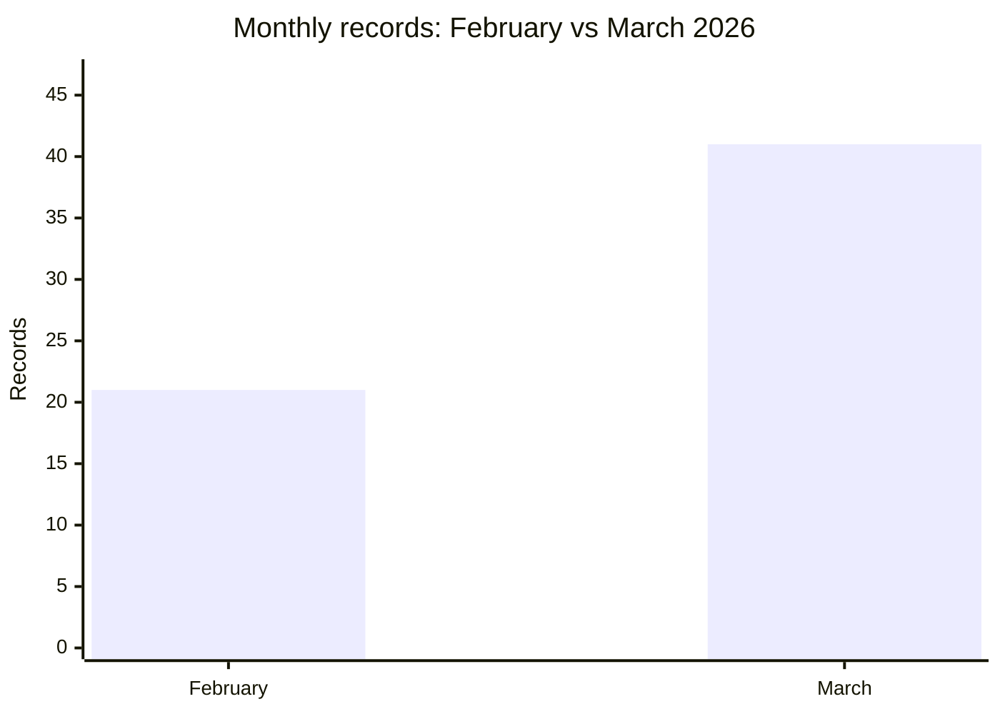

# AFRINTEL comparison: February and March 2026

## Comparable scope

This comparison uses the validated bilingual victim files: **21 records in February** and **41 records in March**. Each record is counted once in its publication or first documented observation month. Earlier or later discovery does not move a record between months.

| Indicator | February | March | Change |
|---|---:|---:|---:|
| Total incidents | **21** | **41** | **+20 (+95.2%)** |
| Ransomware | 20 | 19 | -1 |
| Data Leak | 1 | 21 | +20 |
| Operational Fraud | 0 | 1 | +1 |

## Countries represented

| Country code | February | March |
|---|---:|---:|
| ZA | 3 | 14 |
| EG | 4 | 8 |
| MA | 1 | 8 |
| NG | 2 | 2 |
| GH | 2 | 0 |
| NA | 1 | 1 |
| SN | 1 | 1 |
| TN | 1 | 1 |
| TZ | 1 | 1 |
| CI | 1 | 0 |
| DZ | 0 | 1 |
| GN | 0 | 1 |
| KE | 1 | 0 |
| MG | 0 | 1 |
| MU | 1 | 0 |
| SD | 1 | 0 |
| SO | 1 | 0 |
| ZM | 0 | 1 |

## CTI reading

The corpus changes from 21 to 41 records. This is a change in AFRINTEL documented visibility and composition; it is not, by itself, evidence of a change in the underlying number of compromises.
