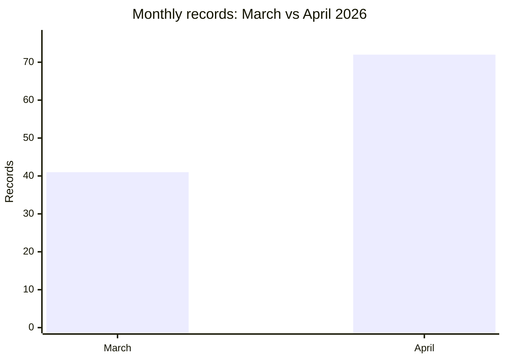

# AFRINTEL comparison: March and April 2026

## Comparable scope

This comparison uses the validated bilingual victim files: **41 records in March** and **72 records in April**. Each record is counted once in its publication or first documented observation month. Earlier or later discovery does not move a record between months.

| Indicator | March | April | Change |
|---|---:|---:|---:|
| Total incidents | **41** | **72** | **+31 (+75.6%)** |
| Ransomware | 19 | 21 | +2 |
| Data Leak | 21 | 40 | +19 |
| Access Sale | 0 | 1 | +1 |
| DDoS | 0 | 9 | +9 |
| Operational Fraud | 1 | 1 | 0 |

## Countries represented

| Country code | March | April |
|---|---:|---:|
| EG | 8 | 19 |
| MA | 8 | 17 |
| ZA | 14 | 10 |
| NG | 2 | 5 |
| DZ | 1 | 4 |
| TN | 1 | 4 |
| KE | 0 | 3 |
| GH | 0 | 2 |
| SN | 1 | 1 |
| ZM | 1 | 1 |
| AO | 0 | 1 |
| BJ | 0 | 1 |
| BW | 0 | 1 |
| ET | 0 | 1 |
| GN | 1 | 0 |
| MG | 1 | 0 |
| NA | 1 | 0 |
| RW | 0 | 1 |
| SC | 0 | 1 |
| SD | 0 | 1 |
| TZ | 1 | 0 |
| UG | 0 | 1 |

## CTI reading

The corpus changes from 41 to 72 records. This is a change in AFRINTEL documented visibility and composition; it is not, by itself, evidence of a change in the underlying number of compromises.
