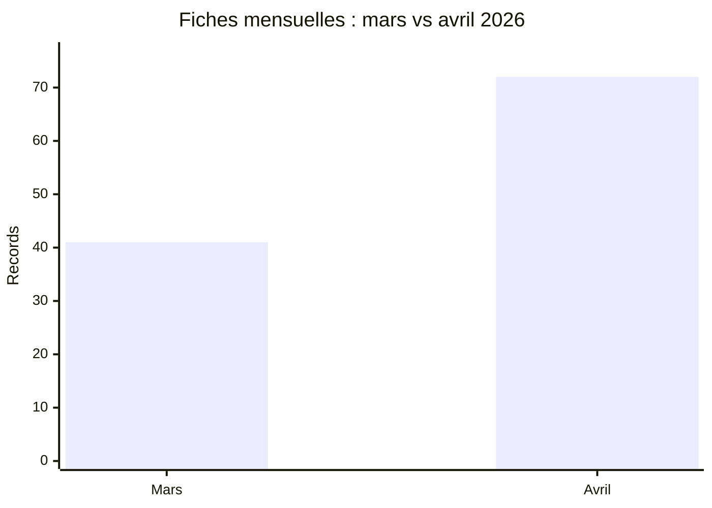

# Comparaison AFRINTEL : mars et avril 2026

## Périmètre comparable

Cette comparaison utilise les fichiers victimes bilingues validés : **41 fiches en mars** et **72 fiches en avril**. Chaque fiche est comptée une fois dans son mois de publication ou de première observation documentée. Une découverte tardive ne déplace pas la fiche entre les mois.

| Indicateur | Mars | Avril | Évolution |
|---|---:|---:|---:|
| Total incidents | **41** | **72** | **+31 (+75.6%)** |
| Ransomware | 19 | 21 | +2 |
| Fuite de données | 21 | 40 | +19 |
| Vente d'accès | 0 | 1 | +1 |
| DDoS | 0 | 9 | +9 |
| Fraude opérationnelle | 1 | 1 | 0 |

## Countries represented

| Country code | March | April |
|---|---:|---:|
| EG | 8 | 19 |
| MA | 8 | 17 |
| ZA | 14 | 10 |
| NG | 2 | 5 |
| DZ | 1 | 4 |
| TN | 1 | 4 |
| KE | 0 | 3 |
| GH | 0 | 2 |
| SN | 1 | 1 |
| ZM | 1 | 1 |
| AO | 0 | 1 |
| BJ | 0 | 1 |
| BW | 0 | 1 |
| ET | 0 | 1 |
| GN | 1 | 0 |
| MG | 1 | 0 |
| NA | 1 | 0 |
| RW | 0 | 1 |
| SC | 0 | 1 |
| SD | 0 | 1 |
| TZ | 1 | 0 |
| UG | 0 | 1 |

## CTI reading

Le corpus évolue de 41 à 72 fiches. Il s agit d une évolution de la visibilité et de la composition documentées par AFRINTEL ; elle ne constitue pas, à elle seule, une preuve d une évolution du nombre réel de compromissions.
