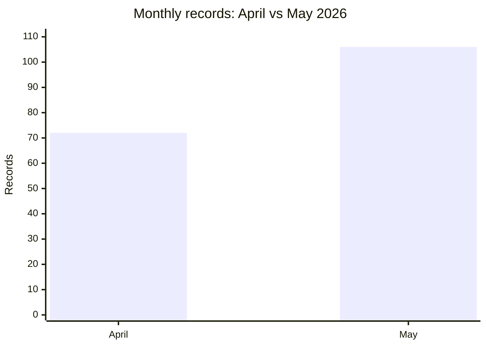

# AFRINTEL comparison: April and May 2026

## Comparable scope

This comparison uses the validated bilingual victim files: **72 records in April** and **106 records in May**. Each record is counted once in its publication or first documented observation month. Earlier or later discovery does not move a record between months.

| Indicator | April | May | Change |
|---|---:|---:|---:|
| Total incidents | **72** | **106** | **+34 (+47.2%)** |
| Ransomware | 21 | 17 | -4 |
| Data Leak | 40 | 44 | +4 |
| Access Sale | 1 | 1 | 0 |
| DDoS | 9 | 43 | +34 |
| System Intrusion | 0 | 1 | +1 |
| Operational Fraud | 1 | 0 | -1 |

## Countries represented

| Country code | April | May |
|---|---:|---:|
| MA | 17 | 53 |
| EG | 19 | 18 |
| ZA | 10 | 16 |
| NG | 5 | 5 |
| TN | 4 | 5 |
| DZ | 4 | 2 |
| KE | 3 | 2 |
| ET | 1 | 2 |
| GH | 2 | 1 |
| SN | 1 | 1 |
| TZ | 0 | 2 |
| AO | 1 | 0 |
| BJ | 1 | 0 |
| BW | 1 | 0 |
| CI | 0 | 1 |
| LR | 0 | 1 |
| LY | 0 | 1 |
| MZ | 0 | 1 |
| RW | 1 | 0 |
| SC | 1 | 0 |
| SD | 1 | 0 |
| SL | 0 | 1 |
| TG | 0 | 1 |
| UG | 1 | 0 |
| ZM | 1 | 0 |
| ZW | 0 | 1 |

## CTI reading

The corpus changes from 72 to 106 records. This is a change in AFRINTEL documented visibility and composition; it is not, by itself, evidence of a change in the underlying number of compromises.
