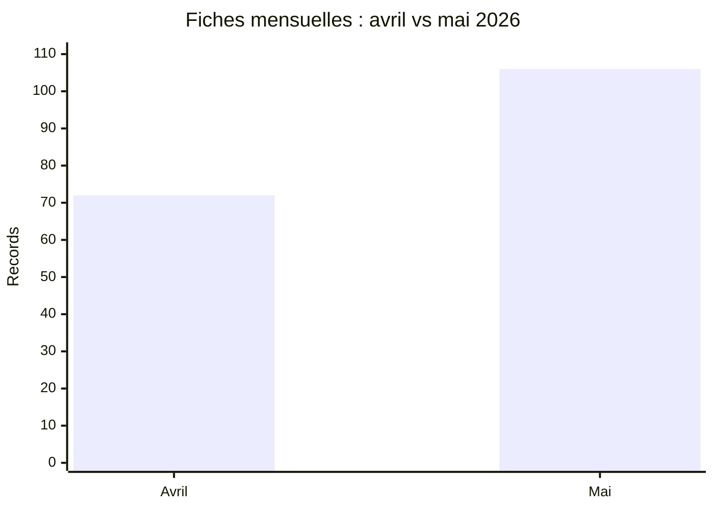

# Comparaison AFRINTEL : avril et mai 2026

## Périmètre comparable

Cette comparaison utilise les fichiers victimes bilingues validés : **72 fiches en avril** et **106 fiches en mai**. Chaque fiche est comptée une fois dans son mois de publication ou de première observation documentée. Une découverte tardive ne déplace pas la fiche entre les mois.

| Indicateur | Avril | Mai | Évolution |
|---|---:|---:|---:|
| Total incidents | **72** | **106** | **+34 (+47.2%)** |
| Ransomware | 21 | 17 | -4 |
| Fuite de données | 40 | 44 | +4 |
| Vente d'accès | 1 | 1 | 0 |
| DDoS | 9 | 43 | +34 |
| Intrusion système | 0 | 1 | +1 |
| Fraude opérationnelle | 1 | 0 | -1 |

## Countries represented

| Country code | April | May |
|---|---:|---:|
| MA | 17 | 53 |
| EG | 19 | 18 |
| ZA | 10 | 16 |
| NG | 5 | 5 |
| TN | 4 | 5 |
| DZ | 4 | 2 |
| KE | 3 | 2 |
| ET | 1 | 2 |
| GH | 2 | 1 |
| SN | 1 | 1 |
| TZ | 0 | 2 |
| AO | 1 | 0 |
| BJ | 1 | 0 |
| BW | 1 | 0 |
| CI | 0 | 1 |
| LR | 0 | 1 |
| LY | 0 | 1 |
| MZ | 0 | 1 |
| RW | 1 | 0 |
| SC | 1 | 0 |
| SD | 1 | 0 |
| SL | 0 | 1 |
| TG | 0 | 1 |
| UG | 1 | 0 |
| ZM | 1 | 0 |
| ZW | 0 | 1 |

## CTI reading

Le corpus évolue de 72 à 106 fiches. Il s agit d une évolution de la visibilité et de la composition documentées par AFRINTEL ; elle ne constitue pas, à elle seule, une preuve d une évolution du nombre réel de compromissions.
