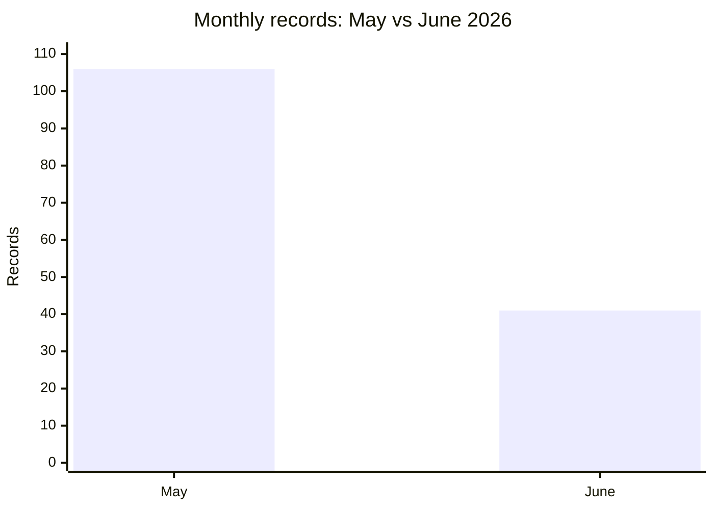

# AFRINTEL comparison: May and June 2026

## Comparable scope

This comparison uses the validated bilingual victim files: **106 records in May** and **41 records in June**. Each record is counted once in its publication or first documented observation month. Earlier or later discovery does not move a record between months.

| Indicator | May | June | Change |
|---|---:|---:|---:|
| Total incidents | **106** | **41** | **-65 (-61.3%)** |
| Ransomware | 17 | 20 | +3 |
| Data Leak | 44 | 18 | -26 |
| Access Sale | 1 | 2 | +1 |
| DDoS | 43 | 0 | -43 |
| System Intrusion | 1 | 1 | 0 |

## Countries represented

| Country code | May | June |
|---|---:|---:|
| MA | 53 | 9 |
| ZA | 16 | 7 |
| EG | 18 | 4 |
| NG | 5 | 4 |
| TN | 5 | 3 |
| LY | 1 | 3 |
| KE | 2 | 1 |
| TZ | 2 | 1 |
| DZ | 2 | 0 |
| ET | 2 | 0 |
| GA | 0 | 2 |
| SN | 1 | 1 |
| ZW | 1 | 1 |
| BW | 0 | 1 |
| CI | 1 | 0 |
| GH | 1 | 0 |
| LR | 1 | 0 |
| MU | 0 | 1 |
| MZ | 1 | 0 |
| SL | 1 | 0 |
| TG | 1 | 0 |
| YT | 0 | 1 |

## CTI reading

The corpus changes from 106 to 41 records. This is a change in AFRINTEL documented visibility and composition; it is not, by itself, evidence of a change in the underlying number of compromises.
