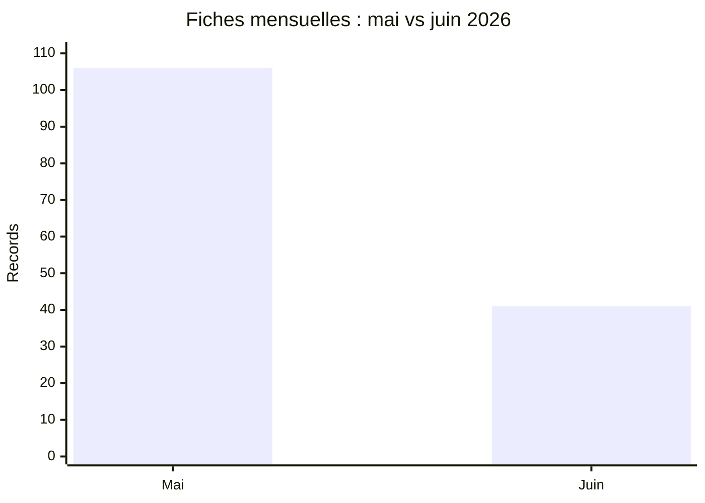

# Comparaison AFRINTEL : mai et juin 2026

## Périmètre comparable

Cette comparaison utilise les fichiers victimes bilingues validés : **106 fiches en mai** et **41 fiches en juin**. Chaque fiche est comptée une fois dans son mois de publication ou de première observation documentée. Une découverte tardive ne déplace pas la fiche entre les mois.

| Indicateur | Mai | Juin | Évolution |
|---|---:|---:|---:|
| Total incidents | **106** | **41** | **-65 (-61.3%)** |
| Ransomware | 17 | 20 | +3 |
| Fuite de données | 44 | 18 | -26 |
| Vente d'accès | 1 | 2 | +1 |
| DDoS | 43 | 0 | -43 |
| Intrusion système | 1 | 1 | 0 |

## Countries represented

| Country code | May | June |
|---|---:|---:|
| MA | 53 | 9 |
| ZA | 16 | 7 |
| EG | 18 | 4 |
| NG | 5 | 4 |
| TN | 5 | 3 |
| LY | 1 | 3 |
| KE | 2 | 1 |
| TZ | 2 | 1 |
| DZ | 2 | 0 |
| ET | 2 | 0 |
| GA | 0 | 2 |
| SN | 1 | 1 |
| ZW | 1 | 1 |
| BW | 0 | 1 |
| CI | 1 | 0 |
| GH | 1 | 0 |
| LR | 1 | 0 |
| MU | 0 | 1 |
| MZ | 1 | 0 |
| SL | 1 | 0 |
| TG | 1 | 0 |
| YT | 0 | 1 |

## CTI reading

Le corpus évolue de 106 à 41 fiches. Il s agit d une évolution de la visibilité et de la composition documentées par AFRINTEL ; elle ne constitue pas, à elle seule, une preuve d une évolution du nombre réel de compromissions.
