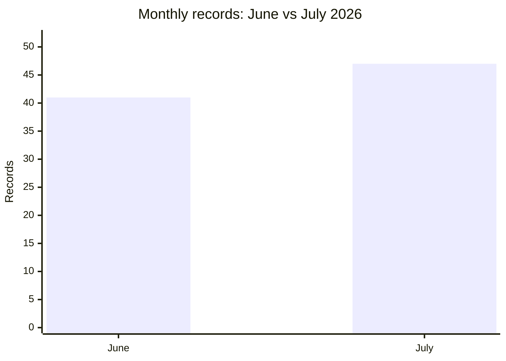

# AFRINTEL comparison: June and July 2026

## Comparable scope

This comparison uses the validated bilingual victim files: **41 records in June** and **47 records in July**. Each record is counted once in its publication or first documented observation month. Earlier or later discovery does not move a record between months.

| Indicator | June | July | Change |
|---|---:|---:|---:|
| Total incidents | **41** | **47** | **+6 (+14.6%)** |
| Ransomware | 20 | 18 | -2 |
| Data Leak | 18 | 21 | +3 |
| Access Sale | 2 | 6 | +4 |
| Defacement | 0 | 2 | +2 |
| System Intrusion | 1 | 0 | -1 |

## Countries represented

| Country code | June | July |
|---|---:|---:|
| MA | 9 | 6 |
| ZA | 7 | 7 |
| EG | 4 | 7 |
| TN | 3 | 7 |
| NG | 4 | 4 |
| CI | 0 | 5 |
| DZ | 0 | 4 |
| KE | 1 | 2 |
| LY | 3 | 0 |
| BW | 1 | 1 |
| CM | 0 | 2 |
| GA | 2 | 0 |
| GH | 0 | 2 |
| MU | 1 | 0 |
| SN | 1 | 0 |
| SS | 0 | 1 |
| TZ | 1 | 0 |
| YT | 1 | 0 |
| ZW | 1 | 0 |

## CTI reading

The corpus changes from 41 to 47 records. This is a change in AFRINTEL documented visibility and composition; it is not, by itself, evidence of a change in the underlying number of compromises.
