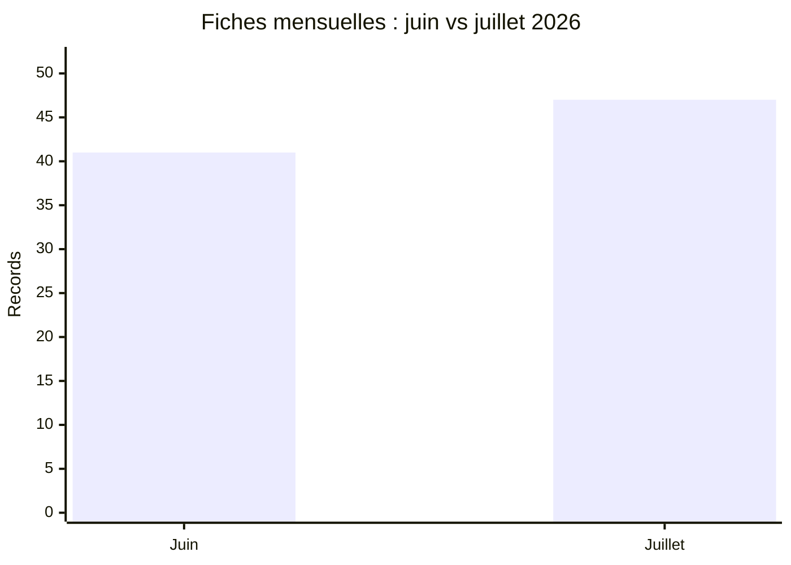

# Comparaison AFRINTEL : juin et juillet 2026

## Périmètre comparable

Cette comparaison utilise les fichiers victimes bilingues validés : **41 fiches en juin** et **47 fiches en juillet**. Chaque fiche est comptée une fois dans son mois de publication ou de première observation documentée. Une découverte tardive ne déplace pas la fiche entre les mois.

| Indicateur | Juin | Juillet | Évolution |
|---|---:|---:|---:|
| Total incidents | **41** | **47** | **+6 (+14.6%)** |
| Ransomware | 20 | 18 | -2 |
| Fuite de données | 18 | 21 | +3 |
| Vente d'accès | 2 | 6 | +4 |
| Défacement | 0 | 2 | +2 |
| Intrusion système | 1 | 0 | -1 |

## Countries represented

| Country code | June | July |
|---|---:|---:|
| MA | 9 | 6 |
| ZA | 7 | 7 |
| EG | 4 | 7 |
| TN | 3 | 7 |
| NG | 4 | 4 |
| CI | 0 | 5 |
| DZ | 0 | 4 |
| KE | 1 | 2 |
| LY | 3 | 0 |
| BW | 1 | 1 |
| CM | 0 | 2 |
| GA | 2 | 0 |
| GH | 0 | 2 |
| MU | 1 | 0 |
| SN | 1 | 0 |
| SS | 0 | 1 |
| TZ | 1 | 0 |
| YT | 1 | 0 |
| ZW | 1 | 0 |

## CTI reading

Le corpus évolue de 41 à 47 fiches. Il s agit d une évolution de la visibilité et de la composition documentées par AFRINTEL ; elle ne constitue pas, à elle seule, une preuve d une évolution du nombre réel de compromissions.
