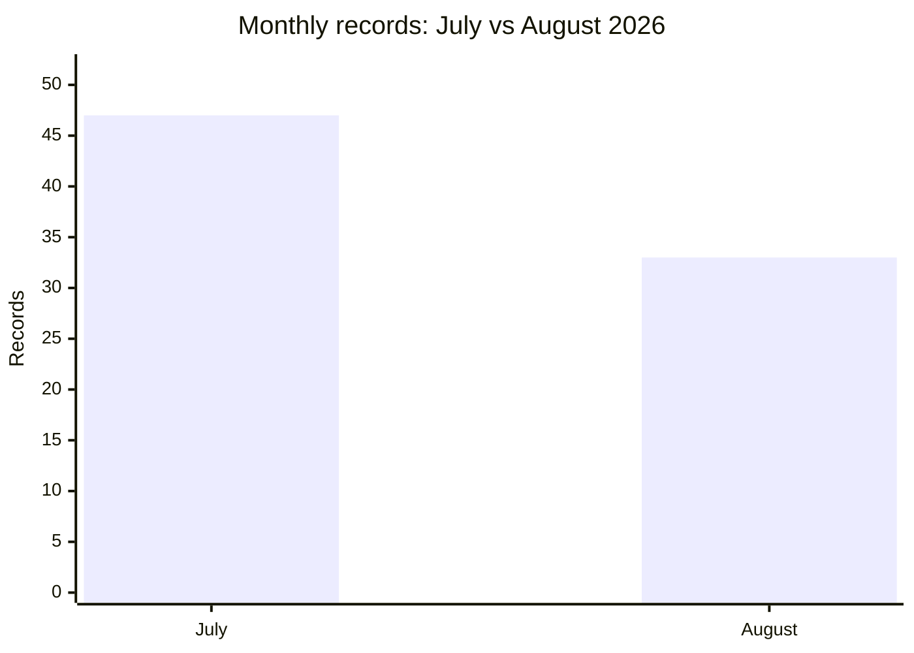

# AFRINTEL comparison: July and August 2026

## Comparable scope

This comparison uses the validated bilingual victim files: **47 records in July** and **33 records in August**. Each record is counted once in its publication or first documented observation month. Earlier or later discovery does not move a record between months.

| Indicator | July | August | Change |
|---|---:|---:|---:|
| Total incidents | **47** | **33** | **-14 (-29.8%)** |
| Ransomware | 18 | 18 | 0 |
| Data Leak | 21 | 14 | -7 |
| Access Sale | 6 | 1 | -5 |
| Defacement | 2 | 0 | -2 |

## Countries represented

| Country code | July | August |
|---|---:|---:|
| ZA | 7 | 12 |
| EG | 7 | 5 |
| DZ | 4 | 5 |
| MA | 6 | 3 |
| TN | 7 | 0 |
| NG | 4 | 2 |
| CI | 5 | 0 |
| KE | 2 | 2 |
| CM | 2 | 1 |
| GH | 2 | 0 |
| BW | 1 | 0 |
| GA | 0 | 1 |
| LY | 0 | 1 |
| MU | 0 | 1 |
| SS | 1 | 0 |

## CTI reading

The corpus changes from 47 to 33 records. This is a change in AFRINTEL documented visibility and composition; it is not, by itself, evidence of a change in the underlying number of compromises.
