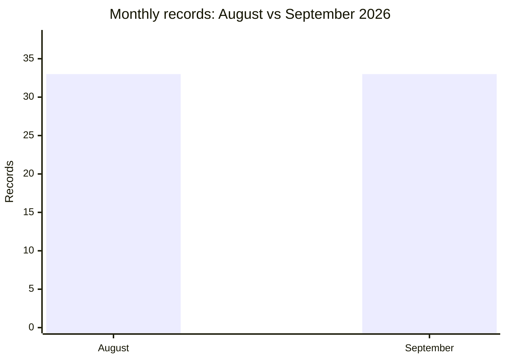

# AFRINTEL comparison: August and September 2026

## Comparable scope

This comparison uses the validated bilingual victim files: **33 records in August** and **33 records in September**. Each record is counted once in its publication or first documented observation month. Earlier or later discovery does not move a record between months.

| Indicator | August | September | Change |
|---|---:|---:|---:|
| Total incidents | **33** | **33** | **0 (0.0%)** |
| Ransomware | 18 | 20 | +2 |
| Data Leak | 14 | 11 | -3 |
| Access Sale | 1 | 0 | -1 |
| System Intrusion | 0 | 2 | +2 |

## Countries represented

| Country code | August | September |
|---|---:|---:|
| ZA | 12 | 9 |
| EG | 5 | 8 |
| MA | 3 | 4 |
| DZ | 5 | 0 |
| KE | 2 | 2 |
| NG | 2 | 2 |
| AO | 0 | 2 |
| CM | 1 | 0 |
| ET | 0 | 1 |
| GA | 1 | 0 |
| LY | 1 | 0 |
| ML | 0 | 1 |
| MU | 1 | 0 |
| NA | 0 | 1 |
| TN | 0 | 1 |
| TZ | 0 | 1 |
| UG | 0 | 1 |

## CTI reading

The corpus remains at 33 records in both August and September. This is a change in documented composition and incident types; it is not, by itself, evidence of a change in the underlying number of compromises.
