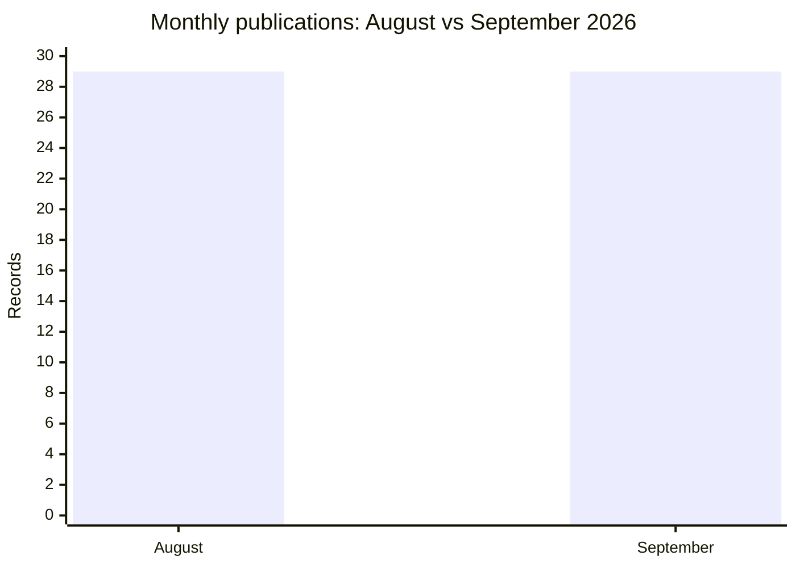

# AFRINTEL comparison: August and September 2026

👉🏾 [French version](README_FR.md)

## Comparable scope

This comparison covers the **29 records assigned to August** and the **29 publications dated in September**. The 12 earlier records integrated into the September corpus are excluded so that a monthly collection is not compared with an expanded retrospective corpus.

| Indicator | August | September | Change |
|---|---:|---:|---:|
| Monthly publications / records | 29 | 29 | 0 (stable) |
| Ransomware | 17 | 20 | +3 (+17.6%) |
| Data Leak | 11 | 7 | -4 (-36.4%) |
| System Intrusion | 0 | 2 | +2 (new) |
| Access Sale | 1 | 0 | -1 (-100.0%) |
| Other types | 0 | 0 | 0 |
| Represented countries | 10 | 12 | +2 |

## Incident types

| Type | August | September | Change |
|---|---:|---:|---:|
| Ransomware | 17 | 20 | +3 |
| Data Leak | 11 | 7 | -4 |
| System Intrusion | 0 | 2 | +2 |
| Access Sale | 1 | 0 | -1 |
| **Total** | **29** | **29** | **0** |

## Most represented countries

| Country | August | September | Change |
|---|---:|---:|---:|
| 🇿🇦 South Africa | 11 | 8 | -3 |
| 🇪🇬 Egypt | 4 | 7 | +3 |
| 🇩🇿 Algeria | 3 | 0 | -3 |
| 🇲🇦 Morocco | 3 | 3 | 0 |
| 🇰🇪 Kenya | 2 | 1 | -1 |
| 🇳🇬 Nigeria | 2 | 2 | 0 |

The remaining countries account for **4 August records** and **8 September records**. The change describes corpus visibility, not a demonstrated change in real compromises.

## CTI reading

September has the same documented volume as August, but a different composition: more ransomware claims, fewer data leaks and two System Intrusion records. The new category does not prove a real increase in intrusions; it reflects the qualification of available records. The 12 earlier incidents retrospectively integrated into September must remain outside this comparison.

[September statistics](../../../statistics/2026/09-september/README.md) · [September report](../../../CyberAttackAfrica/2026/09-september/README.md)
