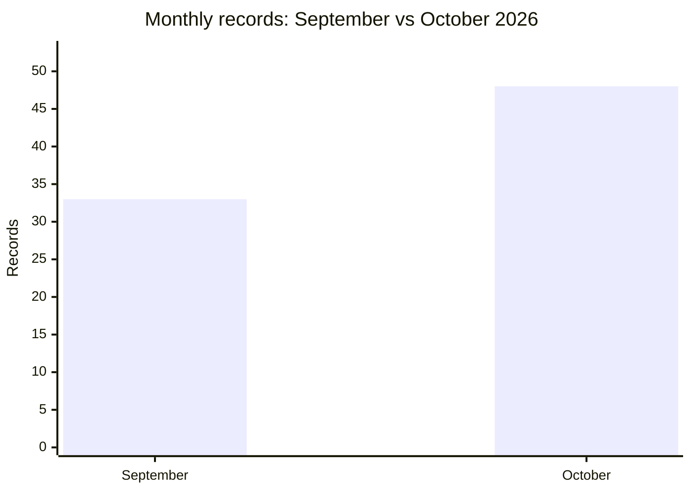

# AFRINTEL comparison: September and October 2026

## Comparable scope

This comparison uses the validated bilingual victim files: **33 records in September** and **48 records in October**. Each record is counted once in its publication or first documented observation month. Earlier or later discovery does not move a record between months.

| Indicator | September | October | Change |
|---|---:|---:|---:|
| Total incidents | **33** | **48** | **+15 (+45.5%)** |
| Ransomware | 20 | 17 | -3 |
| Data Leak | 11 | 23 | +12 |
| Access Sale | 0 | 3 | +3 |
| System Intrusion | 2 | 5 | +3 |

## Countries represented

| Country code | September | October |
|---|---:|---:|
| EG | 8 | 12 |
| ZA | 9 | 9 |
| MA | 4 | 12 |
| ET | 1 | 2 |
| NG | 2 | 1 |
| AO | 2 | 0 |
| CD | 0 | 2 |
| KE | 2 | 0 |
| MG | 0 | 2 |
| TN | 1 | 1 |
| BJ | 0 | 1 |
| CG | 0 | 1 |
| CI | 0 | 1 |
| GA | 0 | 1 |
| ML | 1 | 0 |
| MZ | 0 | 1 |
| NA | 1 | 0 |
| RW | 0 | 1 |
| SL | 0 | 1 |
| TZ | 1 | 0 |
| UG | 1 | 0 |

## CTI reading

The corpus changes from 33 to 48 records. This is a change in AFRINTEL documented visibility and composition; it is not, by itself, evidence of a change in the underlying number of compromises.
