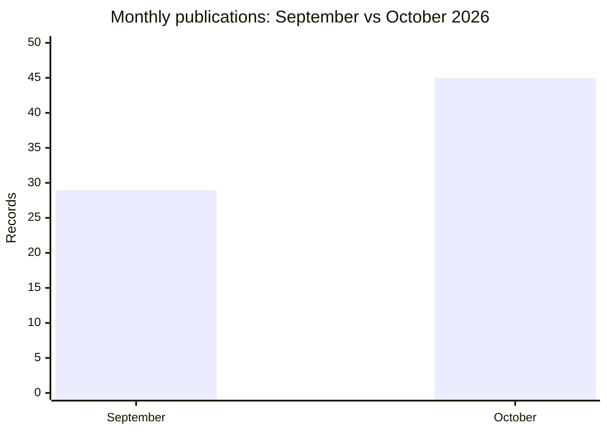

# AFRINTEL comparison: September and October 2026

👉🏾 [French version](README_FR.md)

## Comparable scope

This comparison uses the **29 publications dated in September** and the **45 records published or first documented in October**. Retrospectively identified records are excluded from both monthly denominators.

| Indicator | September | October | Change |
|---|---:|---:|---:|
| Monthly publications / records | 29 | 45 | +16 (+55.2%) |
| Ransomware | 20 | 17 | -3 (-15.0%) |
| Data Leak | 7 | 20 | +13 (+185.7%) |
| System Intrusion | 2 | 6 | +4 (+200.0%) |
| Access Sale | 0 | 2 | +2 (newly observed category) |
| **Total** | **29** | **45** | **+16** |

## CTI reading

October shows a larger documented corpus and a clear shift toward Data Leak records, while Ransomware decreases from 20 to 17. The change reflects the composition of the validated monthly collections. The seven historical records in the October register are excluded from this comparison.

[October statistics](../../../statistics/2026/10-october/README.md) · [October report](../../../CyberAttackAfrica/2026/10-october/README.md)
