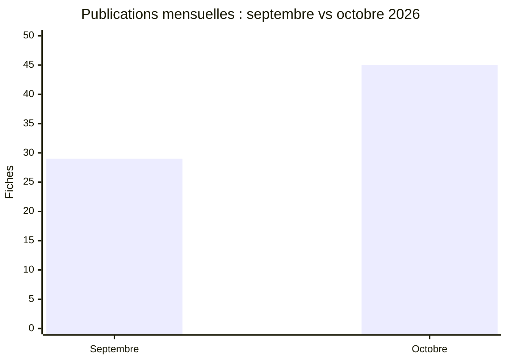

# Comparaison AFRINTEL : septembre et octobre 2026

👉🏾 [Version anglaise](README.md)

## Périmètre comparable

La comparaison utilise les **29 publications datées de septembre** et les **45 fiches publiées ou observées pour la première fois en octobre**. Les fiches découvertes rétrospectivement sont exclues des deux dénominateurs mensuels.

| Indicateur | Septembre | Octobre | Évolution |
|---|---:|---:|---:|
| Publications / fiches mensuelles | 29 | 45 | +16 (+55,2 %) |
| Ransomware | 20 | 17 | -3 (-15,0 %) |
| Data Leak | 7 | 20 | +13 (+185,7 %) |
| System Intrusion | 2 | 6 | +4 (+200,0 %) |
| Access Sale | 0 | 2 | +2 (nouvelle catégorie observée) |
| **Total** | **29** | **45** | **+16** |

## Lecture CTI

Octobre présente un corpus documentaire plus important et un déplacement marqué vers les fiches Data Leak, tandis que le Ransomware passe de 20 à 17 fiches. Cette évolution décrit la composition des collectes mensuelles validées. Les 7 fiches historiques du registre d’octobre sont exclues de cette comparaison.

[Statistiques d’octobre](../../../statistics/2026/10-october/README_FR.md) · [Rapport d’octobre](../../../CyberAttackAfrica/2026/10-october/README_FR.md)
