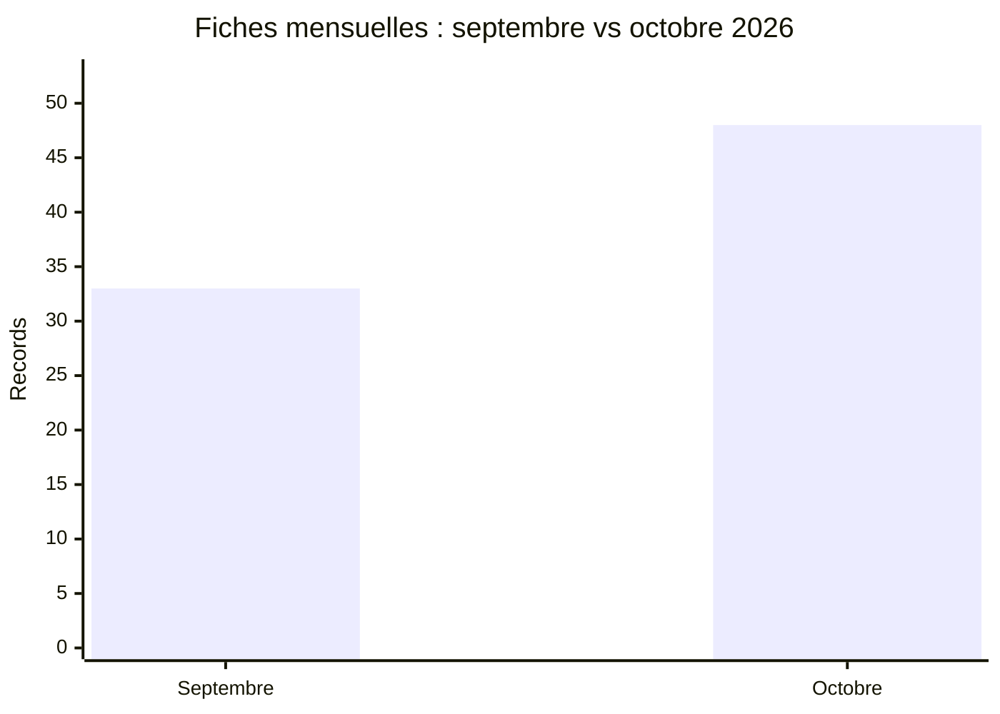

# Comparaison AFRINTEL : septembre et octobre 2026

## Périmètre comparable

Cette comparaison utilise les fichiers victimes bilingues validés : **33 fiches en septembre** et **48 fiches en octobre**. Chaque fiche est comptée une fois dans son mois de publication ou de première observation documentée. Une découverte tardive ne déplace pas la fiche entre les mois.

| Indicateur | Septembre | Octobre | Évolution |
|---|---:|---:|---:|
| Total incidents | **33** | **48** | **+15 (+45.5%)** |
| Ransomware | 20 | 17 | -3 |
| Fuite de données | 11 | 23 | +12 |
| Vente d'accès | 0 | 3 | +3 |
| Intrusion système | 2 | 5 | +3 |

## Countries represented

| Country code | September | October |
|---|---:|---:|
| EG | 8 | 12 |
| ZA | 9 | 9 |
| MA | 4 | 12 |
| ET | 1 | 2 |
| NG | 2 | 1 |
| AO | 2 | 0 |
| CD | 0 | 2 |
| KE | 2 | 0 |
| MG | 0 | 2 |
| TN | 1 | 1 |
| BJ | 0 | 1 |
| CG | 0 | 1 |
| CI | 0 | 1 |
| GA | 0 | 1 |
| ML | 1 | 0 |
| MZ | 0 | 1 |
| NA | 1 | 0 |
| RW | 0 | 1 |
| SL | 0 | 1 |
| TZ | 1 | 0 |
| UG | 1 | 0 |

## CTI reading

Le corpus évolue de 33 à 48 fiches. Il s agit d une évolution de la visibilité et de la composition documentées par AFRINTEL ; elle ne constitue pas, à elle seule, une preuve d une évolution du nombre réel de compromissions.
