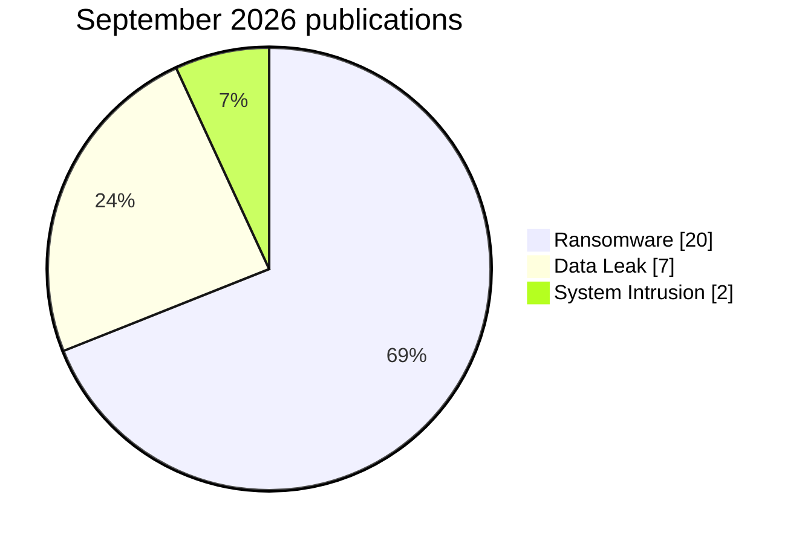

# AFRINTEL: cyber statistics in Africa

## September 2026

👉🏾 [Version française](./README_FR.md)

## Scope and source of truth

These statistics derive from the validated [victims_FR.md](../../../CyberAttackAfrica/2026/09-september/victims_FR.md) / [victims.md](../../../CyberAttackAfrica/2026/09-september/victims.md) pair. The main statistical cohort contains **29 publications dated in September 2026**. The **12 earlier records** integrated retrospectively are shown separately and do not inflate the monthly charts.

## September publication cohort: 29 records

| Type | Records | Share |
|---|---:|---:|
| Ransomware | 20 | 69.0% |
| Data Leak | 7 | 24.1% |
| System Intrusion | 2 | 6.9% |
| DDoS, Defacement, Access Sale, Account Takeover, Malware, Operational Fraud | 0 | 0.0% |
| **Total** | **29** | **100%** |

### Countries

| Country | Records | Share | Bar |
|---|---:|---:|---|
| 🇿🇦 South Africa | 8 | 27.6% | ████████ |
| 🇪🇬 Egypt | 7 | 24.1% | ███████ |
| 🇲🇦 Morocco | 3 | 10.3% | ███ |
| 🇳🇬 Nigeria | 2 | 6.9% | ██ |
| 🇦🇴 Angola | 2 | 6.9% | ██ |
| 🇳🇦 Namibia | 1 | 3.4% | █ |
| 🇹🇳 Tunisia | 1 | 3.4% | █ |
| 🇪🇹 Ethiopia | 1 | 3.4% | █ |
| 🇲🇱 Mali | 1 | 3.4% | █ |
| 🇹🇿 Tanzania | 1 | 3.4% | █ |
| 🇺🇬 Uganda | 1 | 3.4% | █ |
| 🇰🇪 Kenya | 1 | 3.4% | █ |
| **Total** | **29** | **100%** | |

### Normalised sectors

| Sector | Records | Share |
|---|---:|---:|
| Finance / Insurance / Compliance | 7 | 24.1% |
| Transport / Logistics | 4 | 13.8% |
| Real Estate / Construction / Architecture | 4 | 13.8% |
| Health | 3 | 10.3% |
| Government / Administration | 3 | 10.3% |
| Technology / Digital Services | 3 | 10.3% |
| Education | 2 | 6.9% |
| Other sectors | 3 | 10.3% |
| **Total** | **29** | **100%** |

### Displayed actors or accounts

| Label | Records |
|---|---:|
| krybit | 6 |
| TheGentlemen | 4 |
| BLACKLOCKS | 2 |
| N0n | 2 |
| lockbit5 | 2 |
| Other / unattributed | 13 |
| **Total** | **29** |

### Observation profile

The cohort contains **12 Claim - Unverified**, **12 records with a published sample**, **1 Data Fully Published**, **1 Victim Confirmed**, **1 Government Confirmed** and **2 indirect exposures recognised in the analysis**. These categories describe observation maturity; they do not automatically establish full exfiltration, encryption or operational impact.

## Complete corpus after retrospective integration

| Type | Records |
|---|---:|
| Ransomware | 24 |
| Data Leak | 10 |
| System Intrusion | 4 |
| Defacement | 2 |
| Access Sale | 1 |
| **Total** | **41** |

The complete corpus covers **14 countries**. This view supports editorial traceability and must not be confused with the September publication statistics.

## Arithmetic checks

Country total = sector total = incident-type total = **29** for the monthly cohort. The 12 retrospective records remain outside September chart denominators.

[September CTI report](../../../CyberAttackAfrica/2026/09-september/README.md) · [Victim records](../../../CyberAttackAfrica/2026/09-september/victims.md)
