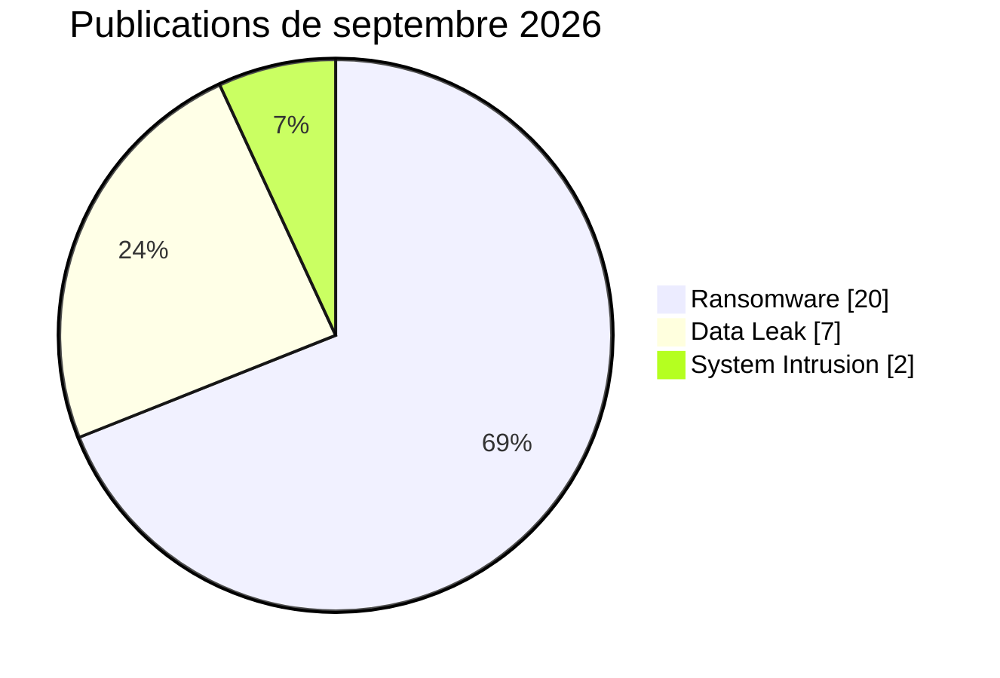

# AFRINTEL : statistiques cyber en Afrique

## Septembre 2026

👉🏾 [English version](./README.md)

## Périmètre et source de vérité

Ces statistiques dérivent du couple validé [victims_FR.md](../../../CyberAttackAfrica/2026/09-september/victims_FR.md) / [victims.md](../../../CyberAttackAfrica/2026/09-september/victims.md). La cohorte statistique principale contient **29 publications datées de septembre 2026**. Les **12 fiches antérieures** intégrées rétrospectivement sont présentées séparément et ne gonflent pas les graphiques mensuels.

## Cohorte de publications de septembre : 29 fiches

| Type | Fiches | Part |
|---|---:|---:|
| Ransomware | 20 | 69,0 % |
| Data Leak | 7 | 24,1 % |
| System Intrusion | 2 | 6,9 % |
| DDoS, Defacement, Access Sale, Account Takeover, Malware, Operational Fraud | 0 | 0,0 % |
| **Total** | **29** | **100 %** |

### Pays

| Pays | Fiches | Part | Barre |
|---|---:|---:|---|
| 🇿🇦 Afrique du Sud | 8 | 27,6 % | ████████ |
| 🇪🇬 Égypte | 7 | 24,1 % | ███████ |
| 🇲🇦 Maroc | 3 | 10,3 % | ███ |
| 🇳🇬 Nigeria | 2 | 6,9 % | ██ |
| 🇦🇴 Angola | 2 | 6,9 % | ██ |
| 🇳🇦 Namibie | 1 | 3,4 % | █ |
| 🇹🇳 Tunisie | 1 | 3,4 % | █ |
| 🇪🇹 Éthiopie | 1 | 3,4 % | █ |
| 🇲🇱 Mali | 1 | 3,4 % | █ |
| 🇹🇿 Tanzanie | 1 | 3,4 % | █ |
| 🇺🇬 Ouganda | 1 | 3,4 % | █ |
| 🇰🇪 Kenya | 1 | 3,4 % | █ |
| **Total** | **29** | **100 %** | |

### Secteurs normalisés

| Secteur | Fiches | Part |
|---|---:|---:|
| Finance / Assurance / Conformité | 7 | 24,1 % |
| Transport / Logistique | 4 | 13,8 % |
| Immobilier / Construction / Architecture | 4 | 13,8 % |
| Santé | 3 | 10,3 % |
| Gouvernement / Administration | 3 | 10,3 % |
| Technologie / Services numériques | 3 | 10,3 % |
| Éducation | 2 | 6,9 % |
| Autres secteurs | 3 | 10,3 % |
| **Total** | **29** | **100 %** |

### Acteurs ou comptes affichés

| Libellé | Fiches |
|---|---:|
| krybit | 6 |
| TheGentlemen | 4 |
| BLACKLOCKS | 2 |
| N0n | 2 |
| lockbit5 | 2 |
| Autres / non attribués | 13 |
| **Total** | **29** |

### Profil d'observation

Le corpus contient **12 Claim - Unverified**, **12 fiches avec échantillon publié**, **1 Data Fully Published**, **1 Victim Confirmed**, **1 Government Confirmed** et **2 expositions indirectes reconnues dans l'analyse**. Ces catégories décrivent la maturité de l'observation ; elles ne prouvent pas automatiquement l'exfiltration complète, le chiffrement ou l'impact opérationnel.

## Corpus complet après intégration rétrospective

| Type | Fiches |
|---|---:|
| Ransomware | 24 |
| Data Leak | 10 |
| System Intrusion | 4 |
| Defacement | 2 |
| Access Sale | 1 |
| **Total** | **41** |

Le corpus complet couvre **14 pays**. Cette vue sert à la traçabilité éditoriale et ne doit pas être confondue avec les statistiques des publications de septembre.

## Contrôles arithmétiques

Somme par type = somme par pays = somme par secteur = **29** pour la cohorte mensuelle. Les 12 fiches rétrospectives restent hors des dénominateurs des graphiques de septembre.

[Rapport CTI de septembre](../../../CyberAttackAfrica/2026/09-september/README_FR.md) · [Fiches victimes](../../../CyberAttackAfrica/2026/09-september/victims_FR.md)
