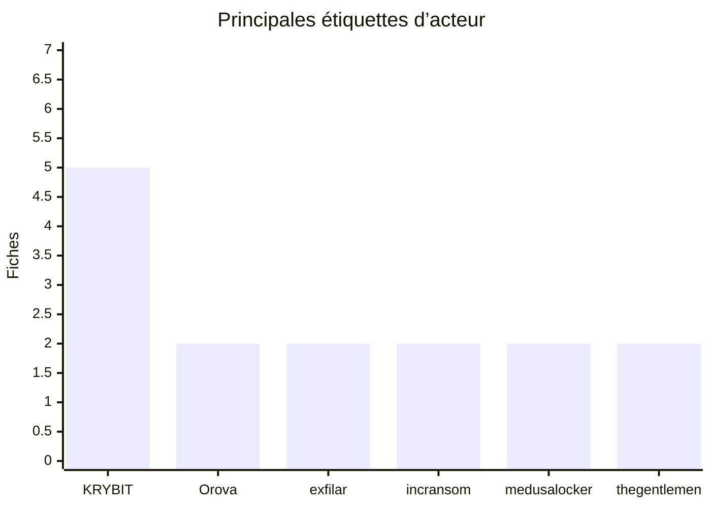

# Acteurs et sources de publication  -  août 2026

KRYBIT est associé à 5 fiches. Orova, exfilar, incransom, medusalocker et thegentlemen sont associés à 2 fiches chacun ; les 18 autres libellés sources apparaissent une fois. Une étiquette de publication ne constitue pas à elle seule une attribution confirmée.
