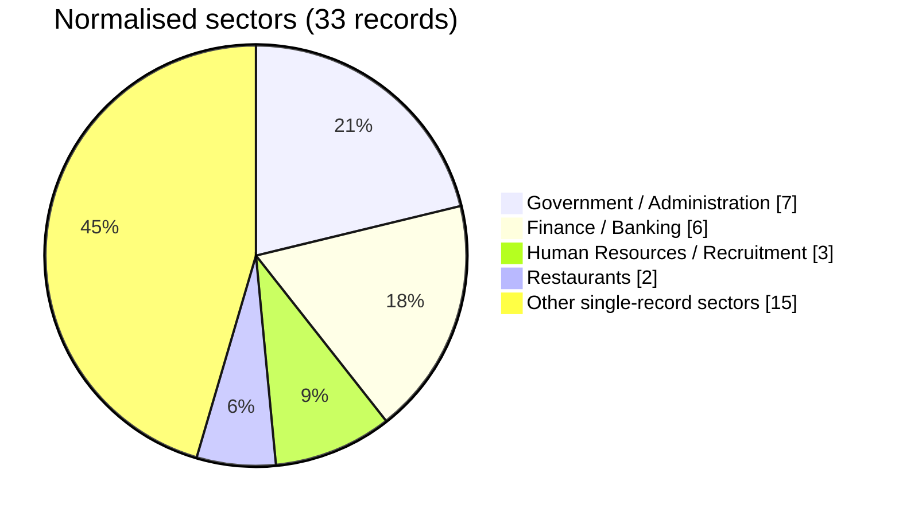

# Sector map  -  August 2026

The chart groups the 30 source sector labels into five analytical categories. The 15-record residual category contains the remaining normalised groups, each represented by one or more source labels.

Source: [August statistics](../../statistics/2026/08-august/README.md).
