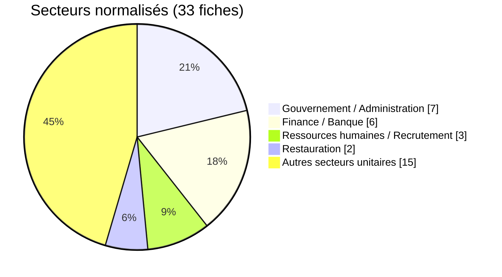

# Carte sectorielle  -  août 2026

Le graphique regroupe les 30 libellés sectoriels sources en cinq catégories analytiques. La catégorie résiduelle de 15 fiches rassemble les autres groupes normalisés, chacun étant représenté par un ou plusieurs libellés sources.

Source : [statistiques d’août](../../statistics/2026/08-august/README_FR.md).
