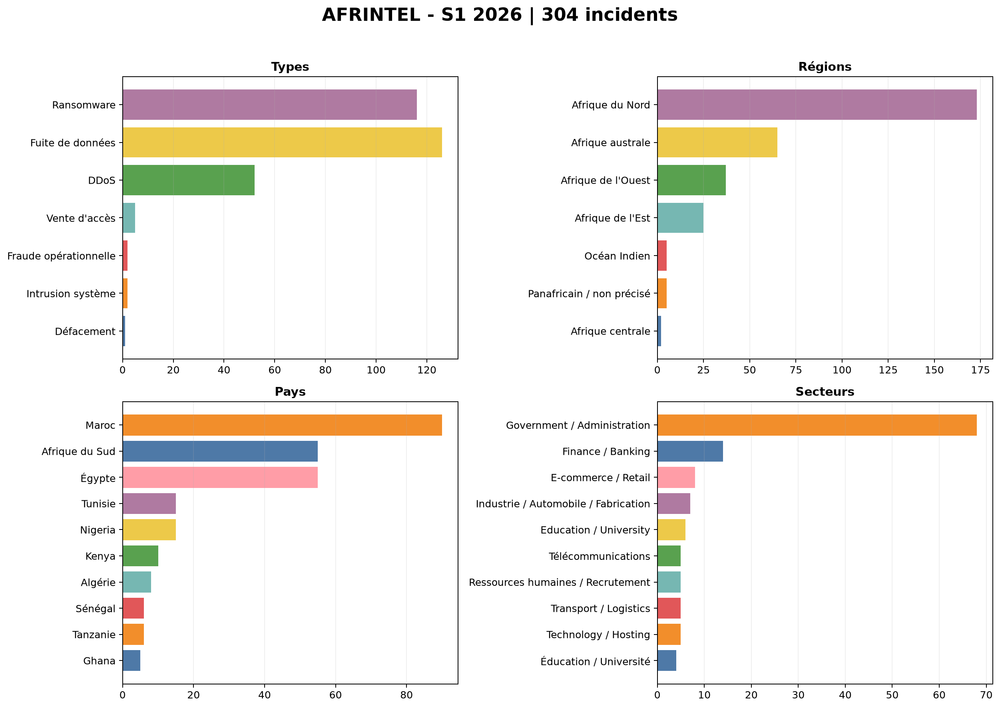
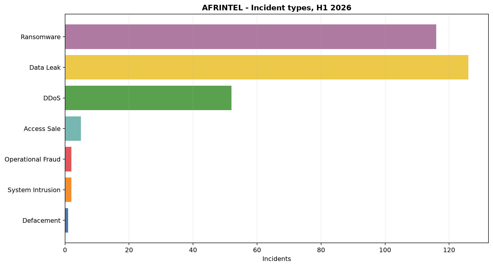
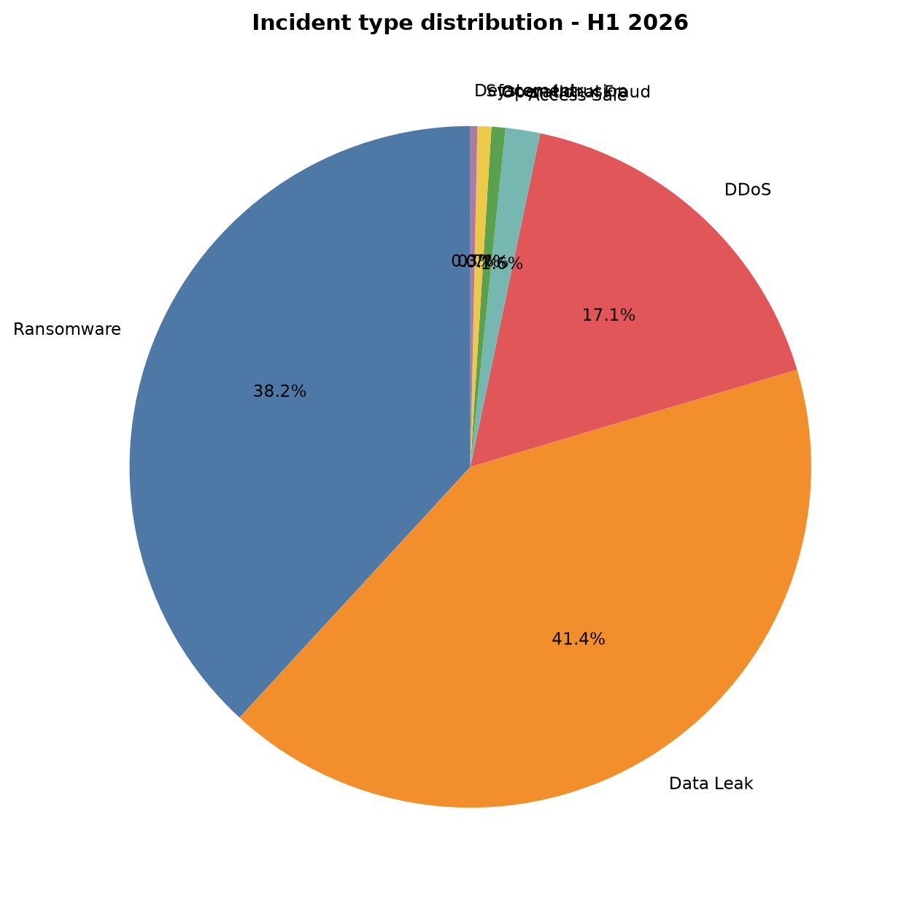
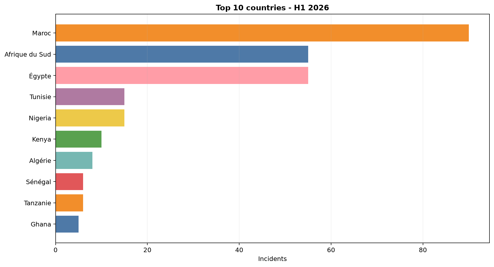
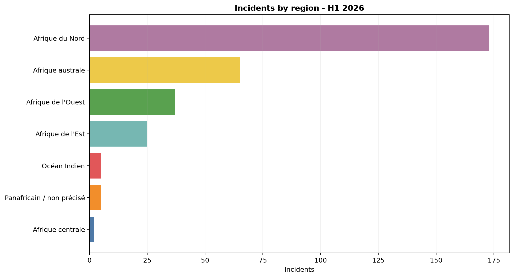
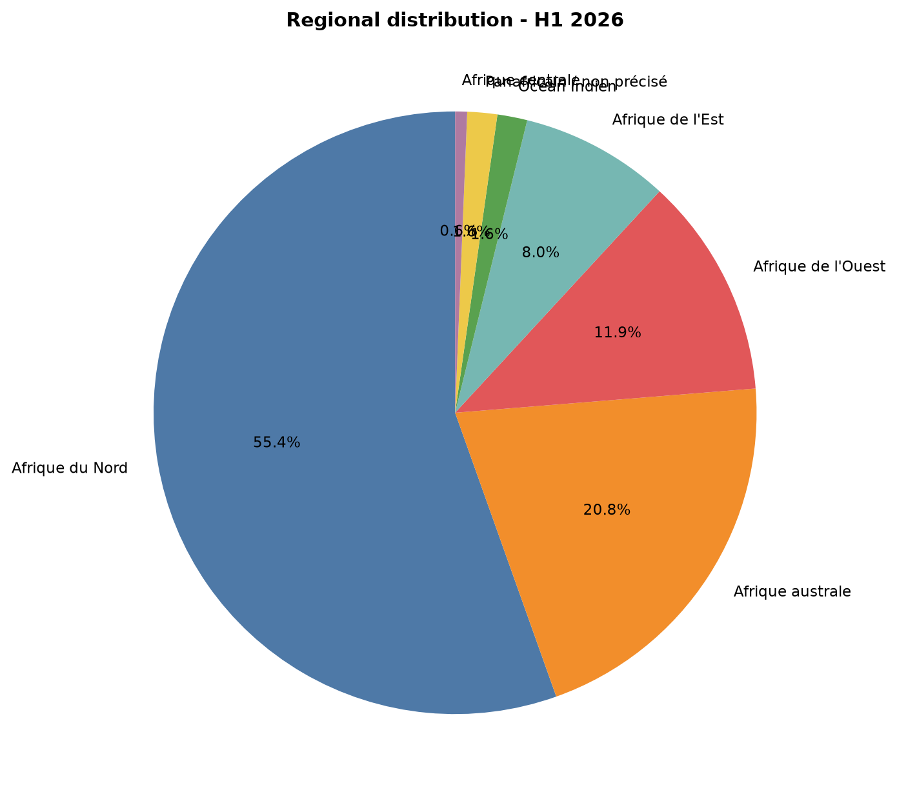
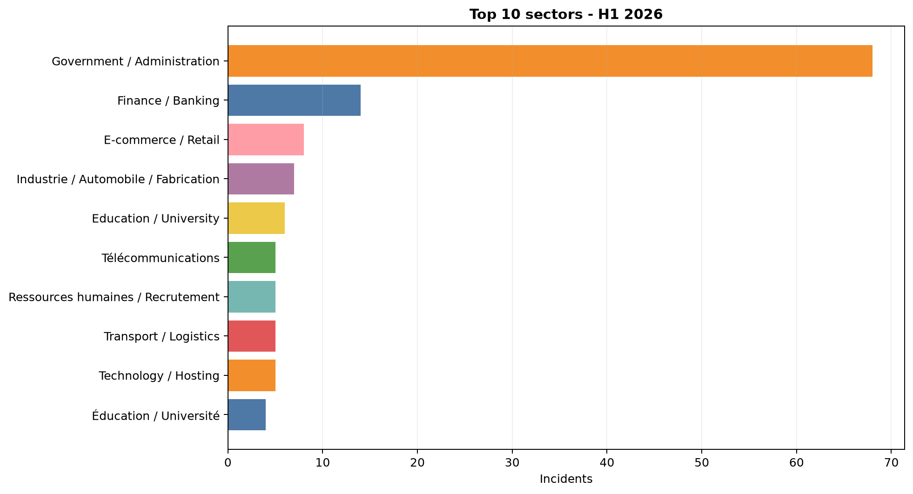
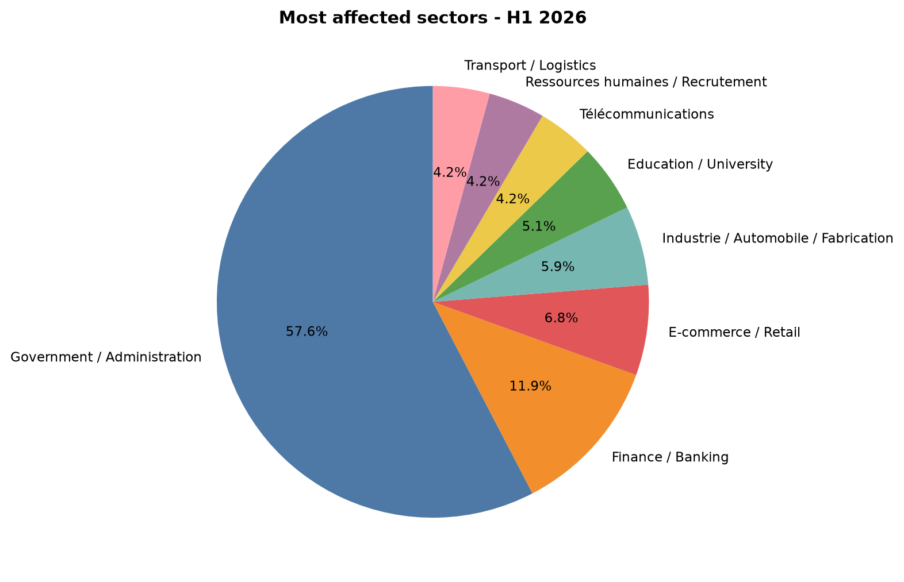
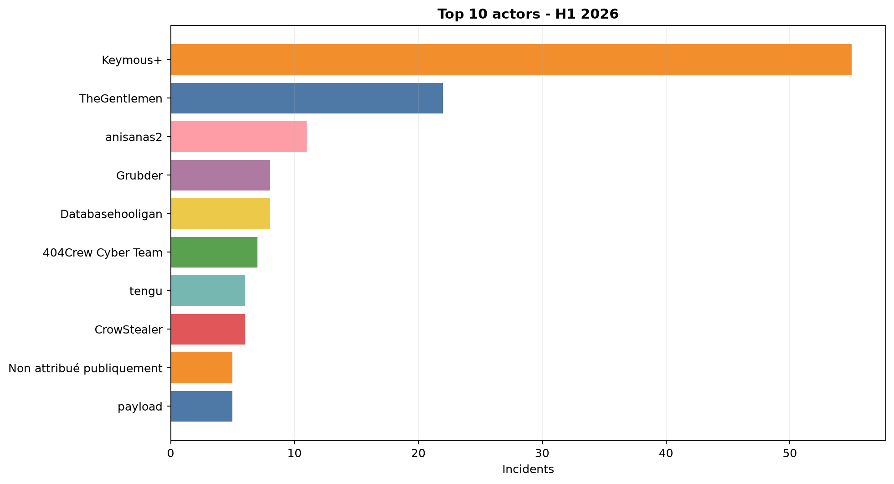

# H1 2026 visual intelligence data

Source: validated monthly pairs victims_FR.md / victims.md. Counts are derived from the French source and checked against the English version.

## Monthly totals

| Month | Total | Ransomware | Data leaks | DDoS | Defacement |
|---|---:|---:|---:|---:|---:|
| January | 23 | 19 | 2 | 0 | 1 |
| February | 21 | 20 | 1 | 0 | 0 |
| March | 41 | 19 | 21 | 0 | 0 |
| April | 72 | 21 | 40 | 9 | 0 |
| May | 106 | 17 | 44 | 43 | 0 |
| June | 41 | 20 | 18 | 0 | 0 |
| **H1 2026** | **304** | **116** | **126** | **52** | **1** |

## Geographic view

The deduplicated corpus contains 304 incidents. The regional breakdown contains 312 occurrences because some records cover multiple countries. This breakdown does not change the incident total.

| Region | Occurrences |
|---|---:|
| Afrique du Nord | 173 |
| Afrique australe | 65 |
| Afrique de l'Ouest | 37 |
| Afrique de l'Est | 25 |
| Océan Indien | 5 |
| Panafricain / non précisé | 5 |
| Afrique centrale | 2 |
| **Geographic total** | **312** |

## Top direct countries

| Country | Incidents |
|---|---:|
| Maroc | 90 |
| Afrique du Sud | 55 |
| Égypte | 55 |
| Tunisie | 15 |
| Nigeria | 15 |
| Kenya | 10 |
| Algérie | 8 |
| Sénégal | 6 |
| Tanzanie | 6 |
| Ghana | 5 |

## Visualisations

 

  

 

