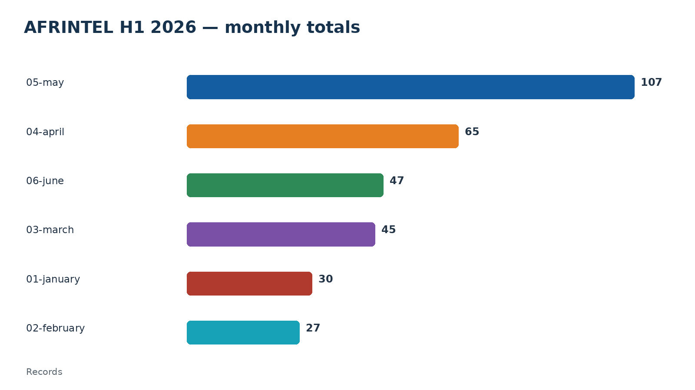
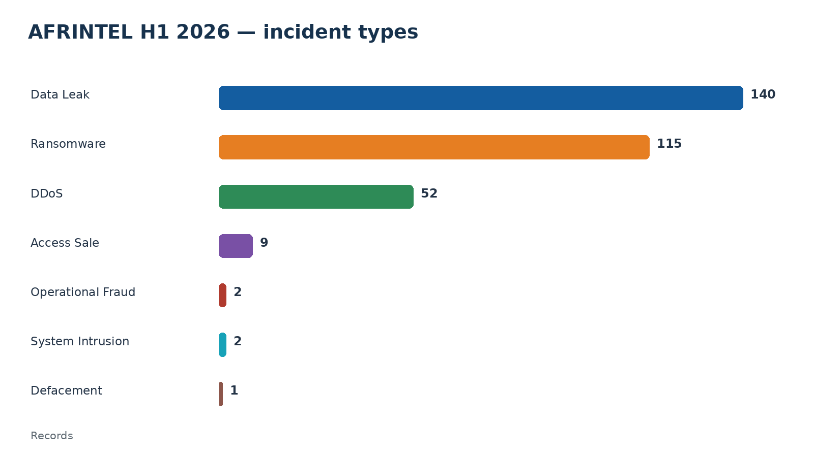
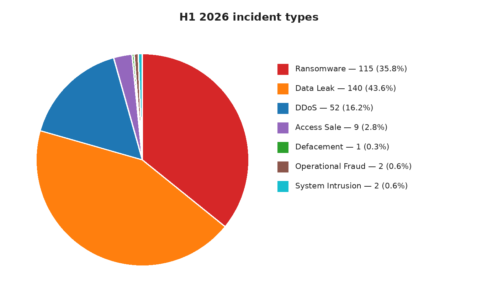
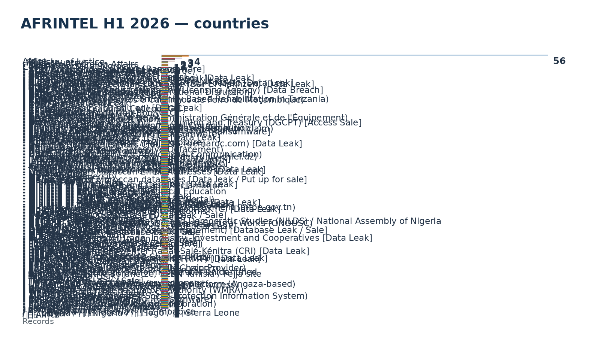
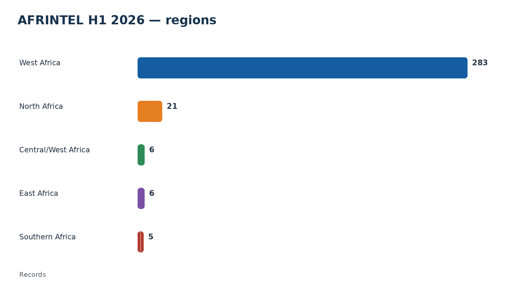
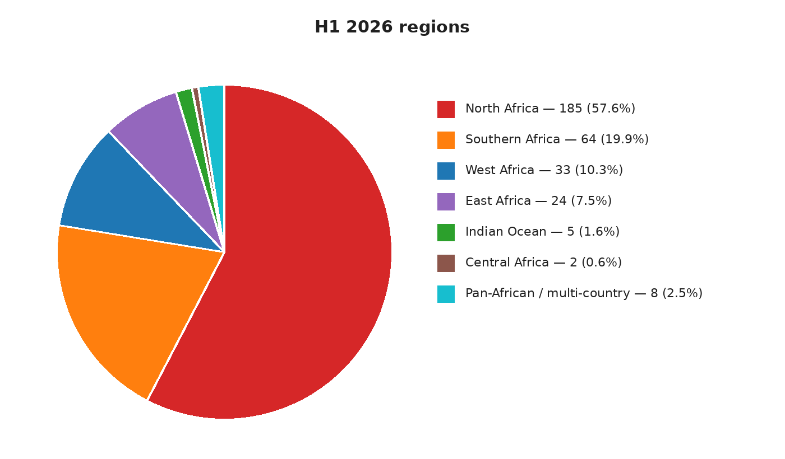
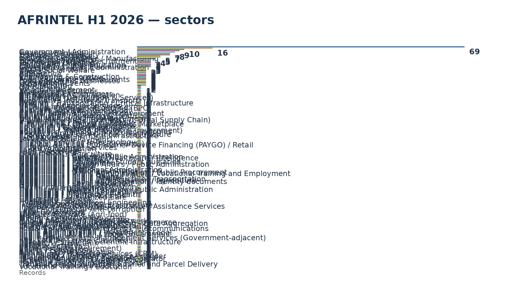
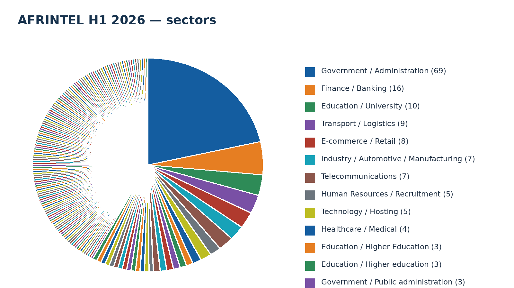
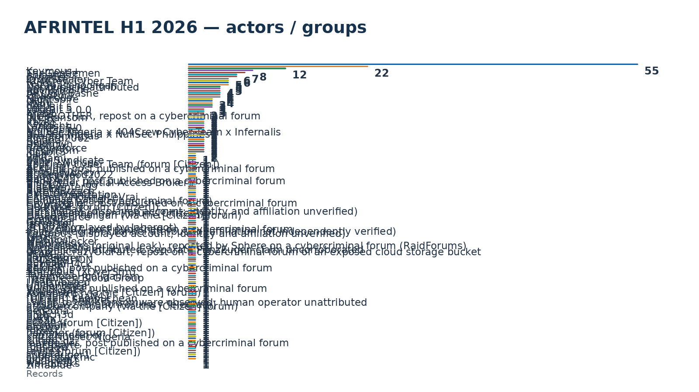

# H1 2026 visual intelligence data

Source: validated monthly pairs victims_FR.md / victims.md. Counts are derived from the French source and checked against the English version.

## Monthly totals

| Month | Total | Ransomware | Data leaks | DDoS | Defacement | Access Sale | Operational Fraud | System Intrusion |
|---|---:|---:|---:|---:|---:|---:|---:|---:|
| January | 30 | 18 | 10 |  | 1 | 1 |  |  |
| February | 27 | 20 | 7 |  |  |  |  |  |
| March | 45 | 19 | 24 |  |  | 1 | 1 |  |
| April | 65 | 21 | 32 | 9 |  | 2 | 1 |  |
| May | 107 | 17 | 45 | 43 |  | 1 |  | 1 |
| June | 47 | 20 | 22 |  |  | 4 |  | 1 |
| **H1 2026** | **321** | **115** | **140** | **52** | **1** | **9** | **1** | **2** |

## Geographic view

The canonical corpus contains 321 incidents. The regional view below uses the primary country or scope assigned to each record; multi-country records remain grouped as pan-African or unspecified and are not expanded into additional incidents.

| Region or scope | Primary records |
|---|---:|
| North Africa | 185 |
| Southern Africa | 64 |
| West Africa | 33 |
| East Africa | 24 |
| Indian Ocean | 5 |
| Central Africa | 2 |
| Pan-African / multi-country | 8 |
| **Geographic total** | **321** | |

## Top direct countries

| Country | Incidents |
|---|---:|
| Morocco | 91 |
| Egypt | 61 |
| South Africa | 56 |
| Tunisia | 18 |
| Nigeria | 15 |
| Kenya | 10 |
| Algeria | 11 |
| Ghana | 6 |
| Senegal | 6 |
| Tanzania | 6 |

## Visualisations

 

  

 

