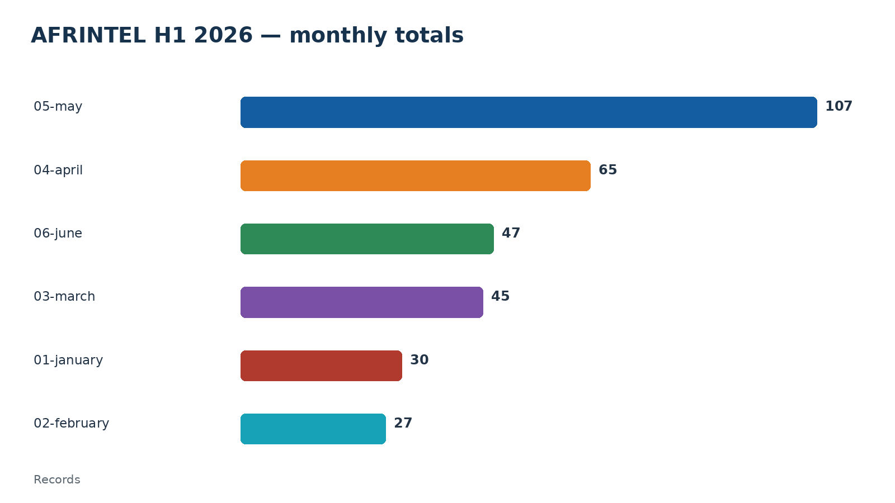
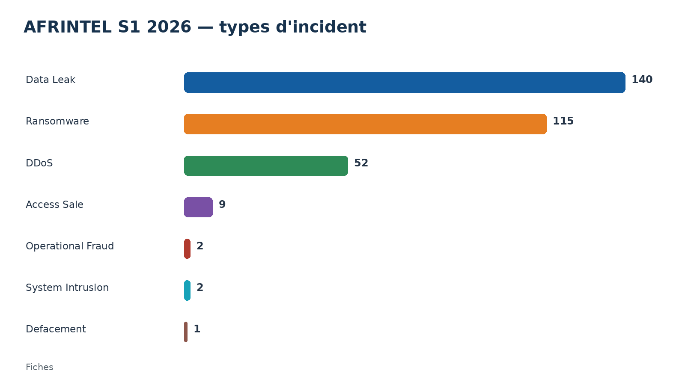
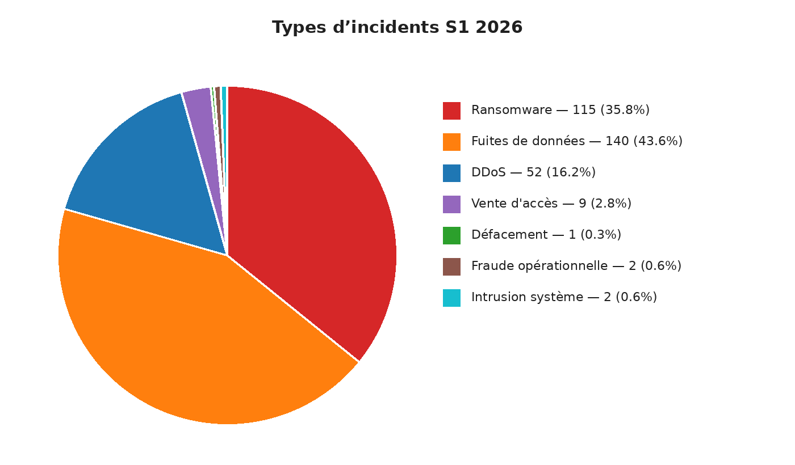
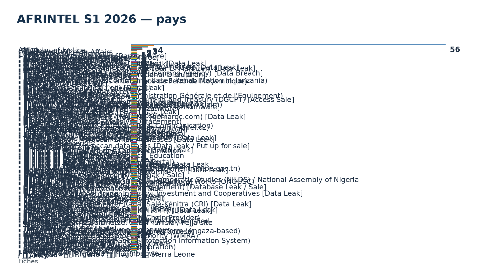
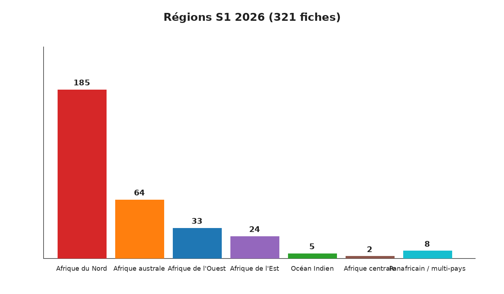
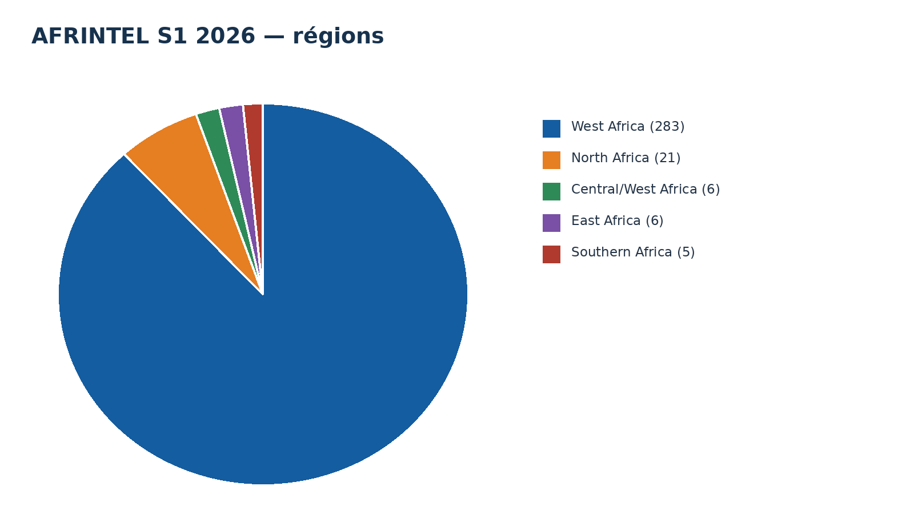
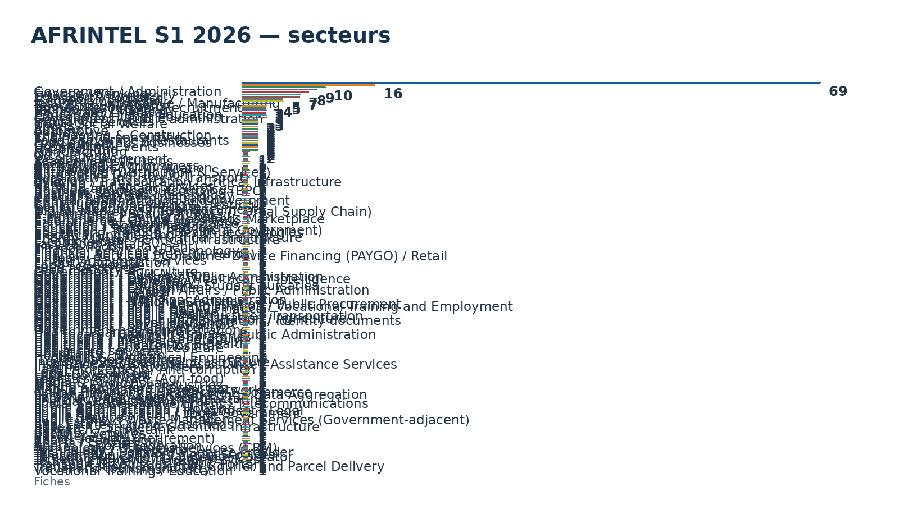
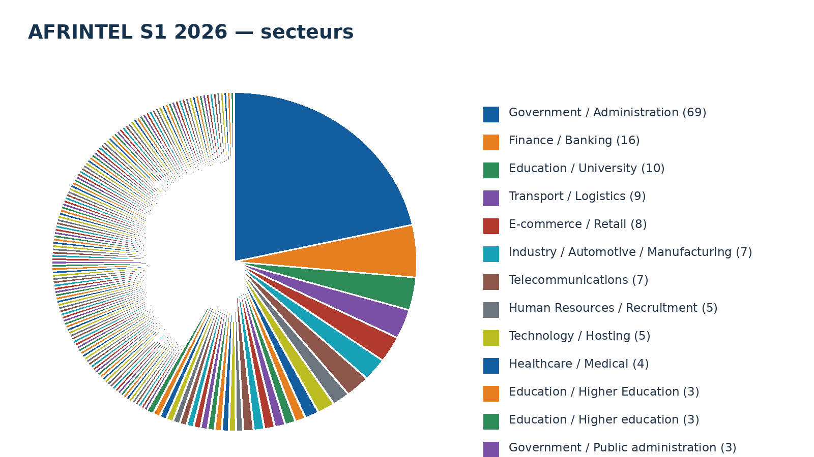
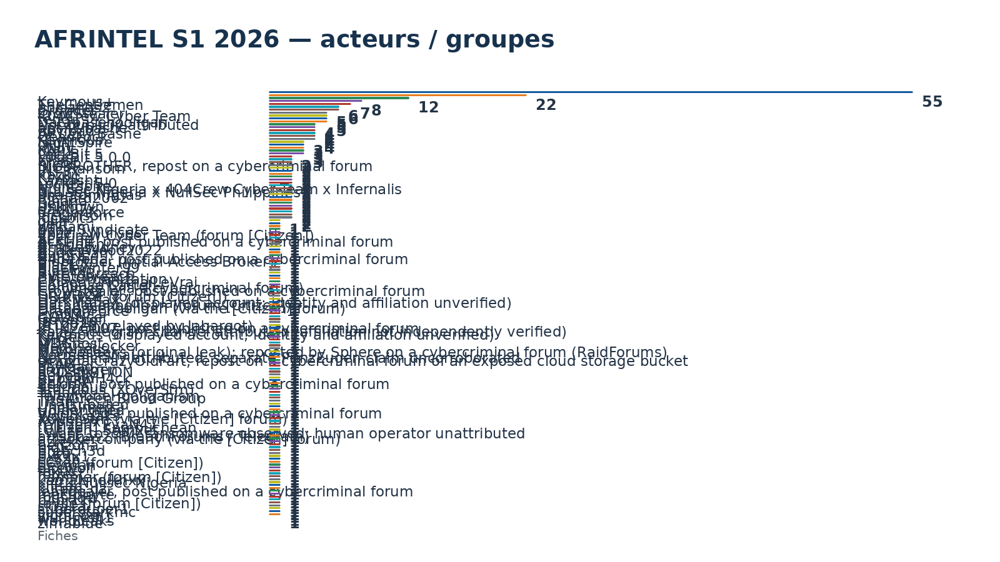

# Données de visual intelligence S1 2026

Source : couples mensuels validés victims_FR.md / victims.md. Les chiffres sont calculés depuis la version française, puis contrôlés contre la version anglaise.

## Totaux mensuels

| Mois | Total | Ransomware | Fuites de données | DDoS | Défacement | Vente d'accès | Fraude opérationnelle | Intrusion système |
|---|---:|---:|---:|---:|---:|---:|---:|---:|
| Janvier | 30 | 18 | 10 |  | 1 | 1 |  |  |
| Février | 27 | 20 | 7 |  |  |  |  |  |
| Mars | 45 | 19 | 24 |  |  | 1 | 1 |  |
| Avril | 64 | 21 | 32 | 9 |  | 2 |  |  |
| Mai | 107 | 17 | 45 | 43 |  | 1 |  | 1 |
| Juin | 47 | 20 | 22 |  |  | 4 |  | 1 |
| **S1 2026** | **320** | **115** | **140** | **52** | **1** | **9** | **1** | **2** |

## Vue géographique

Le corpus canonique compte 320 incidents. La vue régionale ci-dessous utilise le pays ou le périmètre principal attribué à chaque fiche ; les fiches multi-pays restent regroupées sous « Panafricain / multi-pays » et ne sont pas transformées en incidents supplémentaires.

| Région ou périmètre | Fiches principales |
|---|---:|
| Afrique du Nord | 185 |
| Afrique australe | 64 |
| Afrique de l'Ouest | 33 |
| Afrique de l'Est | 23 |
| Océan Indien | 5 |
| Afrique centrale | 2 |
| Panafricain / multi-pays | 8 |
| **Total géographique** | **320** |

## Principaux pays directs

| Pays | Incidents |
|---|---:|
| Maroc | 91 |
| Égypte | 61 |
| Afrique du Sud | 56 |
| Tunisie | 18 |
| Nigeria | 15 |
| Kenya | 10 |
| Algérie | 11 |
| Ghana | 6 |
| Sénégal | 6 |
| Tanzanie | 6 |

## Visualisations

 

  

 

