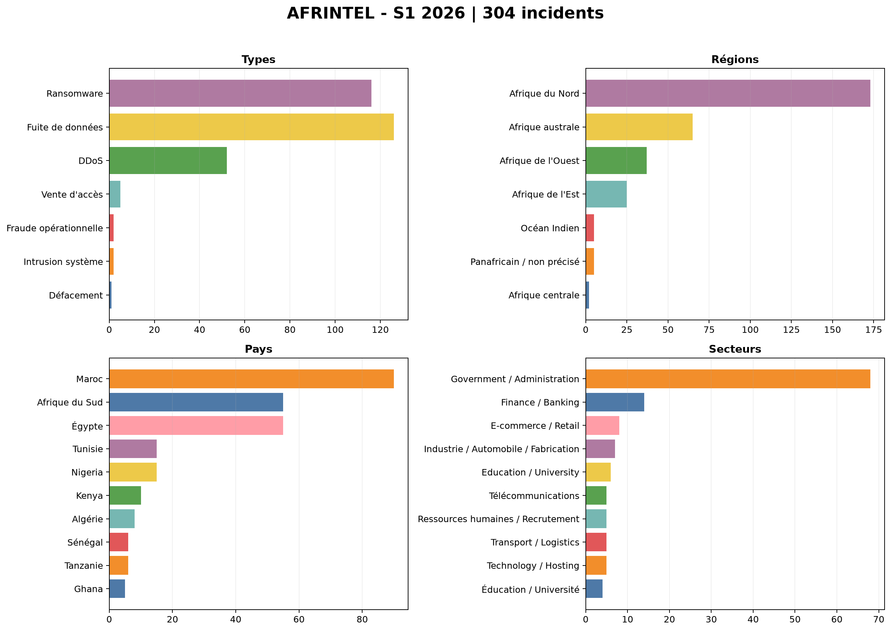
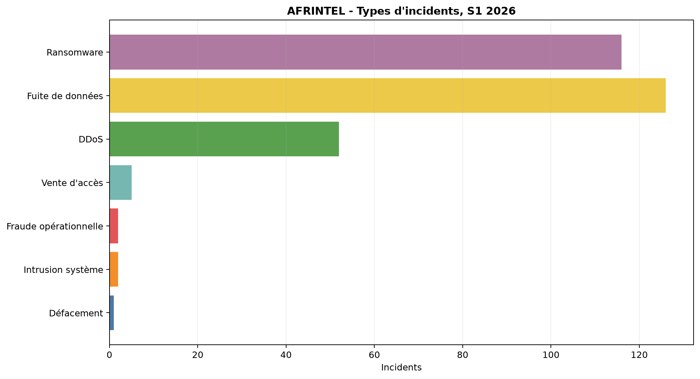
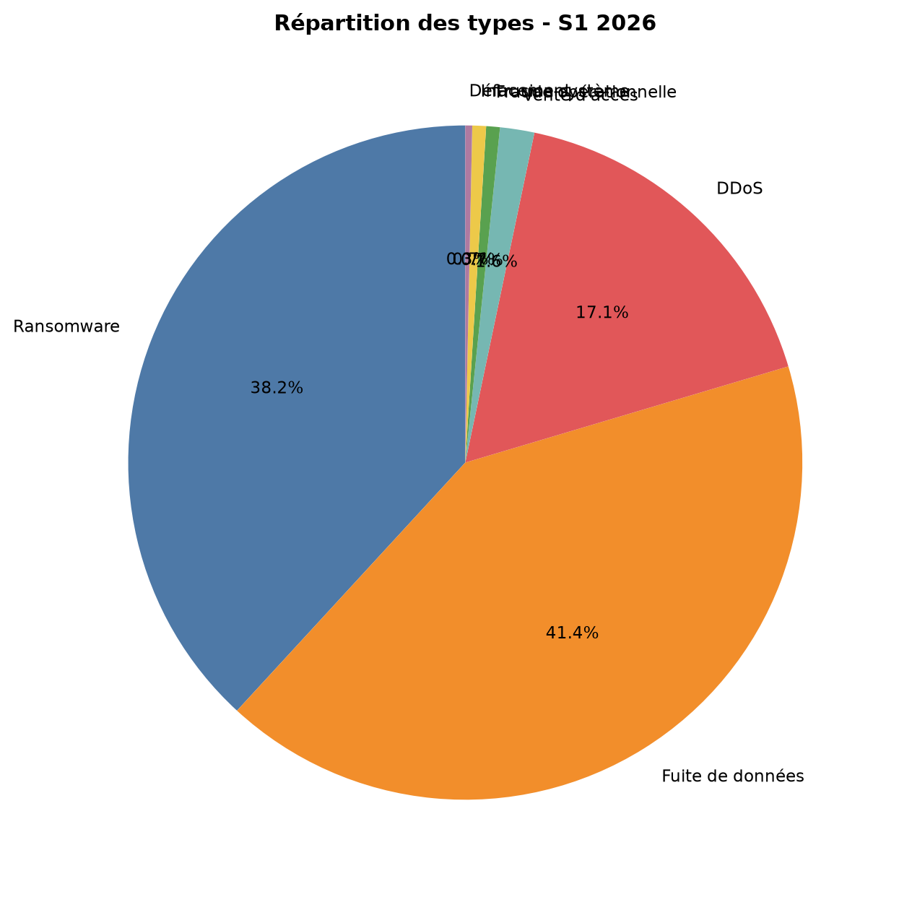
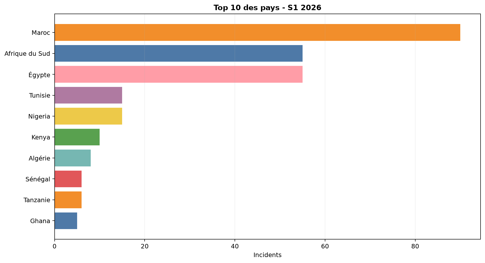
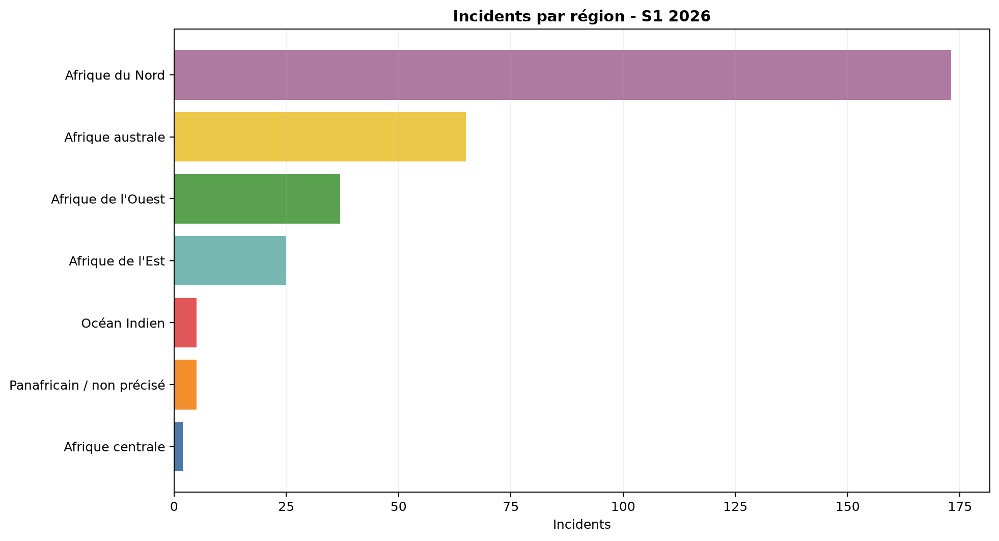
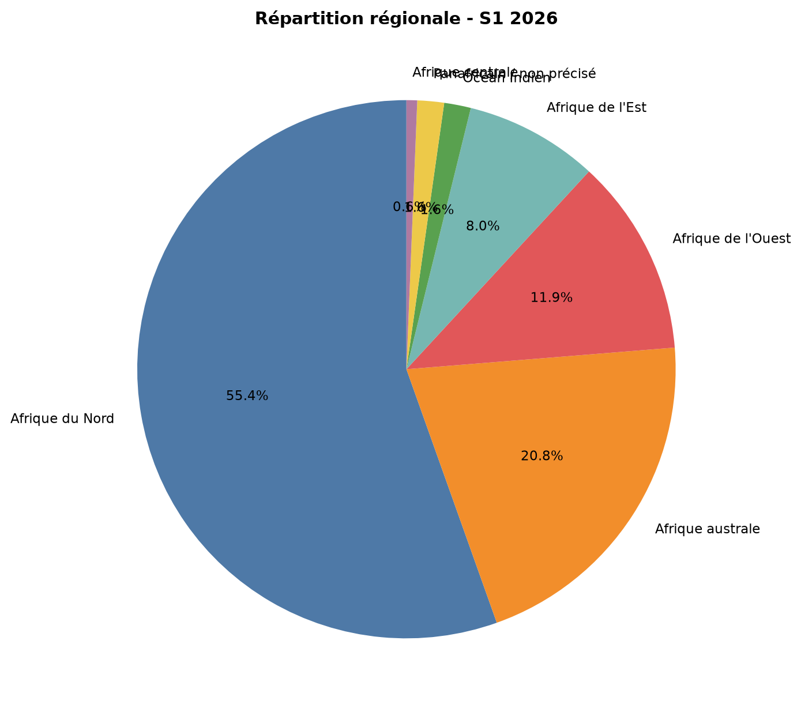
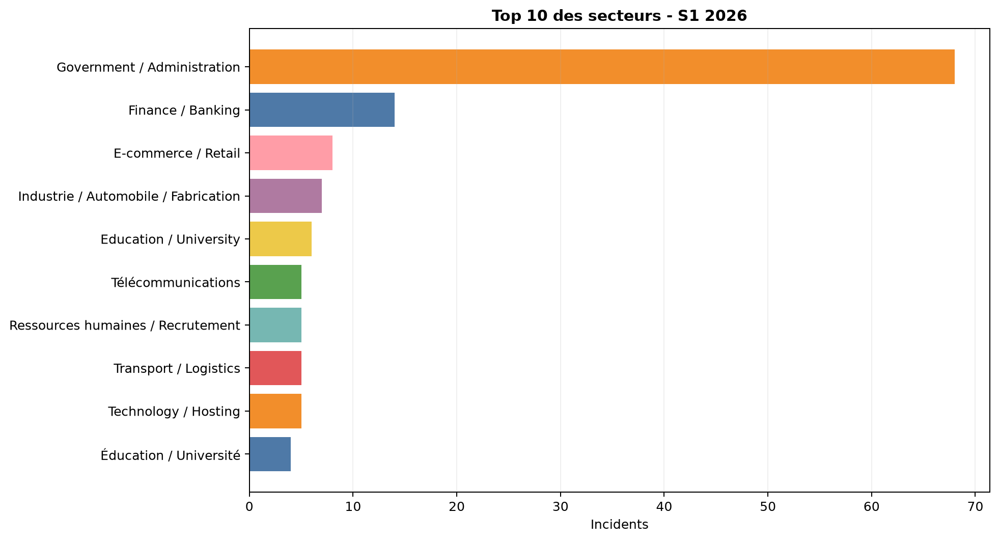
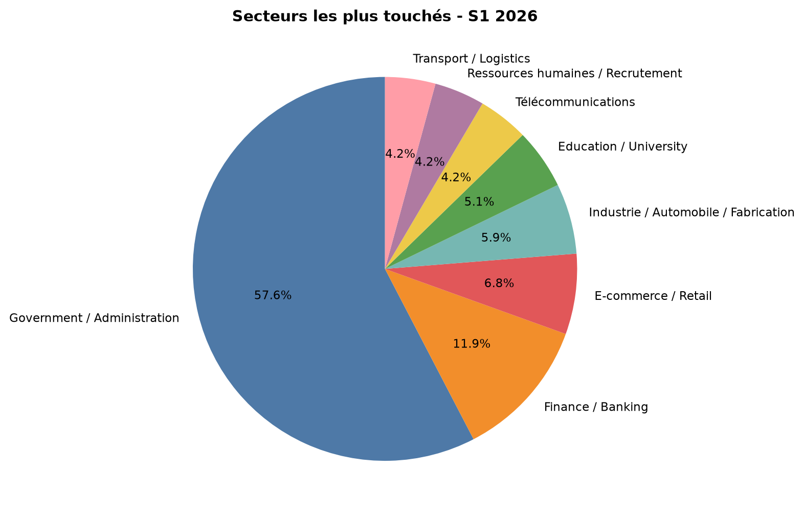
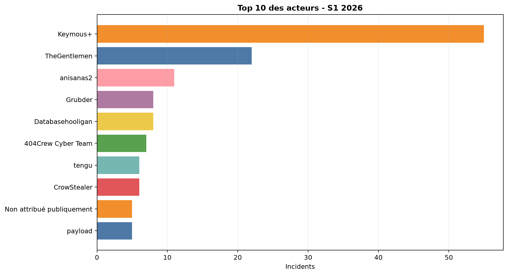

# Données de visual intelligence S1 2026

Source : couples mensuels validés victims_FR.md / victims.md. Les chiffres sont calculés depuis la version française, puis contrôlés contre la version anglaise.

## Totaux mensuels

| Mois | Total | Ransomware | Fuites de données | DDoS | Défacement |
|---|---:|---:|---:|---:|---:|
| Janvier | 23 | 19 | 2 | 0 | 1 |
| Février | 21 | 20 | 1 | 0 | 0 |
| Mars | 41 | 19 | 21 | 0 | 0 |
| Avril | 72 | 21 | 40 | 9 | 0 |
| Mai | 106 | 17 | 44 | 43 | 0 |
| Juin | 41 | 20 | 18 | 0 | 0 |
| **S1 2026** | **304** | **116** | **126** | **52** | **1** |

## Vue géographique

Le corpus dédupliqué compte 304 incidents. La ventilation régionale compte 312 occurrences, car certaines fiches couvrent plusieurs pays. Cette ventilation ne modifie pas le total d'incidents.

| Région | Occurrences |
|---|---:|
| Afrique du Nord | 173 |
| Afrique australe | 65 |
| Afrique de l'Ouest | 37 |
| Afrique de l'Est | 25 |
| Océan Indien | 5 |
| Panafricain / non précisé | 5 |
| Afrique centrale | 2 |
| **Total géographique** | **312** |

## Principaux pays directs

| Pays | Incidents |
|---|---:|
| Maroc | 90 |
| Afrique du Sud | 55 |
| Égypte | 55 |
| Tunisie | 15 |
| Nigeria | 15 |
| Kenya | 10 |
| Algérie | 8 |
| Sénégal | 6 |
| Tanzanie | 6 |
| Ghana | 5 |

## Visualisations

 

  

 

